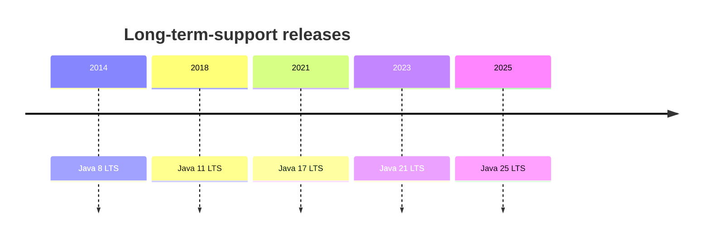

# Java 7 → 27 at a glance

One page, twenty releases. **LTS** marks long-term-support releases, the ones most companies standardize on. Each version links to its OpenJDK project page, which lists every JEP it delivered.

| Release | Date | Headline changes |
|---|---|---|
| **7** | Jul 2011 | Diamond `<>`, try-with-resources, strings in `switch`, multi-catch, binary literals, NIO.2 file API |
| **8** · LTS | Mar 2014 | Lambdas, method references, streams, `Optional`, `java.time`, default methods, Metaspace replaces PermGen |
| **[9](https://openjdk.org/projects/jdk9/)** | Sep 2017 | Module system, `jshell`, `List.of`/`Map.of`, private interface methods, compact strings, G1 default GC |
| **[10](https://openjdk.org/projects/jdk/10/)** | Mar 2018 | `var` for local variables; the six-month release cadence begins |
| **[11](https://openjdk.org/projects/jdk/11/)** · LTS | Sep 2018 | HTTP Client, `java Hello.java`, new `String` methods, Java EE and CORBA modules removed, no separate JRE |
| **[12](https://openjdk.org/projects/jdk/12/)** | Mar 2019 | Switch expressions (preview), Shenandoah GC (experimental) |
| **[13](https://openjdk.org/projects/jdk/13/)** | Sep 2019 | Text blocks (preview) |
| **[14](https://openjdk.org/projects/jdk/14/)** | Mar 2020 | Switch expressions final, helpful `NullPointerException` messages |
| **[15](https://openjdk.org/projects/jdk/15/)** | Sep 2020 | Text blocks final, ZGC production-ready, Nashorn removed |
| **[16](https://openjdk.org/projects/jdk/16/)** | Mar 2021 | Records, pattern matching for `instanceof`, `jpackage`, JDK internals encapsulated by default |
| **[17](https://openjdk.org/projects/jdk/17/)** · LTS | Sep 2021 | Sealed classes, JDK internals strongly encapsulated |
| **[18](https://openjdk.org/projects/jdk/18/)** | Mar 2022 | UTF-8 by default, `jwebserver`, code snippets in Javadoc |
| **[19](https://openjdk.org/projects/jdk/19/)** | Sep 2022 | Virtual threads and record patterns (preview) |
| **[20](https://openjdk.org/projects/jdk/20/)** | Mar 2023 | Scoped values (incubator), more previews |
| **[21](https://openjdk.org/projects/jdk/21/)** · LTS | Sep 2023 | Virtual threads, record patterns, pattern matching for `switch`, sequenced collections, generational ZGC |
| **[22](https://openjdk.org/projects/jdk/22/)** | Mar 2024 | Unnamed variables `_`, Foreign Function & Memory API, multi-file source launch |
| **[23](https://openjdk.org/projects/jdk/23/)** | Sep 2024 | Markdown documentation comments, generational ZGC by default, string templates withdrawn |
| **[24](https://openjdk.org/projects/jdk/24/)** | Mar 2025 | Stream gatherers, Class-File API, Security Manager permanently disabled |
| **[25](https://openjdk.org/projects/jdk/25/)** · LTS | Sep 2025 | Compact source files and instance `main`, module imports, flexible constructor bodies, scoped values, compact object headers (opt-in) |
| **[26](https://openjdk.org/projects/jdk/26/)** | Mar 2026 | HTTP/3 in the HTTP Client, Applet API removed |
| **[27](https://openjdk.org/projects/jdk/27/)** | Sep 2026 | G1 the default GC everywhere, compact object headers on by default, post-quantum hybrid key exchange for TLS 1.3 |

## Reading the table

- **Final vs. preview.** A feature counts as "delivered" in the release where it became final. Previews let you try a feature with `--enable-preview`, and they can still change or disappear: string templates were previewed in Java 21 and 22, then withdrawn.
- **Which version should you target?** For new production work, the latest LTS (Java 25) is the usual choice. Use non-LTS releases to try new features early.
- **Where each feature lives in this book.** Every chapter ends with a timeline of the releases that changed its topic.
