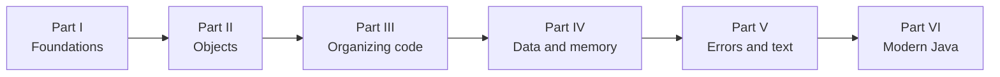

# Contents

The book starts with the foundations every Java developer needs, then follows each part of the language forward through the releases that changed it, ending with the features that define modern Java: lambdas, streams, modern concurrency and pattern matching.

| | Chapter | What it covers |
|---|---|---|
| | **Part I — Foundations** | |
| 1 | [Why Java Exists](part1/ch01-why-java-exists.md) | Bytecode and the JVM → `jshell` (9) → `java File.java` (11) → compact source files (25) |
| 2 | [Types, Variables and Conversions](part1/ch02-types-and-variables.md) | Primitives and casting → compact strings (9) → `var` (10) → UTF-8 default (18) → `_` (22) |
| 3 | [Operators and Control Flow](part1/ch03-operators-and-control-flow.md) | Precedence, short-circuiting → strings in `switch` (7) → switch expressions (14) → pattern `switch` (21) |
| | **Part II — Objects** | |
| 4 | [Classes, Objects and References](part2/ch04-classes-objects-references.md) | Stack vs. heap, references, `toString` → records (16) |
| 5 | [Constructors, `this`, `static` and Initializer Blocks](part2/ch05-constructors-static-init.md) | Constructor chaining, init and static blocks → flexible constructor bodies (25) |
| 6 | [Methods and Polymorphism](part2/ch06-methods-and-polymorphism.md) | Overloading, pass-by-value, binding → covariant returns, varargs |
| 7 | [Inheritance and Composition](part2/ch07-inheritance-and-composition.md) | `super`, overriding rules, composition vs. aggregation → sealed classes (17) |
| 8 | [Abstraction and Interfaces](part2/ch08-abstraction-and-interfaces.md) | Abstract classes, interfaces → default methods (8) → private methods (9) → sealed interfaces (17) |
| | **Part III — Organizing Code** | |
| 9 | [Packages, Access and Modules](part3/ch09-packages-access-modules.md) | Packages, classpath, access modifiers → modules (9) → module imports (25) |
| 10 | [Nested and Anonymous Classes → Lambdas](part3/ch10-nested-classes-to-lambdas.md) | Inner, local and anonymous classes → lambdas and method references (8) |
| | **Part IV — Data and Memory** | |
| 11 | [Arrays → Collections](part4/ch11-arrays-to-collections.md) | Arrays, array of arrays → `List.of` (9) → sequenced collections (21) |
| 12 | [Garbage Collection and Memory](part4/ch12-garbage-collection-and-memory.md) | Reachability, `finalize` → G1 (9) → ZGC (15) → compact object headers (25, 27) |
| | **Part V — Errors and Text** | |
| 13 | [Exceptions](part5/ch13-exceptions.md) | `try`/`catch`/`finally` → try-with-resources (7) → helpful NPEs (14) |
| 14 | [Strings and Text](part5/ch14-strings-and-text.md) | String pool, `StringBuilder` → text blocks (15) → new `String` methods (11) |
| 15 | [Wrapper Classes and Boxing](part5/ch15-wrappers-and-boxing.md) | Autoboxing, the integer cache → deprecated constructors (9, 16) |
| | **Part VI — Modern Java** | |
| 16 | [Functional Java: Streams](part6/ch16-functional-java-streams.md) | Loops → streams (8) → gatherers (24) |
| 17 | [Dates and Times](part6/ch17-dates-and-times.md) | `Date` and `Calendar` → `java.time` (8) |
| 18 | [Concurrency](part6/ch18-concurrency.md) | Threads → executors → virtual threads (21) → scoped values (25) → structured concurrency (preview) |
| 19 | [Data-Oriented Java](part6/ch19-data-oriented-java.md) | Records, sealed types and pattern matching working together (16 → 21) |
| 20 | [The Modern Toolchain](part6/ch20-modern-toolchain.md) | `jlink`, `jpackage`, JFR, the HTTP Client (11) → HTTP/3 (26) |
| | **Appendices** | |
| A | [Java 7 → 27 at a glance](at-a-glance.md) | One page, twenty releases |
| B | [Migration checklist](appendices/b-migration-checklist.md) | Moving a Java 7/8 code base to Java 25 |
