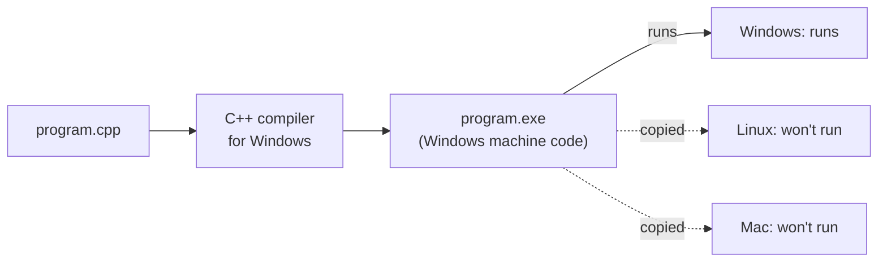
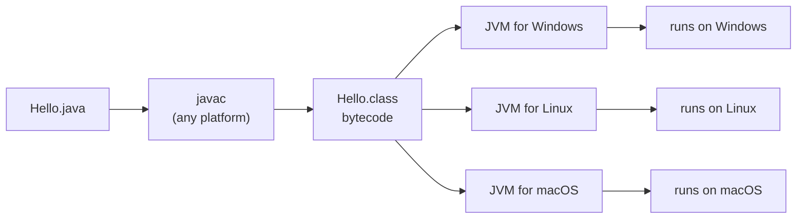
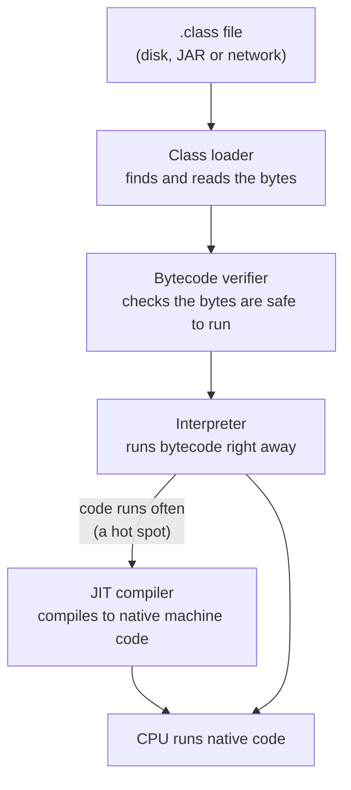
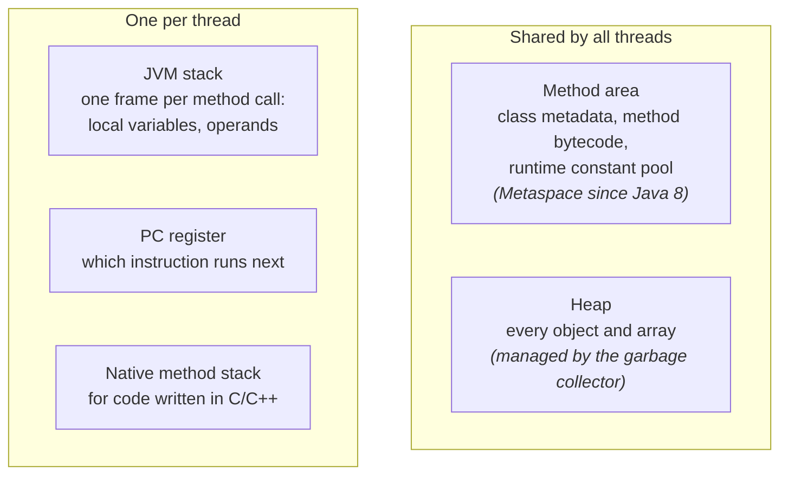
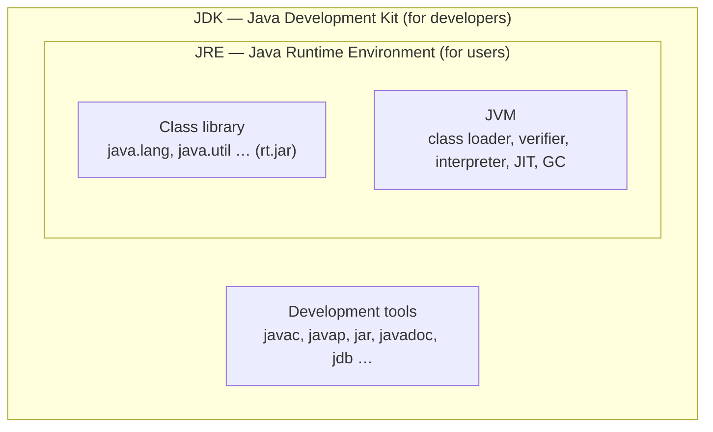
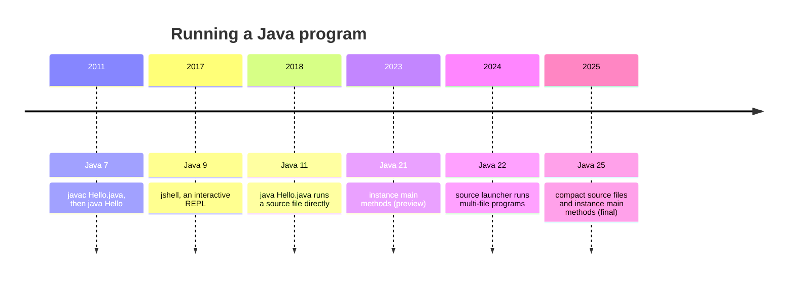

# 1. Why Java Exists

> [!TIP]
> You're reading the **complete edition**, the reference guide with every deep dive and runnable sample. For a focused read, see this chapter on the [website edition](https://hikefromjava7.com/part1/ch01-why-java-exists/).

> **In this chapter:** the problem Java was built to solve, what really happens between typing [`javac`](https://docs.oracle.com/en/java/javase/25/docs/specs/man/javac.html) and seeing output, how the JDK, JRE and JVM fit together, and how "running a Java program" changed between Java 7 and Java 25.

> [!TIP]
> **Key points**
>
> - `javac` compiles `.java` into platform-neutral **bytecode** (`.class`). A platform-specific **JVM** runs it: load → verify → interpret → JIT-compile the hot parts.
> - Objects live on the **[heap](https://docs.oracle.com/javase/specs/jvms/se25/html/jvms-2.html#jvms-2.5.3)**, method calls on per-thread **stacks**. Class metadata moved from PermGen to **Metaspace** in **Java 8**.
> - **Java 11** dropped the separate JRE download; **Java 9**'s [`jlink`](https://docs.oracle.com/en/java/javase/25/docs/specs/man/jlink.html) builds trimmed runtimes instead.
> - Every [class file](https://docs.oracle.com/javase/specs/jvms/se25/html/jvms-4.html#jvms-4.1) records its Java version: *major − 44*. Mismatch → `UnsupportedClassVersionError`. Compile with `--release N`.
> - Running Java got lighter: [`jshell`](https://docs.oracle.com/en/java/javase/25/docs/specs/man/jshell.html) (**9**), `java Hello.java` (**11**), multi-file launch (**22**), and in **Java 25**, a whole program can be `void main() { IO.println("Hi"); }`.

## A program that only runs at home

Picture a team in the 1990s. They write a program in C++, compile it on a Windows machine and get a `.exe` file. The program works. A customer on a different operating system copies that file to their machine, double-clicks it, and nothing happens.

Nothing is wrong with the code. The problem is what the compiler produced. A C or C++ compiler turns source code directly into **machine code**: instructions for one kind of processor, wrapped in the file format and system calls of one operating system. That output is tied to the platform it was built for.



The traditional fix was to keep the source code and compile it again on every platform, with a compiler built for that platform. That works, but it has real costs:

- **Compilers are expensive to build.** Each operating system and processor needs its own compiler, and the compilers don't always agree on the details.
- **You ship many binaries.** One build per platform means one test cycle per platform.
- **Machine code is a dead end.** You can't easily inspect it, check it for safety, or optimize it later for the machine it lands on.

> [!NOTE]
> **The classic rule**
>
> *"Problem → machine code is compatible to one particular environment. It will not run on another O.S. Solution → there should be a language where M.C can run on any O.S."*
>
> Still the best one-line summary of why Java exists.

Java's designers asked a different question: what if the compiler didn't produce machine code at all?

## The middle language: bytecode

Java splits the work into two steps. The Java compiler, `javac`, turns your source code into **bytecode**: a compact set of instructions for a machine that doesn't physically exist. Then, on each computer, a program called the **Java Virtual Machine (JVM)** reads that bytecode and turns it into real machine code for that computer.



This is what "Write Once, Run Anywhere" means. The **`.class` file is platform-independent**, and the **JVM is platform-dependent**. Somebody still has to build a JVM for every platform, but that work is done once, by the people who make the JVM, and not by every application team.

> [!IMPORTANT]
> **Rule**
>
> Byte code is O.S independent. The JVM is O.S dependent.

A few facts about bytecode are worth keeping:

- **It is a binary format, not text.** Most instructions (*opcodes*) take one byte, which is where the name comes from.
- **It keeps more information than machine code.** Class names, method names, field types and the structure of the program survive compilation. That's why Java tools can inspect, verify and even decompile class files.
- **Every class gets its own `.class` file**, named after the class. A source file with three classes produces three class files.

> [!WARNING]
> **Common mistake**
>
> "Bytecode is interpreted, so Java is slow." That was roughly true in 1996. Since Java 1.3 the standard JVM (HotSpot) watches which code runs most often and compiles it to optimized machine code while the program runs. The JVM section below shows how.

## Your first program, Java 7 style

Here is the classic first program. In Java 7 every one of these words was required, and each has a reason:

**Example:** [`code/ch01/Hello.java`](../../code/ch01/Hello.java) · [how to run it](../../code/ch01/README.md#hellojava) · Java 11+, any Java

```java
public class Hello {
    public static void main(String[] args) {
        System.out.println("Hello from the JVM!");
    }
}
```

| Piece | Why it's there |
|---|---|
| `public class Hello` | All Java code lives inside a class. A `public` class must be saved in a file with the same name: `Hello.java`. |
| `public` | The launcher, which lives outside your class, has to be allowed to call `main`. |
| `static` | The launcher calls `main` before any object exists, so `main` must belong to the class rather than an instance. |
| `void` | `main` returns nothing. A program reports success or failure with an exit code instead. |
| `String[] args` | Command-line arguments. `String... args` (varargs, Java 5) also works. |

Compile and run it in two steps:

```text
$ javac Hello.java      # produces Hello.class
$ java Hello            # note: the class name, not the file name
Hello from the JVM!
```

Some ground rules from the Java 7 days that still hold:

- The source file ends in `.java`. If you save it from a plain text editor, make sure the editor doesn't quietly add `.txt`.
- `java Hello` takes a **class name**, not a file name. Typing `java Hello.class` fails with `Could not find or load main class Hello.class`, in every version. (From Java 11 you can run the `.java` source file directly, covered later in this chapter.)
- Names are case-sensitive. By convention, class names start with a capital letter.

### Peeking at the bytecode

The JDK ships a disassembler, [`javap`](https://docs.oracle.com/en/java/javase/25/docs/specs/man/javap.html), that shows what the compiler produced. Running `javap -c Hello` on the class above prints this (from a real run, with spacing trimmed):

```text
public class Hello {
  public Hello();
    Code:
       0: aload_0
       1: invokespecial #1   // Method java/lang/Object."<init>":()V
       4: return

  public static void main(java.lang.String[]);
    Code:
       0: getstatic     #7   // Field java/lang/System.out:Ljava/io/PrintStream;
       3: ldc           #13  // String Hello from the JVM!
       5: invokevirtual #15  // Method java/io/PrintStream.println:(Ljava/lang/String;)V
       8: return
}
```

Two things are worth noticing. First, the compiler quietly added a constructor, `Hello()`, that we never wrote. Every class gets a default constructor if it declares none (Chapter 5 returns to this). Second, `System.out.println` became three instructions: fetch the `out` field, load the string constant, and call `println` on it.

## What the JVM does when you press Enter

When you type `java Hello`, an operating system process starts and a **JVM instance** is born inside it. That instance has one job: run your program. When `main` finishes (and no other non-daemon threads are running), the instance shuts down. Start three Java programs and you get three independent JVM instances, each with its own memory.

Inside the instance, your class goes through a pipeline:



**The class loader** finds the bytes for a class, from a directory, a JAR file or anywhere else, and turns them into a class the JVM understands. Classes are loaded lazily, the first time they're needed, not all at startup.

**The [bytecode verifier](https://docs.oracle.com/javase/specs/jvms/se25/html/jvms-4.html#jvms-4.10)** checks that the bytes follow the rules: instructions are valid, types line up, the stack can't overflow or underflow, and code can't jump into the middle of an instruction. Class files can come from anywhere, so the JVM refuses to trust them blindly.

> [!WARNING]
> **A common misconception**
>
> Older notes often say the verifier "removes viruses." It doesn't. It's not an antivirus and it doesn't remove anything. It **rejects** bytecode that breaks the JVM's safety rules, so a malformed or malicious class file can't corrupt memory. Code that is valid but harmful, such as a program that deletes your files, passes verification just fine.

**The interpreter and the JIT compiler** share the actual running. The interpreter starts executing bytecode immediately, which keeps startup fast. Meanwhile the JVM counts how often each method and loop runs. Code that runs a lot, a *hot spot* (hence the name **HotSpot JVM**), gets handed to the **Just-In-Time (JIT) compiler**, which compiles it into optimized machine code for the exact CPU it's running on. That's why a Java program often gets faster during its first few seconds: the JVM is still learning what to optimize.

## Where things live: the JVM's memory areas

Java 7-era courses drew the JVM's memory as a set of boxes. The picture still holds, with one important rename in Java 8.



- **[Method area](https://docs.oracle.com/javase/specs/jvms/se25/html/jvms-2.html#jvms-2.5.4).** One copy of each loaded class: its methods' bytecode, field and method descriptions, and its [*runtime constant pool*](https://docs.oracle.com/javase/specs/jvms/se25/html/jvms-2.html#jvms-2.5.5) (the literals and symbolic references the class uses).
- **[Heap](https://docs.oracle.com/javase/specs/jvms/se25/html/jvms-2.html#jvms-2.5.3).** Every object you create with `new` lives here, no matter which method created it. The garbage collector reclaims objects nobody can reach anymore (Chapter 12).
- **[Stack](https://docs.oracle.com/javase/specs/jvms/se25/html/jvms-2.html#jvms-2.5.2).** Each thread has its own stack. Every method call pushes a *frame* holding that call's local variables and working values, and the frame disappears when the method returns. Too much recursion fills the stack and causes a `StackOverflowError`.
- **[PC register](https://docs.oracle.com/javase/specs/jvms/se25/html/jvms-2.html#jvms-2.5.1).** Each thread tracks which bytecode instruction it's executing.
- **[Native method stack](https://docs.oracle.com/javase/specs/jvms/se25/html/jvms-2.html#jvms-2.5.6).** Used when Java calls into code written in C or C++.

> [!NOTE]
> **What changed: PermGen became Metaspace (Java 8)**
>
> In Java 7, HotSpot kept class metadata in a fixed-size heap region called the **Permanent Generation** (PermGen). Applications that loaded many classes, like app servers redeploying web apps, would crash with `java.lang.OutOfMemoryError: PermGen space`. Java 8 removed PermGen ([JEP 122](https://openjdk.org/jeps/122)) and moved class metadata into **Metaspace**, which lives in native memory and grows as needed. The `-XX:PermSize` and `-XX:MaxPermSize` flags no longer apply. Use `-XX:MaxMetaspaceSize` if you want a cap.

## JDK, JRE, JVM: then and now

These three acronyms confuse almost everyone at first. In the Java 7 world they nested neatly:



- The **JVM** runs bytecode.
- The **JRE** is the JVM plus the standard class library: everything needed to *run* a Java program. In Java 7 the library was packed into one large file, `rt.jar`.
- The **JDK** is the JRE plus the tools to *build* programs: the compiler, disassembler, archiver, documentation generator and debugger.

In 2013, end users installed a JRE from java.com and developers installed the JDK. That split is mostly gone.

> [!NOTE]
> **What changed: from one big JRE to custom runtimes**
>
> - **Java 9 (2017)** split the platform into **modules** ([JEP 200](https://openjdk.org/jeps/200)) and removed `rt.jar` and `tools.jar` ([JEP 220](https://openjdk.org/jeps/220)). It also added `jlink` ([JEP 282](https://openjdk.org/jeps/282)), which builds a runtime containing only the modules your application needs.
> - **Java 11 (2018)**: Oracle stopped offering a separate JRE or Server JRE download. Only the JDK is offered, and you can use `jlink` to build a smaller runtime.
> - **Today**: applications usually ship *with* their own runtime, either inside a container image or bundled by `jlink`/[`jpackage`](https://docs.oracle.com/en/java/javase/25/docs/specs/man/jpackage.html), rather than relying on whatever JRE a user installed. Some vendors still publish JRE-style builds, but the "install Java on every PC" era is over.
>
> You can see the modules in your own JDK with `java --list-modules`. On the JDK 21 used to test this book, the list has 69 entries, starting with `java.base`.

### The toolbox, then and now

| Tool | What it does | Since |
|---|---|---|
| `javac` | Compiles `.java` to `.class` | 1.0 |
| `java` | Launches a JVM and runs a class | 1.0 |
| `jar` | Packages class files into a `.jar` archive | 1.1 |
| `javadoc` | Generates HTML documentation from comments | 1.0 |
| `jdb` / `javap` | Debugger / class-file disassembler | 1.0 |
| `jshell` | Interactive REPL: type Java, see results | **9** ([JEP 222](https://openjdk.org/jeps/222)) |
| `jlink` | Builds a custom runtime image | **9** |
| `jpackage` | Builds native installers (`.msi`, `.pkg`, `.deb`) | **16** ([JEP 392](https://openjdk.org/jeps/392)) |
| `jwebserver` | A minimal static file server for testing | **18** ([JEP 408](https://openjdk.org/jeps/408)) |

## Every class file knows its Java version

Each `.class` file starts with the same four bytes, `0xCAFEBABE` (a famous in-joke from the original Sun team), followed by a version number. The JVM reads that number before anything else and refuses class files that are newer than itself.

This small program reads those bytes from a compiled class:

**Example:** [`code/ch01/ClassVersion.java`](../../code/ch01/ClassVersion.java) · [how to run it](../../code/ch01/README.md#classversionjava) · any Java

```java
import java.io.DataInputStream;
import java.io.IOException;
import java.io.InputStream;

public class ClassVersion {
    public static void main(String[] args) throws IOException {
        // The first 8 bytes of every .class file: magic number, minor, major.
        try (InputStream in = ClassVersion.class.getResourceAsStream("Probe.class");
             DataInputStream data = new DataInputStream(in)) {
            int magic = data.readInt();
            int minor = data.readUnsignedShort();
            int major = data.readUnsignedShort();
            System.out.printf("magic = 0x%X%n", magic);
            System.out.println("class file major version = " + major
                    + "  ->  built for Java " + (major - 44));
        }
    }
}
```

Compiling `Probe.java` (an empty class) with `javac --release N` for four different targets and running the reader produces:

```text
--- compiled with --release 8
magic = 0xCAFEBABE
class file major version = 52  ->  built for Java 8
--- compiled with --release 11
magic = 0xCAFEBABE
class file major version = 55  ->  built for Java 11
--- compiled with --release 17
magic = 0xCAFEBABE
class file major version = 61  ->  built for Java 17
--- compiled with --release 21
magic = 0xCAFEBABE
class file major version = 65  ->  built for Java 21
```

The rule is *major version − 44 = Java version*: Java 7 is 51, Java 25 is 69 and Java 27 is 71. This number explains one of the most common errors you'll ever see:

```text
UnsupportedClassVersionError: Hello has been compiled by a more recent version
of the Java Runtime (class file version 65.0), this version of the Java Runtime
only recognizes class file versions up to 61.0
```

Translated: the class was built with Java 21, but you tried to run it on Java 17. Either upgrade the runtime, or compile with `--release 17`.

> [!IMPORTANT]
> **Migration tip: prefer `--release` over `-source`/`-target`**
>
> Java 7 projects used `-source 1.7 -target 1.7`. Those flags set the language level and class-file version, but they still compile against the *current* JDK's library, so you can accidentally call a method that doesn't exist on the older runtime. `--release N` (Java 9, [JEP 247](https://openjdk.org/jeps/247)) checks against the real API of release N. In Maven that's `<maven.compiler.release>`; in Gradle, `options.release`.

## Compile time vs. run time

Two moments matter in every Java program, and errors can strike at either.

**Compile time** is when `javac` checks your code. Type mismatches, missing semicolons and calls to methods that don't exist are caught here, before the program ever runs:

**Example:** [`code/ch01/CompileError.java`](../../code/ch01/CompileError.java) · [how to run it](../../code/ch01/README.md#compileerrorjava) · any Java

```java
public class CompileError {
    public static void main(String[] args) {
        int count = "hello";
    }
}
```

```text
CompileError.java:3: error: incompatible types: String cannot be converted to int
        int count = "hello";
                    ^
1 error
```

No `.class` file is produced, so there's nothing to run.

**Run time** is when the JVM executes the bytecode. Some problems depend on values the compiler can't know:

**Example:** [`code/ch01/RunTimeError.java`](../../code/ch01/RunTimeError.java) · [how to run it](../../code/ch01/README.md#runtimeerrorjava) · any Java

```java
public class RunTimeError {
    public static void main(String[] args) {
        int zero = args.length;          // 0, because we pass no arguments
        System.out.println(10 / zero);   // the compiler cannot know this will fail
    }
}
```

```text
Exception in thread "main" java.lang.ArithmeticException: / by zero
```

This compiled cleanly, because the compiler can't know that `args.length` will be zero. The JVM finds out when it runs. A good habit, and a recurring theme in modern Java, is to push as many mistakes as possible from run time to compile time. Features like generics (Java 5), records (16), [sealed classes](https://docs.oracle.com/javase/specs/jls/se25/html/jls-8.html#jls-8.1.1.2) (17) and exhaustive `switch` (21) all exist partly to do exactly that.

## Puzzles about `main`

There are several classic interview questions about `main`, marked **IQ** in this book. Here they are, tested on real JDKs.

**IQ: Can a class have more than one `main`?** Yes. `main` is an ordinary static method, so it can be overloaded. The launcher only looks for the one with the right signature; the others are just methods.

**Example:** [`code/ch01/MainOverload.java`](../../code/ch01/MainOverload.java) · [how to run it](../../code/ch01/README.md#mainoverloadjava) · any Java

```java
public class MainOverload {
    public static void main(String[] args) {
        System.out.println("JVM called main(String[]) with " + args.length + " args");
        main(42);               // an ordinary call: main is just a method
    }

    public static void main(int n) {
        System.out.println("I am an overload, called by ordinary code: " + n);
    }
}
```

```text
$ java MainOverload a b
JVM called main(String[]) with 2 args
I am an overload, called by ordinary code: 42
```

**IQ: Can you call `main` yourself?** Yes, like any static method, as the example above does with `main(42)`. If the signature is `main(String... args)`, you can even call `main()` with no arguments.

**IQ: Can you declare the same `main` twice?** No. Two methods with identical signatures are a compile error, `main` or not.

**IQ: Can each class in one file have its own `main`?** Yes. You choose which one to run by naming its class: `java Demo1` or `java Demo2`. Style guides still recommend one top-level class per file.

**IQ: Does `main` have to be `public static`?** In Java 7 through 24, yes (unless you turn on preview features). A package-private `main` compiles fine but fails at launch:

**Example:** [`code/ch01/NonPublicMain.java`](../../code/ch01/NonPublicMain.java) · [how to run it](../../code/ch01/README.md#nonpublicmainjava) · Java 24 and earlier, Java 25+

```java
class NonPublicMain {
    static void main(String[] args) {
        System.out.println("A non-public main ran");
    }
}
```

```text
Error: Main method not found in class NonPublicMain, please define the main method as:
```

From **Java 25**, the same class runs and prints `A non-public main ran`. The next section explains why.

## How running Java changed: Java 7 → Java 25

For most of Java's history, "Hello, World" required a class, an access modifier, a `static` keyword, an array type and a `System.out` chain, all before a beginner wrote a single line of their own logic. Several releases chipped away at that ceremony.



**Java 9: `jshell`.** Type Java expressions and see results immediately, with no class and no `main`. It's ideal for trying out an API or checking how an expression evaluates.

```text
$ jshell
jshell> 7 + 20
$1 ==> 27
jshell> "java".toUpperCase()
$2 ==> "JAVA"
```

**Java 11: run a source file directly** ([JEP 330](https://openjdk.org/jeps/330)). `java Hello.java` compiles the file in memory and runs it, with no `.class` file left behind. Java 22 extended this to programs spread across several source files ([JEP 458](https://openjdk.org/jeps/458)).

**Java 25: compact source files and instance main methods** ([JEP 512](https://openjdk.org/jeps/512)). After four rounds of preview starting in Java 21, a complete program can now be this:

**Example:** [`code/ch01/HelloCompact.java`](../../code/ch01/HelloCompact.java) · [how to run it](../../code/ch01/README.md#hellocompactjava) · Java 25+

```java
void main() {
    IO.println("Hello from a compact source file!");
}
```

```text
$ java HelloCompact.java
Hello from a compact source file!
```

Three things changed:

1. **No class declaration.** A file with top-level methods and fields becomes a *compact source file*, and the compiler wraps it in an implicitly declared class.
2. **`main` can be an instance method**, and needn't be `public`, `static` or take `String[]`.
3. **`IO.println`.** A new class, `java.lang.IO`, offers `print`, `println` and `readln` for console programs. Like everything in `java.lang`, it needs no import. Compact source files also import the whole `java.base` module automatically, so `List`, `Map` and friends work without import lines.

None of this replaces normal classes. Real applications still use packages, classes and the full `public static void main`. Compact source files are an on-ramp for learning, scripts and small tools.

### Which `main` runs?

Now that several `main` shapes are legal, the launcher needs a rule. Java 25 picks by parameter list first, and `static` doesn't matter:

1. A non-private `main(String[] args)`, if there is one.
2. Otherwise, a non-private `main()` with no parameters.
3. If `main` is an instance method, the launcher creates an object with the class's no-argument constructor and calls `main` on it.

**Example:** [`code/ch01/OrderB.java`](../../code/ch01/OrderB.java) · [how to run it](../../code/ch01/README.md#orderbjava) · Java 21 only, Java 25+

```java
class OrderB {
    static void main()              { System.out.println("static main()"); }
    void main(String[] args)        { System.out.println("instance main(String[])"); }
}
```

On Java 25, running `OrderB` prints `instance main(String[])`, because the `String[]` version wins.

> [!WARNING]
> **Preview features can change before they're final**
>
> On Java 21 with `--enable-preview`, the same `OrderB` prints `static main()`, because the first preview ([JEP 445](https://openjdk.org/jeps/445)) preferred `static` methods. Java 22 ([JEP 463](https://openjdk.org/jeps/463)) changed the rule. This book's test suite runs both versions, and both outputs are recorded. The lesson: preview features are real and usable, but don't build production code on them, because the details may still move.

## A short, accurate history

Here is the version history, from the first release to Java 27:

| Version | Year | Headline |
|---|---|---|
| JDK 1.0 | 1996 | First public release (Oak was renamed Java in 1995) |
| JDK 1.1 | 1997 | Inner classes, JDBC, reflection |
| J2SE 1.2 | 1998 | Collections framework, Swing, JIT compiler |
| J2SE 1.3 | 2000 | HotSpot becomes the default JVM |
| J2SE 1.4 | 2002 | `assert`, NIO, regular expressions |
| J2SE 5.0 | 2004 | Generics, annotations, enums, autoboxing, varargs, enhanced `for` |
| Java SE 6 | 2006 | Scripting API, performance work |
| Java SE 7 | 2011 | Diamond `<>`, try-with-resources, strings in `switch`, multi-catch |
| Java SE 8 | 2014 | Lambdas, streams, `java.time`, default methods |
| Java SE 9 | 2017 | Module system, `jshell` |
| 10 → 27 | 2018 → 2026 | A new release every March and September |

Java was created by James Gosling's team at Sun Microsystems, starting in 1991. Oracle acquired Sun in 2010, so Java 7 was the first major release under Oracle. Since Java 10, a new version ships every six months, and some releases are designated **long-term support (LTS)**: 8, 11, 17, 21 and 25. The rest of this book follows that release train.

## IQ corner

**IQ** marks a classic interview question. Here are this chapter's, with answers that hold for modern Java.

1. **Is Java compiled or interpreted?** Both. `javac` compiles source to bytecode ahead of time. The JVM then interprets bytecode and JIT-compiles hot code to native machine code at run time.
2. **Is the JVM platform-independent?** No. Bytecode is platform-independent. Each platform needs its own JVM.
3. **What happened to PermGen?** Removed in Java 8 and replaced by Metaspace in native memory.
4. **Can `main` be overloaded?** Yes. Only the signature the launcher looks for is the entry point.
5. **What does `UnsupportedClassVersionError` mean?** The class was compiled for a newer Java than the runtime you're using.
6. **Does the bytecode verifier protect you from malicious programs?** It protects the *JVM* from malformed or unsafe bytecode. It doesn't judge what a valid program does.

## Exercises

1. Compile `Hello.java`, then run `javap -c Hello`. Find the instruction that loads the string constant. What does `ldc` stand for?
2. Compile any class with `--release 8` and run it on your current JDK. Then try the opposite: compile with your current JDK's default and run it on an older JDK, if you have one. Read the error message carefully.
3. Write a program that recurses forever. Which memory area runs out, and what error do you get? Try `-Xss512k` and `-Xss4m` and compare how deep it gets.
4. Run `java --list-modules` and count the modules starting with `java.` versus `jdk.`. What do you think the difference is?
5. In a compact source file (Java 25), use `List.of(...)` without an import and print it with `IO.println`. Why does it compile without `import java.util.List;`?

## Summary

- C and C++ compile to machine code for one platform. Java compiles to **bytecode**, and a platform-specific **JVM** runs it anywhere.
- Inside the JVM, classes are **loaded**, **verified**, **interpreted**, and the hot parts are **JIT-compiled** to native code.
- Objects live on the **heap**. Each thread has its own **stack** of method frames. Class metadata lives in **Metaspace** since Java 8.
- The JDK/JRE/JVM split changed: since Java 11, Oracle ships only the JDK, and `jlink` builds trimmed runtimes.
- Running Java got simpler: `jshell` (9), single-file launch (11), multi-file launch (22), and compact source files with instance `main` (25).

**Next:** Chapter 2 looks at the values those programs work with: Java's eight [primitive types](https://docs.oracle.com/javase/specs/jls/se25/html/jls-4.html#jls-4.2), how they convert, and what `var` changed.
