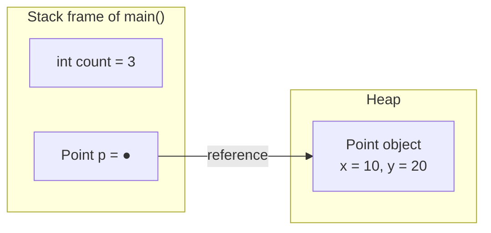
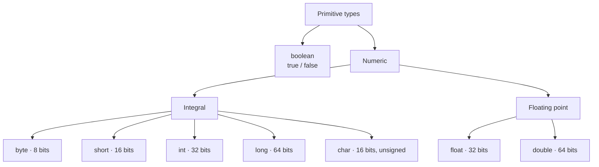
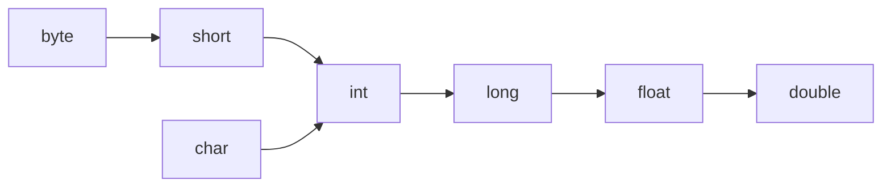
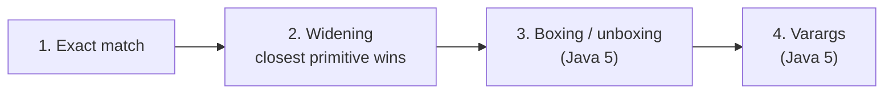
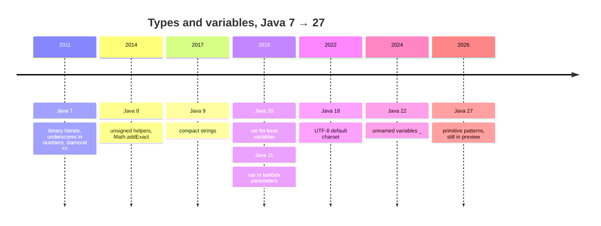

# 2. Types, Variables and Conversions

> [!TIP]
> You're reading the **complete edition**, the reference guide with every deep dive and runnable sample. For a focused read, see this chapter on the [website edition](https://hikefromjava7.com/part1/ch02-types-and-variables/).

> **In this chapter:** Java's eight primitive types and why their sizes are fixed, how `char` and Unicode really fit together, when Java converts types for you and when it refuses, and how `var` (Java 10) and `_` (Java 22) changed the way we declare variables.

> [!TIP]
> **Key points**
>
> - **Eight primitives** with fixed sizes on every platform: `byte` 8 bits, `short` 16, `char` 16 (unsigned), `int` 32, `long` 64, `float` 32, `double` 64, plus `boolean`. Everything else is a **reference**.
> - **Widening** (small → big) is automatic. **Narrowing** needs a cast and silently drops bits: `(byte) 130` is `-126`. Use `Math.addExact` (**Java 8**) when overflow must fail loudly.
> - `byte + byte` is an `int`. Arithmetic on `byte`, `short` and `char` always happens in `int`.
> - Fields get default values, local variables don't. Use `BigDecimal` for money, never `double`.
> - `var` (**Java 10**) infers a local's type. `_` (**Java 22**) names a variable you never use. UTF-8 is the default charset since **Java 18**.

## A variable is a named box

A running program keeps its data in memory, which is a long row of numbered bytes. A **variable** gives one of those locations a name and a type, so you can write `total` instead of "the four bytes starting at address 0x7ff3a0".

Java has two kinds of variables, and the difference shapes the whole language:



- A **primitive variable** holds the value itself. `int count = 3` puts the bits for 3 right in the variable.
- A **reference variable** holds a pointer-like *reference* to an object on the heap. Classes, interfaces, arrays, enums, records: everything that isn't one of the eight primitives is used through references.

Java has no pointer arithmetic. You can't add 4 to a reference or turn an integer into one. That single restriction removes an entire category of C and C++ bugs.

> [!WARNING]
> **A common misconception**
>
> "A reference takes 4 bytes" was true on 32-bit JVMs. On today's 64-bit JVMs a reference is 8 bytes in principle, but HotSpot **compresses** references to 4 bytes by default when the heap is smaller than about 32 GB. The language deliberately doesn't say, so never write code that depends on it.

## The eight primitives

C left integer sizes up to the compiler, so an `int` might be 16 bits on one machine and 32 on another. Java fixed every size in the language specification. An `int` is 32 bits on every JVM, everywhere. That's portability again, applied to data.



The wrapper classes know each type's limits, so we can ask Java directly:

**Example:** [`code/ch02/Ranges.java`](../../code/ch02/Ranges.java) · [how to run it](../../code/ch02/README.md#rangesjava) · any Java

```java
public class Ranges {
    public static void main(String[] args) {
        System.out.println("byte   " + Byte.MIN_VALUE + " .. " + Byte.MAX_VALUE);
        System.out.println("short  " + Short.MIN_VALUE + " .. " + Short.MAX_VALUE);
        System.out.println("int    " + Integer.MIN_VALUE + " .. " + Integer.MAX_VALUE);
        System.out.println("long   " + Long.MIN_VALUE + " .. " + Long.MAX_VALUE);
        System.out.println("char   " + (int) Character.MIN_VALUE + " .. " + (int) Character.MAX_VALUE);
        System.out.println("float  max " + Float.MAX_VALUE);
        System.out.println("double max " + Double.MAX_VALUE);
    }
}
```

```text
byte   -128 .. 127
short  -32768 .. 32767
int    -2147483648 .. 2147483647
long   -9223372036854775808 .. 9223372036854775807
char   0 .. 65535
float  max 3.4028235E38
double max 1.7976931348623157E308
```

> [!NOTE]
> **From the notebook**
>
> *"Rule → All the datatypes in Java are signed. Range = −2^(n−1) to 2^(n−1) − 1, so a byte holds −128 to 127."*
>
> One correction for 2026: `char` is the exception, being unsigned, 0 to 65,535.

### Why −128 to 127?

The integer types are **signed** and use *two's complement*: the top bit carries the sign. With *n* bits, the range is −2^(n−1) to 2^(n−1) − 1. For a `byte`, *n* = 8, giving −128 to 127. There's one more negative number than positive because zero takes a slot on the positive side.

`char` is the exception: it's an **unsigned** 16-bit number, 0 to 65,535, because it represents a character code.

### How big is a `boolean`?

The Java Virtual Machine Specification doesn't fix a size for `boolean`. In practice, HotSpot stores a `boolean` field in a byte and compiles `boolean` arrays as byte arrays.

> [!WARNING]
> **A common misconception**
>
> Some notes say a `boolean` used 1 bit up to JDK 1.4 and "no memory" afterwards. Neither is right. The size was never specified, and real JVMs use a whole byte for a boolean field or array element, because CPUs can't address single bits efficiently. If you need millions of flags, use `java.util.BitSet`, which really does pack one flag per bit.

## Writing numbers: literals

**Example:** [`code/ch02/Literals.java`](../../code/ch02/Literals.java) · [how to run it](../../code/ch02/README.md#literalsjava) · any Java

```java
public class Literals {
    public static void main(String[] args) {
        int binary  = 0b1010;          // Java 7
        int hex     = 0x1F;
        int octal   = 017;             // a leading zero means octal!
        long million = 1_000_000L;     // Java 7 underscores, L for long
        double rate = 6.022_140_76e23;
        System.out.println(binary + " " + hex + " " + octal + " " + million + " " + rate);
    }
}
```

```text
10 31 15 1000000 6.02214076E23
```

- A whole-number literal is an `int` unless it ends in `L`. Writing `3_000_000_000` without `L` is a compile error, because it doesn't fit in an `int`. Use a capital `L`, since `1l` looks like `11`.
- A decimal literal is a `double` unless it ends in `f` (for `float`).
- **Java 7** added binary literals (`0b1010`) and underscores between digits (`1_000_000`) purely for readability.

> [!WARNING]
> **The leading-zero trap**
>
> `017` is **octal**, so it's 15, not 17. This is a common source of bugs when people pad numbers with zeros, such as month numbers `08` and `09`, which don't even compile.

## Characters and Unicode

Early computers stored text as **ASCII**: 7 bits per character, enough for 128 symbols, plus various 8-bit extensions that covered 256 Latin characters. That works for English and fails for most of the world.

Java was designed around **Unicode** from day one, which is why its `char` is 16 bits rather than C's 8. In 1995, 65,536 code points looked like enough for every character in every language.

Unicode then outgrew 16 bits. Emoji, many historic scripts and tens of thousands of rarer Chinese characters live above 65,535. Since **Java 5**, a `String` is a sequence of UTF-16 *code units*: most characters take one `char`, and the rest take a **surrogate pair** of two.

**Example:** [`code/ch02/CharMath.java`](../../code/ch02/CharMath.java) · [how to run it](../../code/ch02/README.md#charmathjava) · any Java

```java
public class CharMath {
    public static void main(String[] args) {
        char c = 'A';
        System.out.println(c + 1);            // int arithmetic: 66
        System.out.println((char) (c + 1));   // B
        c++;                                  // ++ keeps the char type
        System.out.println(c);                // B

        String coffee = "☕";             // hot beverage, one UTF-16 unit
        String grin   = "😀";       // grinning face, a surrogate pair
        System.out.println("coffee length = " + coffee.length());
        System.out.println("grin length   = " + grin.length());
        System.out.println("grin code points = " + grin.codePointCount(0, grin.length()));
    }
}
```

```text
66
B
B
coffee length = 1
grin length   = 2
grin code points = 1
```

The first three lines show that a `char` is a number. `c + 1` is integer arithmetic, so it prints 66. To get a character back you cast, while `c++` keeps the `char` type. The last three lines show that `length()` counts UTF-16 units, not visible characters: one emoji has a length of 2.

> [!NOTE]
> **What changed: how strings are stored and decoded**
>
> - **Java 9 — compact strings** ([JEP 254](https://openjdk.org/jeps/254)). A `String` used to store a `char[]`, two bytes per character. Now it stores a `byte[]` and uses one byte per character when every character fits in Latin-1, which roughly halves the memory of typical English-heavy strings. The API is unchanged.
> - **Java 18 — UTF-8 by default** ([JEP 400](https://openjdk.org/jeps/400)). Before Java 18, reading a file without naming a charset used the *operating system's* default, so the same program could read a file correctly on Linux and garble it on Windows. Now the default is UTF-8 everywhere:
>
> **Example:** [`code/ch02/DefaultCharset.java`](../../code/ch02/DefaultCharset.java) · [how to run it](../../code/ch02/README.md#defaultcharsetjava) · Java 18+
>
> ```java
> import java.nio.charset.Charset;
>
> public class DefaultCharset {
>     public static void main(String[] args) {
>         System.out.println(Charset.defaultCharset());
>     }
> }
> ```
>
> ```text
> UTF-8
> ```

## Widening and narrowing

Assigning a value of one numeric type to another is a **conversion**. The direction decides whether Java does it for you.



**Widening** follows the arrows: a smaller type into a bigger one. It's automatic, because the value always fits.

```java
byte b = 10;
int i = b;          // automatic
double d = i;       // automatic
```

**Narrowing** goes against the arrows. It needs an explicit cast, because information can be lost, and Java won't lose it silently on your behalf:

**Example:** [`code/ch02/Narrowing.java`](../../code/ch02/Narrowing.java) · [how to run it](../../code/ch02/README.md#narrowingjava) · any Java

```java
public class Narrowing {
    public static void main(String[] args) {
        int big = Integer.MAX_VALUE;
        System.out.println("MAX_VALUE + 1  = " + (big + 1));          // silent wrap-around
        System.out.println("(byte) 130     = " + (byte) 130);         // keeps only the low 8 bits
        System.out.println("(int) 3.99     = " + (int) 3.99);         // truncates, never rounds
        System.out.println("(int) -3.99    = " + (int) -3.99);
        System.out.println("(int) 1e20     = " + (int) 1e20);         // clamps for double -> int
        System.out.println("Math.addExact  = " + safeAdd(big, 1));
    }

    static String safeAdd(int a, int b) {
        try {
            return String.valueOf(Math.addExact(a, b));               // Java 8+
        } catch (ArithmeticException e) {
            return "ArithmeticException: " + e.getMessage();
        }
    }
}
```

```text
MAX_VALUE + 1  = -2147483648
(byte) 130     = -126
(int) 3.99     = 3
(int) -3.99    = -3
(int) 1e20     = 2147483647
Math.addExact  = ArithmeticException: integer overflow
```

Each line is a lesson:

- **Integer overflow wraps around silently.** No exception, just a wrong answer.
- **Integer narrowing keeps the low bits.** 130 is `1000 0010` in binary; as a signed byte, that bit pattern means −126.
- **Floating-point to integer truncates toward zero.** It never rounds. Use `Math.round` if you want rounding.
- **Out-of-range floating values clamp** to the target type's minimum or maximum.
- **`Math.addExact`** and its siblings (`multiplyExact`, `toIntExact`, added in **Java 8**) throw instead of wrapping. Use them wherever a wrong number is worse than an exception: money, sizes, counters.

> [!WARNING]
> **Widening isn't always lossless**
>
> `long` → `float` and `int` → `float` are "widening", but a `float` has only 24 bits of precision. `(float) 123_456_789` becomes 123,456,792. The range grows, but precision can drop.

## Promotion in expressions

> [!NOTE]
> **From the notebook**
>
> *"In an expression, byte, short and char values are automatically promoted to int."*

Here is another classic surprise from the notebook, tested:

**Example:** [`code/ch02/Promotion.java`](../../code/ch02/Promotion.java) · [how to run it](../../code/ch02/README.md#promotionjava) · any Java

```java
public class Promotion {
    public static void main(String[] args) {
        byte a = 10;
        byte b = 20;
        byte sum = a + b;      // does not compile: a + b is an int
        System.out.println(sum);
    }
}
```

```text
Promotion.java:5: error: incompatible types: possible lossy conversion from int to byte
        byte sum = a + b;      // does not compile: a + b is an int
                     ^
1 error
```

Both operands are `byte`, yet the result is an `int`. Java's rule, called **binary numeric promotion**, is:

1. If either operand is `double`, the other becomes `double`.
2. Otherwise, if either is `float`, both become `float`.
3. Otherwise, if either is `long`, both become `long`.
4. **Otherwise, both become `int`**, even if they started as `byte`, `short` or `char`.

The JVM has no instructions for adding bytes, so arithmetic happens in `int` at minimum. Three ways to live with it:

**Example:** [`code/ch02/PromotionFixed.java`](../../code/ch02/PromotionFixed.java) · [how to run it](../../code/ch02/README.md#promotionfixedjava) · any Java

```java
public class PromotionFixed {
    public static void main(String[] args) {
        byte a = 10;
        byte b = 20;
        int sum = a + b;            // fix 1: accept the int
        byte cast = (byte) (a + b); // fix 2: narrow it yourself
        a += b;                     // fix 3: compound assignment casts for you
        System.out.println(sum + " " + cast + " " + a);
    }
}
```

```text
30 30 30
```

Notice the third fix: compound assignment operators like `+=` include a hidden cast back to the left-hand type. That's convenient, and it can also hide an overflow.

## Conversions choose your overload

> [!NOTE]
> **From the notebook, 9 July 2013**
>
> *"`show(10)` → 10 is int by default. Since `show(int)` does not exist, the compiler promotes int to the next available type."*

Widening also decides which overloaded method gets called. Here's the `show(10)` experiment from the notebook, extended:

**Example:** [`code/ch02/OverloadPick.java`](../../code/ch02/OverloadPick.java) · [how to run it](../../code/ch02/README.md#overloadpickjava) · any Java

```java
public class OverloadPick {
    static void show(byte b)  { System.out.println("show(byte)"); }
    static void show(short s) { System.out.println("show(short)"); }
    static void show(long l)  { System.out.println("show(long)"); }
    static void show(double d){ System.out.println("show(double)"); }

    public static void main(String[] args) {
        show(10);           // 10 is an int; there is no show(int)
        show('A');          // char widens to int, then to long
        show(10.5f);        // float widens to double
        byte b = 10;
        show(b);            // exact match wins
    }
}
```

```text
show(long)
show(long)
show(double)
show(byte)
```

`10` is an `int`, and there's no `show(int)`. The compiler won't *narrow* to `byte` or `short`, so it widens to the closest type that matches: `long`. A `char` joins the chain at `int`, so `'A'` also lands on `long`.

The complete order the compiler tries is:



Each phase only runs if the previous one found nothing. So if you add a `show(Integer)` to the class above, `show(10)` still calls `show(long)`: widening beats boxing. This order exists for backward compatibility. When Java 5 added boxing and varargs, every call that already compiled had to keep calling the same method.

## Fields vs. local variables

The notes named the two places a variable can live: in a class (a **field**) or in a method (a **local variable**). They follow different rules.

**Example:** [`code/ch02/Defaults.java`](../../code/ch02/Defaults.java) · [how to run it](../../code/ch02/README.md#defaultsjava) · any Java

```java
public class Defaults {
    int count;          // fields get default values
    boolean ready;
    String name;
    double ratio;

    public static void main(String[] args) {
        Defaults d = new Defaults();
        System.out.println(d.count + " " + d.ready + " " + d.name + " " + d.ratio);
    }
}
```

```text
0 false null 0.0
```

> [!IMPORTANT]
> **Rule**
>
> Local variables must be initialized before their first use. Class variables get default values.

Fields get default values: zero for numbers, `false` for `boolean`, `'\u0000'` for `char`, and `null` for references. Local variables get **nothing**, and the compiler refuses to let you read one before you assign it:

**Example:** [`code/ch02/LocalNoInit.java`](../../code/ch02/LocalNoInit.java) · [how to run it](../../code/ch02/README.md#localnoinitjava) · any Java

```java
public class LocalNoInit {
    public static void main(String[] args) {
        int total;                 // locals get no default value
        System.out.println(total);
    }
}
```

```text
LocalNoInit.java:4: error: variable total might not have been initialized
        System.out.println(total);
                           ^
1 error
```

Why the difference? Objects are created at run time in many different ways, so zeroing their memory is the only practical guarantee. Local variables are visible to the compiler in one method body, so it can prove every path assigns them first, which catches real bugs.

## Floating-point traps

**Example:** [`code/ch02/FloatTrap.java`](../../code/ch02/FloatTrap.java) · [how to run it](../../code/ch02/README.md#floattrapjava) · any Java

```java
import java.math.BigDecimal;

public class FloatTrap {
    public static void main(String[] args) {
        System.out.println(0.1 + 0.2);
        System.out.println(0.1 + 0.2 == 0.3);
        System.out.println(new BigDecimal("0.1").add(new BigDecimal("0.2")));
        System.out.println(1.0 / 0 + " " + -1.0 / 0 + " " + 0.0 / 0);
    }
}
```

```text
0.30000000000000004
false
0.3
Infinity -Infinity NaN
```

`float` and `double` are binary fractions (IEEE 754). Just as 1/3 can't be written exactly in decimal, 0.1 can't be stored exactly in binary, so tiny errors appear and `==` comparisons fail. Two rules follow:

- **Never use `double` for money.** Use `BigDecimal`, constructed from a `String` (`new BigDecimal("0.1")`), or count in whole cents with a `long`.
- **Compare floating results with a tolerance**, such as `Math.abs(a - b) < 1e-9`, never with `==`.

Also note that dividing a floating value by zero doesn't throw. It produces `Infinity` or `NaN`. Only *integer* division by zero throws `ArithmeticException`, as Chapter 1 showed.

## Unsigned values, Java 8 style

Java has no `unsigned int` type, and still doesn't in Java 27. That's awkward when you parse binary files or network protocols, where bytes are naturally 0–255. **Java 8** added helper methods that treat signed types' bits as unsigned:

**Example:** [`code/ch02/Unsigned.java`](../../code/ch02/Unsigned.java) · [how to run it](../../code/ch02/README.md#unsignedjava) · Java 8+

```java
public class Unsigned {
    public static void main(String[] args) {
        int allOnes = -1;   // bit pattern 0xFFFFFFFF
        System.out.println(Integer.toUnsignedString(allOnes));          // Java 8
        System.out.println(Integer.toUnsignedLong(allOnes));
        System.out.println(Integer.divideUnsigned(allOnes, 2));
        System.out.println(Byte.toUnsignedInt((byte) 0xFF));            // reading raw bytes
        System.out.println(Integer.compareUnsigned(-1, 1) > 0);
    }
}
```

```text
4294967295
4294967295
2147483647
255
true
```

The bits of `-1` are thirty-two ones, which as an unsigned number means 4,294,967,295. `Byte.toUnsignedInt` is the clean replacement for the old `b & 0xFF` idiom.

## Declaring variables in modern Java

### `var`: local variable type inference (Java 10)

Java 7 made you write types twice. The diamond `<>` (also Java 7) helped on the right-hand side, but long generic types remained noisy. **Java 10** added `var` ([JEP 286](https://openjdk.org/jeps/286)): the compiler infers a local variable's type from its initializer.

**Example:** [`code/ch02/VarDemo.java`](../../code/ch02/VarDemo.java) · [how to run it](../../code/ch02/README.md#vardemojava) · Java 10+

```java
import java.util.ArrayList;
import java.util.HashMap;
import java.util.List;
import java.util.Map;

public class VarDemo {
    public static void main(String[] args) {
        // Java 7: the type is written twice (the diamond <> saved us a little)
        Map<String, List<Integer>> scores7 = new HashMap<>();

        // Java 10: the compiler infers the type from the right-hand side
        var scores = new HashMap<String, List<Integer>>();
        scores.put("asha", new ArrayList<>(List.of(90, 85)));

        for (var entry : scores.entrySet()) {
            var name = entry.getKey();          // String
            var marks = entry.getValue();       // List<Integer>
            System.out.println(name + " -> " + marks);
        }

        var n = 10;        // int, not Integer and not long
        var d = 10.0;      // double
        var big = 10L;     // long
        System.out.println(kind(n) + " " + kind(d) + " " + kind(big));
        System.out.println(scores7.isEmpty());
    }

    static String kind(int x)    { return "int"; }
    static String kind(long x)   { return "long"; }
    static String kind(double x) { return "double"; }
}
```

```text
asha -> [90, 85]
int double long
true
```

`var` is **not** dynamic typing. The type is fixed at compile time, exactly as if you'd written it. `var n = 10` is an `int`, forever. It just saves you from writing it out.

The rules are strict on purpose:

- Only for **local variables with an initializer**, including `for` loop variables and try-with-resources. Not for fields, method parameters or return types.
- There must be something to infer from:

**Example:** [`code/ch02/VarError.java`](../../code/ch02/VarError.java) · [how to run it](../../code/ch02/README.md#varerrorjava) · Java 10+

```java
public class VarError {
    public static void main(String[] args) {
        var later;          // no initializer, nothing to infer from
    }
}
```

```text
VarError.java:3: error: cannot infer type for local variable later
        var later;          // no initializer, nothing to infer from
            ^
  (cannot use 'var' on variable without initializer)
1 error
```

- `var x = null;` fails too, because `null` has no useful type.
- `var` is a *reserved type name*, not a keyword, so old code with a variable named `var` still compiles. A *class* named `var` doesn't.

**Java 11** extended `var` to lambda parameters ([JEP 323](https://openjdk.org/jeps/323)), mainly so you can annotate them: `(@NonNull var s) -> s.length()`.

> [!IMPORTANT]
> **When to use `var`**
>
> Use it when the type is obvious from the right-hand side (`var list = new ArrayList<String>()`) or when a long generic type adds nothing. Avoid it when the right-hand side hides the type (`var result = service.process()`), because readers can't hover over code in a code review. A good test: would the variable name plus the initializer tell a reader the type?

### `_`: unnamed variables (Java 22)

Sometimes Java forces you to name a variable you'll never use: a loop counter, a caught exception, a lambda parameter. **Java 22** finalized unnamed variables ([JEP 456](https://openjdk.org/jeps/456)). Write `_` and the compiler knows it's intentionally unused:

**Example:** [`code/ch02/Unnamed.java`](../../code/ch02/Unnamed.java) · [how to run it](../../code/ch02/README.md#unnamedjava) · Java 21 only, Java 22+

```java
import java.util.List;

public class Unnamed {
    public static void main(String[] args) {
        int count = 0;
        for (var _ : List.of("a", "b", "c")) {   // we only need the count
            count++;
        }
        System.out.println("count = " + count);

        try {
            Integer.parseInt("forty-two");
        } catch (NumberFormatException _) {        // we never read the exception
            System.out.println("not a number");
        }
    }
}
```

```text
count = 3
not a number
```

This tells readers, and linters, that ignoring the value is deliberate. (`_` became illegal as an ordinary identifier in Java 9, which freed it up for this job.)

### On the horizon

- **Primitive types in patterns.** `instanceof` and `switch` patterns are being extended to primitives, so code like `if (x instanceof byte b)` can test whether a value fits safely before narrowing. It's still in preview in Java 27, in its fifth round ([JEP 532](https://openjdk.org/jeps/532)), so treat it as coming, not here.
- **Value classes (Project Valhalla).** A long-running effort to let you define your own types that behave like primitives, flat in memory with no object header, while still having methods. It's not part of Java as of Java 27.

## The journey at a glance



## IQ corner

1. **Why does `byte c = a + b;` fail when `a` and `b` are bytes?** Arithmetic promotes them to `int`, and assigning an `int` to a `byte` is a narrowing conversion that needs a cast.
2. **What does `(byte) 200` print?** −56. Narrowing keeps the low 8 bits, and 200 − 256 = −56.
3. **Why does `0.1 + 0.2 == 0.3` print `false`?** Neither value is exactly representable in binary floating point.
4. **Is `var` dynamic typing?** No. The type is inferred once, at compile time, and never changes.
5. **Which overload does `show(10)` call if only `show(long)` and `show(Integer)` exist?** `show(long)`. Widening is tried before boxing.
6. **How long is `"😀".length()`?** 2. It's one code point stored as two UTF-16 units.

## Exercises

1. Predict, then check: `(short) 70_000`, `(char) 65.9`, `(int) 'z'`, `(byte) -129`.
2. Write `static long add(int a, int b)` that never overflows silently. Then write one using `Math.addExact` that fails loudly. When would you want each?
3. Add a `show(Integer)` and a `show(int...)` overload to `OverloadPick`. Which method does `show(10)` call now? Remove `show(long)` and `show(double)` and try again.
4. Sum the prices `0.10`, `0.20` and `0.30` using `double`, then using `BigDecimal`. Print both.
5. Rewrite a Java 7 method from your own code (or the samples) using `var` where it helps readability, and leave explicit types where it doesn't. Explain each choice in a comment.

## Summary

- Java's eight primitives have **fixed sizes** on every platform. All integer types are signed except `char`.
- **Widening** is automatic. **Narrowing** needs a cast and can silently change values. Arithmetic on small types happens in **`int`**.
- Fields get **default values**. Locals must be **definitely assigned** before use.
- Use **`BigDecimal`** for money and `Math.*Exact` for overflow-sensitive math.
- Modern Java added **`var`** (10), **compact strings** (9), **UTF-8 by default** (18) and **`_`** (22).

**Next:** Chapter 3 covers operators and control flow: precedence, short-circuiting, and the journey from the Java 7 `switch` statement to Java 21 pattern-matching `switch` expressions.
