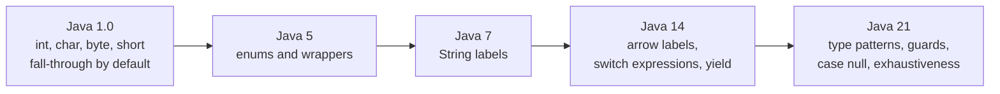
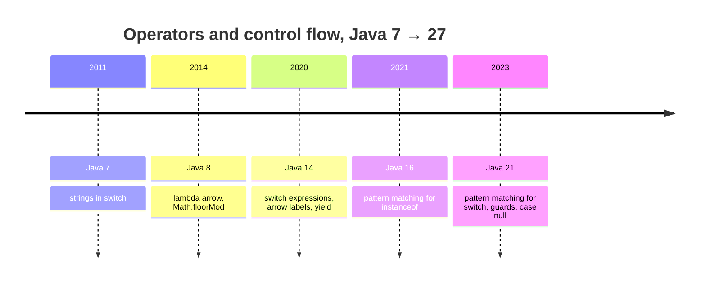

# 3. Operators and Control Flow

> [!TIP]
> You're reading the **complete edition**, the reference guide with every deep dive and runnable sample. For a focused read, see this chapter on the [website edition](https://hikefromjava7.com/part1/ch03-operators-and-control-flow/).

> **In this chapter:** how Java evaluates expressions, the operators that surprise people most, and the biggest control-flow story in modern Java: how `switch` grew from a fall-through statement into a pattern-matching expression.

> [!TIP]
> **Key points**
>
> - Expressions evaluate **left to right**; precedence decides grouping. `i++ + ++i` with `i = 5` is `12`.
> - Integer `/` **truncates toward zero** and `%` takes the **sign of the dividend**: `-7 % 3` is `-1`. Use `Math.floorMod` (**Java 8**) for a remainder that's never negative.
> - `&&` and `||` **short-circuit**; `&` and `|` always evaluate both sides. `>>` keeps the sign, `>>>` fills with zeros.
> - `switch` grew up: strings (**Java 7**), arrows and switch *expressions* with `yield` (**Java 14**), type patterns, guards and `case null` (**Java 21**).
> - No new arithmetic or logical operators arrived between Java 7 and 27; Java 8's `->` and `::` are syntax for lambdas and [method references](https://docs.oracle.com/javase/specs/jls/se25/html/jls-15.html#jls-15.13). `instanceof` gained patterns (**Java 16**), which removed most casts.

## How Java evaluates an expression

Two separate rules decide what an expression means:

- **Precedence and associativity** decide how operators *group*. `a + b * c` groups as `a + (b * c)`.
- **Evaluation order** decides when each operand is *computed*. In Java it's always **left to right**, and every operand is evaluated before the operator is applied. C and C++ leave this unspecified, which is why `i++ + ++i` is undefined behavior there. Java defines it.

**Example:** [`code/ch03/Precedence.java`](../../code/ch03/Precedence.java) · [how to run it](../../code/ch03/README.md#precedencejava) · any Java

```java
public class Precedence {
    public static void main(String[] args) {
        int i = 5;
        int r = i++ + ++i;        // 5 (then i = 6) + 7 (i becomes 7 first)
        System.out.println("r = " + r + ", i = " + i);

        // * / % bind tighter than +, left to right
        int x = 10 * 20 + -30 * 2 / 4 % 3;
        System.out.println("x = " + x);

        int a, b, c;
        a = b = c = 42;           // assignment is right-associative
        System.out.println(a + " " + b + " " + c);
    }
}
```

```text
r = 12, i = 7
x = 200
42 42 42
```

Walk through `i++ + ++i`: the left operand `i++` produces 5 and sets `i` to 6. The right operand `++i` sets `i` to 7 and produces 7. The sum is 12. It's well-defined, but write it this way in real code and your reviewers will rightly reject it.

> [!NOTE]
> **The classic rule**
>
> *"Rule → Except the assignment, all binary operators have Left to Right associativity. Unary and ternary operators have Right to Left."*
>
> Still exactly right. It's why `a = b = c = 42` works: it groups as `a = (b = (c = 42))`.

### The precedence ladder

From tightest to loosest. When in doubt, add parentheses; nobody is impressed by a reader having to consult this table.

| Level | Operators | Associativity |
|---|---|---|
| Postfix | `x++` `x--` | left → right |
| Unary | `++x` `--x` `+` `-` `!` `~` `(cast)` | right → left |
| Multiplicative | `*` `/` `%` | left → right |
| Additive | `+` `-` | left → right |
| Shift | `<<` `>>` `>>>` | left → right |
| Relational | `<` `>` `<=` `>=` `instanceof` | left → right |
| Equality | `==` `!=` | left → right |
| Bitwise | `&`, then `^`, then `\|` | left → right |
| Logical | `&&`, then `\|\|` | left → right |
| Conditional | `? :` | right → left |
| Assignment | `=` `+=` `-=` … | right → left |
| Lambda | `->` | right → left |

The lambda arrow (Java 8) is the only new row since Java 7, and like the method-reference `::`, it's syntax rather than an operator.

## Division and remainder

**Example:** [`code/ch03/DivMod.java`](../../code/ch03/DivMod.java) · [how to run it](../../code/ch03/README.md#divmodjava) · any Java

```java
public class DivMod {
    public static void main(String[] args) {
        System.out.println(" 7 / 2  = " + (7 / 2));
        System.out.println("-7 / 2  = " + (-7 / 2));  // truncates toward zero
        System.out.println(" 7 % 3  = " + (7 % 3));
        // sign follows the dividend
        System.out.println("-7 % 3  = " + (-7 % 3));
        System.out.println(" 7 % -3 = " + (7 % -3));
        // Java 8
        System.out.println("floorMod(-7, 3) = " + Math.floorMod(-7, 3));
        System.out.println("isOdd(-3) with % 2 == 1 ? " + (-3 % 2 == 1));
    }
}
```

```text
 7 / 2  = 3
-7 / 2  = -3
 7 % 3  = 1
-7 % 3  = -1
 7 % -3 = 1
floorMod(-7, 3) = 2
isOdd(-3) with % 2 == 1 ? false
```

Integer division throws away the fraction, rounding **toward zero**, so `-7 / 2` is `-3`, not `-4`. The remainder follows so that `(a / b) * b + a % b == a` always holds, which means `%` takes the sign of the left operand.

> [!WARNING]
> **The odd-number bug**
>
> `n % 2 == 1` is false for every negative odd number. Write `n % 2 != 0`. If you need a remainder that's never negative, such as when wrapping around a circular buffer, use `Math.floorMod` (Java 8).

## Logical operators and short-circuiting

**Example:** [`code/ch03/ShortCircuit.java`](../../code/ch03/ShortCircuit.java) · [how to run it](../../code/ch03/README.md#shortcircuitjava) · any Java

```java
public class ShortCircuit {
    static boolean check(String name, boolean result) {
        System.out.println("  evaluated " + name);
        return result;
    }

    public static void main(String[] args) {
        System.out.println("&& (short-circuit):");
        if (check("left", false) && check("right", true)) { }

        System.out.println("&  (always both):");
        if (check("left", false) & check("right", true)) { }

        String s = null;
        System.out.println("safe: " + (s != null && s.length() > 3));
    }
}
```

```text
&& (short-circuit):
  evaluated left
&  (always both):
  evaluated left
  evaluated right
safe: false
```

`&&` and `||` stop as soon as the result is known. That's what makes the guard `s != null && s.length() > 3` safe. On `boolean` values, `&` and `|` are logical operators too, but they **always evaluate both sides**. Use them only when the right side has a side effect you need, which is rare.

## Bitwise and shift operators

**Example:** [`code/ch03/Shifts.java`](../../code/ch03/Shifts.java) · [how to run it](../../code/ch03/README.md#shiftsjava) · any Java

```java
public class Shifts {
    public static void main(String[] args) {
        System.out.println("  8 << 2   = " + (8 << 2));
        // keeps the sign
        System.out.println("-16 >> 2   = " + (-16 >> 2));
        // fills with zeros
        System.out.println("-16 >>> 28 = " + (-16 >>> 28));
        // int shifts use only 5 bits: 33 % 32 = 1
        System.out.println("  1 << 33  = " + (1 << 33));
        System.out.println("  1L << 33 = " + (1L << 33));
        System.out.println("6 & 3 = " + (6 & 3) + ", 6 | 3 = " + (6 | 3)
                + ", 6 ^ 3 = " + (6 ^ 3) + ", ~6 = " + (~6));
    }
}
```

```text
  8 << 2   = 32
-16 >> 2   = -4
-16 >>> 28 = 15
  1 << 33  = 2
  1L << 33 = 8589934592
6 & 3 = 2, 6 | 3 = 7, 6 ^ 3 = 5, ~6 = -7
```

- `<<` shifts left, multiplying by powers of two.
- `>>` is an **arithmetic** shift: it copies the sign bit in from the left, so negative numbers stay negative.
- `>>>` is a **logical** shift: it fills with zeros. Java has it because Java has no unsigned types (Chapter 2).
- An `int` shift uses only the **low 5 bits** of the shift distance, so `1 << 33` is `1 << 1`. A `long` shift uses the low 6 bits.

## The conditional operator's hidden conversion

**Example:** [`code/ch03/TernaryTrap.java`](../../code/ch03/TernaryTrap.java) · [how to run it](../../code/ch03/README.md#ternarytrapjava) · any Java

```java
public class TernaryTrap {
    public static void main(String[] args) {
        System.out.println(true ? 1 : 2.0);  // both sides promoted to double
        // no common numeric type: stays Integer
        Object o = true ? Integer.valueOf(1) : "one";
        System.out.println(o);
        char grade = 'A';
        // constant int that fits in char: stays char
        System.out.println(false ? 1 : grade);
    }
}
```

```text
1.0
1
A
```

`cond ? a : b` has one type, so when the branches are different numeric types, both are promoted, exactly like `a + b` would be. `true ? 1 : 2.0` therefore prints `1.0`. When one branch is an `int` constant that fits in the other branch's `char`, the result stays `char`, so the last line prints `A`, not `65`. This rule regularly appears in certification exams.

## Labeled break and the enhanced `for`

**Example:** [`code/ch03/Labeled.java`](../../code/ch03/Labeled.java) · [how to run it](../../code/ch03/README.md#labeledjava) · any Java

```java
public class Labeled {
    public static void main(String[] args) {
        int[][] grid = { {1, 2, 3}, {4, -5, 6}, {7, 8, 9} };
        search:
        for (int r = 0; r < grid.length; r++) {
            for (int c = 0; c < grid[r].length; c++) {
                if (grid[r][c] < 0) {
                    System.out.println("first negative at ["
                            + r + "][" + c + "]");
                    break search;      // leaves both loops
                }
            }
        }
        for (int n : grid[2]) {        // enhanced for: Java 5
            System.out.print(n + " ");
        }
        System.out.println();
    }
}
```

```text
first negative at [1][1]
7 8 9
```

A plain `break` leaves only the innermost loop. A **labeled** `break` leaves the loop with that label, which is the clean way out of nested searches. `continue label` works the same way. If you find yourself labeling often, extract a method and `return` instead.

## The journey of `switch`

`switch` is the clearest example in Java of a feature being rebuilt in small, compatible steps.



### Java 7: strings, and the fall-through problem

**Example:** [`code/ch03/SwitchJava7.java`](../../code/ch03/SwitchJava7.java) · [how to run it](../../code/ch03/README.md#switchjava7java) · any Java

```java
public class SwitchJava7 {
    static int daysIn(String month) {
        int days = 0;
        switch (month) {               // strings in switch: Java 7
            case "APR":
            case "JUN":
            case "SEP":
            case "NOV":
                days = 30;
                break;
            case "FEB":
                days = 28;
                // forgot break: falls through!
            default:
                days = 31;
        }
        return days;
    }

    public static void main(String[] args) {
        System.out.println("JUN " + daysIn("JUN"));
        System.out.println("FEB " + daysIn("FEB") + "   <- fall-through bug");
        System.out.println("JAN " + daysIn("JAN"));
    }
}
```

```text
JUN 30
FEB 31   <- fall-through bug
JAN 31
```

Java 7 let you `switch` on a [`String`](https://docs.oracle.com/en/java/javase/25/docs/api/java.base/java/lang/String.html), which the compiler implements with `hashCode()` and `equals()`. But it kept C's oldest trap: without `break`, control **falls through** into the next case. The missing `break` after `FEB` is a real bug that compiles without a warning, unless you turn on `-Xlint:fallthrough`.

### Java 14: switch expressions

[Switch expressions](https://docs.oracle.com/javase/specs/jls/se25/html/jls-15.html#jls-15.28) ([JEP 361](https://openjdk.org/jeps/361)) fixed three things at once:

**Example:** [`code/ch03/SwitchExpression.java`](../../code/ch03/SwitchExpression.java) · [how to run it](../../code/ch03/README.md#switchexpressionjava) · Java 14+

```java
public class SwitchExpression {
    static int daysIn(String month, boolean leap) {
        // Java 14: switch is an expression
        return switch (month) {
            // several labels, no fall-through
            case "APR", "JUN", "SEP", "NOV" -> 30;
            case "FEB" -> {
                int d = leap ? 29 : 28;
                yield d;  // yield returns a value from a block
            }
            default -> 31;
        };
    }

    public static void main(String[] args) {
        System.out.println("JUN " + daysIn("JUN", false));
        System.out.println("FEB " + daysIn("FEB", false));
        System.out.println("FEB " + daysIn("FEB", true) + " (leap)");
        System.out.println("JAN " + daysIn("JAN", false));
    }
}
```

```text
JUN 30
FEB 28
FEB 29 (leap)
JAN 31
```

1. **Arrow labels (`->`) never fall through.** Each case runs its right side and stops.
2. **Several labels share one case**, separated by commas.
3. **`switch` can be an expression** that produces a value. Inside a block, `yield` hands the value back. A switch expression must cover every possible input, so you can't forget a case and silently get the default value of a variable.

### Java 21: pattern matching for switch

The final step ([JEP 441](https://openjdk.org/jeps/441)) lets a `switch` test the **type** of a value, bind it to a variable, and add a condition:

**Example:** [`code/ch03/PatternSwitch.java`](../../code/ch03/PatternSwitch.java) · [how to run it](../../code/ch03/README.md#patternswitchjava) · Java 21+

```java
public class PatternSwitch {
    static String describe(Object value) {
        return switch (value) {                                   // Java 21
            case null                  -> "nothing";
            // guard with 'when'
            case Integer i when i < 0  -> "a negative int " + i;
            case Integer i             -> "an int " + i;
            case String s              -> "a string of length " + s.length();
            case int[] arr             -> "an int array of " + arr.length;
            default                    -> "something else: "
                    + value.getClass().getSimpleName();
        };
    }

    public static void main(String[] args) {
        Object[] samples =
                { 42, -7, "Java", new int[] {1, 2, 3}, 3.14, null };
        for (Object o : samples) {
            System.out.println(describe(o));
        }
    }
}
```

```text
an int 42
a negative int -7
a string of length 4
an int array of 3
something else: Double
nothing
```

- `case Integer i` tests the type and binds `i` in one step, so no cast is needed.
- `when` adds a **guard**. Cases are tried top to bottom, so the guarded case must come before the general [`Integer`](https://docs.oracle.com/en/java/javase/25/docs/api/java.base/java/lang/Integer.html) case. The compiler rejects the opposite order as unreachable.
- `case null` handles `null` explicitly. Without it, a `switch` on `null` still throws [`NullPointerException`](https://docs.oracle.com/en/java/javase/25/docs/api/java.base/java/lang/NullPointerException.html), as it always did.
- With a **sealed** hierarchy (Chapter 19), the compiler can prove a `switch` covers every subtype, and you can drop `default` entirely.

> [!IMPORTANT]
> **Migration tip**
>
> Convert old `switch` statements to the arrow form even when you don't need a value. Arrows remove fall-through entirely, and most IDEs can do it for you. Reach for type patterns wherever you see an `if (x instanceof A) { A a = (A) x; … } else if …` chain.

## Loops: what changed and what didn't

The four loops, `while`, `do-while`, `for` and the enhanced `for` from Java 5, are unchanged since Java 7. What changed is how often you need them. Java 8's streams (Chapter 16) replaced many loops that filter, transform and collect, and Java 21's sequenced collections made "loop backwards over a list" a method call. Plain loops are still the right tool when the logic is simple or performance-critical.

## The journey at a glance



## Exercises

1. Without running it, predict `int j = 3; j = j++ + j++;`. Then run it.
2. Rewrite `SwitchJava7.daysIn` as a switch expression that takes a `java.time.Month` (Chapter 17) and handles leap years.
3. Write a method that returns `(index + offset)` wrapped into a circular array of size `n`, correct for negative offsets.
4. Add a `case Long l when l > 1_000_000 -> …` to `PatternSwitch` and place it after `default`. What does the compiler say?

## IQ corner

1. **What does `-7 / 2` give in Java?** `-3`. Integer division truncates toward zero.
2. **Difference between `&` and `&&` on booleans?** `&&` short-circuits; `&` always evaluates both sides.
3. **What is `1 << 32` for an `int`?** `1`. Only the low 5 bits of the shift distance count.
4. **Can you `switch` on a `long`?** Not in standard Java, even Java 27. Primitive types in patterns, still in preview in Java 27, would allow it.
5. **What happens when a `switch` gets `null`?** It throws `NullPointerException`, unless it has a `case null` (Java 21).

## Summary

- Operands are evaluated **left to right**; precedence only decides grouping. Use parentheses for readers.
- `/` truncates toward zero, `%` follows the dividend's sign, and `Math.floorMod` gives a non-negative remainder.
- `&&`/`||` short-circuit. `>>>` is the zero-filling shift. Shift distances wrap.
- `switch` evolved from fall-through statements (Java 7 strings) to expressions (14) to pattern matching (21).

**Next:** Part II begins. Chapter 4 looks at what an object really is, where it lives, and what a reference variable holds.
