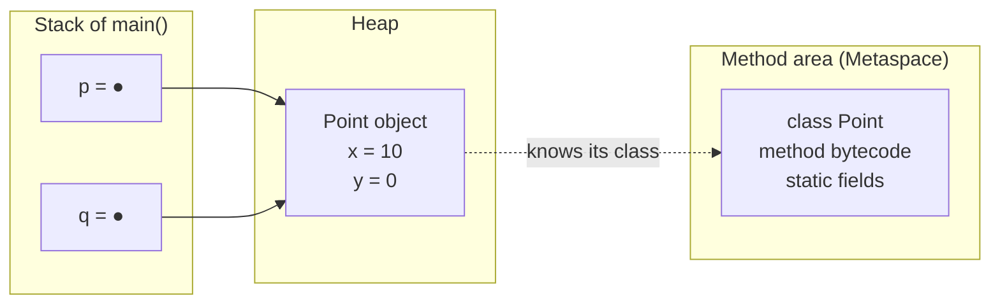

# 4. Classes, Objects and References

> [!TIP]
> You're reading the **complete edition**, the reference guide with every deep dive and runnable sample. For a focused read, see this chapter on the [website edition](https://hikefromjava7.com/part2/ch04-classes-objects-references/).

> **In this chapter:** what an object physically is, where it lives, what a reference variable really holds, and how "a class that just holds data" went from forty lines of boilerplate in Java 7 to one line in Java 16.

> [!TIP]
> **Key points**
>
> - A **class** is a blueprint; an **object** is an instance created at run time with `new`, always on the **heap**.
> - A **reference variable** holds a reference to an object, not the object. Copying a reference shares the object.
> - Printing an object shows `ClassName@` plus its **hash code in hex**. That's not a memory address.
> - `==` compares references; `equals()` compares meaning, but only if the class overrides it.
> - A data class needed hand-written `equals`, `hashCode` and `toString` in Java 7. A **record** (**Java 16**) generates them: `record Money(String currency, long cents) {}`.

## Classes, objects and the three pillars

Object-oriented programming models a program as objects that combine **state** (fields) and **behavior** (methods). The course notebook summed up the core ideas with the acronym **PIE**:

- **Polymorphism**: one interface, many implementations (Chapter 6).
- **Inheritance**: a class built on another class (Chapter 7).
- **Encapsulation**: hiding state behind methods, enforced by access modifiers (Chapter 9).

Abstraction, the fourth idea often listed with these, gets Chapter 8.

A class is a compile-time description. Nothing exists in memory for it until the JVM loads it, and no object exists until you ask for one.

> [!NOTE]
> **From the notebook**
>
> *"Rule → In Java objects are made dynamically only. The `new` operator allocates memory only to the object."*
>
> Still true: every object comes from `new` (or from something that calls it for you, such as reflection or deserialization), and its memory is allocated at run time.

## Where things live



- The **class** (its methods' code and its `static` fields) exists once, in the method area.
- Each **object** lives on the heap and holds its own copy of every instance field, plus a small header that, among other things, points to its class.
- **Methods are not copied per object.** Every `Point` shares the same method code; when a method runs, it receives the object it's working on as a hidden `this` parameter.

## References: two names, one object

**Example:** [`code/ch04/References.java`](../../code/ch04/References.java) · [how to run it](../../code/ch04/README.md#referencesjava) · any Java

```java
public class References {
    public static void main(String[] args) {
        Point p = new Point();     // one object on the heap
        Point q = p;               // a second reference to the SAME object
        q.x = 10;
        System.out.println("p.x = " + p.x);         // 10: one object, two names

        q = new Point();           // q now refers to a new object; p is unaffected
        q.x = 99;
        System.out.println("p.x = " + p.x + ", q.x = " + q.x);
        System.out.println("p == q ? " + (p == q));
    }
}
```

```text
p.x = 10
p.x = 10, q.x = 99
p == q ? false
```

`Point q = p` copies the **reference**, not the object. Both variables now lead to the same object, so a change made through `q` is visible through `p`. Assigning `q = new Point()` points `q` somewhere else and leaves `p` alone.

> [!NOTE]
> **From the notebook**
>
> *"Rule → The Reference ID of one object can be put into any number of Reference Variables."*

### What does `println(object)` show?

**Example:** [`code/ch04/PrintReference.java`](../../code/ch04/PrintReference.java) · [how to run it](../../code/ch04/README.md#printreferencejava) · any Java

```java
public class PrintReference {
    public static void main(String[] args) {
        Point p = new Point();
        String text = p.toString();                          // what println(p) prints
        String expected = "Point@" + Integer.toHexString(p.hashCode());
        System.out.println("looks like Point@<hex>: " + text.startsWith("Point@"));
        System.out.println("hex is the hash code:   " + text.equals(expected));
    }
}
```

```text
looks like Point@<hex>: true
hex is the hash code:   true
```

`Object.toString()` returns the class name, `@`, and the object's `hashCode()` in hexadecimal.

> [!WARNING]
> **A common misconception**
>
> Many courses, including the 2013 notebook, call this a "reference ID" or address. It isn't. The JVM moves objects around during garbage collection, so a fixed address couldn't be printed meaningfully, and the default hash code is a number the JVM generates once and stores in the object header. Java deliberately gives you no way to see an object's address.

## Pointers vs. references

C++ gives you pointers you can add to, cast to integers and point anywhere. Java's references can only:

- point to an object of a compatible type,
- be `null`,
- be copied and compared with `==`.

No arithmetic, no casting to numbers, no pointing into the middle of an object. Combined with the bytecode verifier (Chapter 1) and automatic garbage collection (Chapter 12), this is what makes Java memory-safe.

## `this` and data shadowing

**Example:** [`code/ch04/Shadowing.java`](../../code/ch04/Shadowing.java) · [how to run it](../../code/ch04/README.md#shadowingjava) · any Java

```java
public class Shadowing {
    int width = 1;

    void resize(int width) {
        width = width * 2;            // changes the PARAMETER (data shadowing)
        System.out.println("parameter = " + width + ", field = " + this.width);
        this.width = width;           // 'this' reaches the field
        System.out.println("field now = " + this.width);
    }

    public static void main(String[] args) {
        new Shadowing().resize(5);    // an anonymous object: used once, never named
    }
}
```

```text
parameter = 10, field = 1
field now = 10
```

When a parameter or local variable has the same name as a field, the local name wins inside the method. The notebook calls this **data shadowing**. `this.width` reaches past the local name to the field. That's why constructors so often read `this.width = width`.

`main` above also creates an **anonymous object**: `new Shadowing().resize(5)` uses an object without ever storing its reference. After the call, nothing refers to it, so it's immediately eligible for garbage collection.

## Equality: `==` vs. `equals()`

`==` on references asks "are these the same object?" `equals()` asks "do these mean the same thing?" But `Object.equals` is just `==`, so a class must **override** `equals` (and `hashCode`, which must agree with it) to get value equality.

### The Java 7 way

**Example:** [`code/ch04/Money7.java`](../../code/ch04/Money7.java) · [how to run it](../../code/ch04/README.md#money7java) · any Java

```java
import java.util.Objects;

public class Money7 {                  // the Java 7 way: write it all by hand
    private final String currency;
    private final long cents;

    public Money7(String currency, long cents) {
        this.currency = Objects.requireNonNull(currency);   // Objects: Java 7
        this.cents = cents;
    }
    public String currency() { return currency; }
    public long cents() { return cents; }

    @Override public boolean equals(Object o) {
        if (this == o) return true;
        if (!(o instanceof Money7)) return false;
        Money7 m = (Money7) o;
        return cents == m.cents && currency.equals(m.currency);
    }
    @Override public int hashCode() { return Objects.hash(currency, cents); }
    @Override public String toString() { return "Money7[currency=" + currency + ", cents=" + cents + "]"; }

    public static void main(String[] args) {
        Money7 a = new Money7("USD", 1250);
        Money7 b = new Money7("USD", 1250);
        System.out.println(a + "  ==: " + (a == b) + "  equals: " + a.equals(b));
    }
}
```

```text
Money7[currency=USD, cents=1250]  ==: false  equals: true
```

Java 7 added `java.util.Objects`, whose `requireNonNull`, `equals` and `hash` made this boilerplate safer. It was still about thirty lines for two fields, and every new field meant updating three methods by hand. Forgetting one was a classic bug: two "equal" objects that land in different `HashMap` buckets.

### The modern way: records (Java 16)

**Example:** [`code/ch04/MoneyRecord.java`](../../code/ch04/MoneyRecord.java) · [how to run it](../../code/ch04/README.md#moneyrecordjava) · Java 16+

```java
public class MoneyRecord {
    record Money(String currency, long cents) { }      // Java 16: one line

    public static void main(String[] args) {
        Money a = new Money("USD", 1250);
        Money b = new Money("USD", 1250);
        System.out.println(a + "  ==: " + (a == b) + "  equals: " + a.equals(b));
        System.out.println("same hashCode: " + (a.hashCode() == b.hashCode()));
        System.out.println("accessor: " + a.cents());
    }
}
```

```text
Money[currency=USD, cents=1250]  ==: false  equals: true
same hashCode: true
accessor: 1250
```

A **record** ([JEP 395](https://openjdk.org/jeps/395)) declares its fields in its header and gets, for free:

- private `final` fields and a constructor that sets them,
- accessor methods named after the fields (`cents()`, not `getCents()`),
- `equals`, `hashCode` and `toString` based on all fields.

Records are deliberately limited: they're immutable, can't extend another class, and can't add instance fields beyond the header. That's the point: a record says "this is just data." Chapter 19 shows what records do together with sealed types and pattern matching.

> [!IMPORTANT]
> **Migration tip**
>
> Look for classes that only hold data and have hand-written `equals`/`hashCode`, or that use Lombok's `@Value`. They're usually drop-in record candidates. Watch for two differences: accessors lose the `get` prefix, and records are always immutable.

## Under the hood: how big is an object?

On a 64-bit HotSpot JVM, every object carries a **header** before its fields: historically 12 bytes with compressed class pointers, holding the hash code, locking and GC state, and the class pointer. Fields follow, and the total is padded to a multiple of 8 bytes. So a `Point` with two `int` fields takes 24 bytes, not 8.

That header overhead is why Java has been working on smaller headers:

- **Java 25** made **compact object headers** a product feature ([JEP 519](https://openjdk.org/jeps/519)), shrinking the header to 8 bytes with `-XX:+UseCompactObjectHeaders`.
- **Java 27** turned compact object headers **on by default** ([JEP 534](https://openjdk.org/jeps/534)), cutting memory use for object-heavy applications without code changes.

The JIT can also avoid heap allocation entirely for objects that never escape a method (*escape analysis*), keeping their fields in registers. "Objects always live on the heap" is the language model; the JVM is free to optimize behind it.

## Exercises

1. Write a method `void reset(Point p) { p = new Point(); }` and call it. Does the caller's point change? Why not? (Chapter 6 answers this.)
2. Override `toString` in `Point` and print a `Point` again.
3. Put two `Money7` objects that are `equals` into a `HashSet`. Then remove `hashCode` from `Money7` and repeat. What changes?
4. Try to add an instance field `String note;` inside a record's body. Read the compiler error.

## IQ corner

1. **Where do objects live?** On the heap. Local variables, including reference variables, live in stack frames.
2. **Does Java have pointers?** It has references, which are restricted, safe pointers with no arithmetic.
3. **What does `Object.toString()` print?** `ClassName@` followed by the hash code in hex.
4. **If you override `equals`, what else must you override?** `hashCode`, so that equal objects have equal hash codes.
5. **Can a record have methods?** Yes, including static ones, plus extra constructors and a compact constructor for validation.

## Summary

- Objects are created with `new` on the heap; classes and their code live once in the method area.
- Reference variables hold references. Copying a reference shares the object.
- The default `toString` shows the hash code, not an address.
- `==` checks identity; override `equals` and `hashCode` for value equality, or use a **record** (Java 16).

**Next:** Chapter 5 covers how objects get built: constructors, initializer blocks, `static`, and the Java 25 change to what you can write before `super()`.
