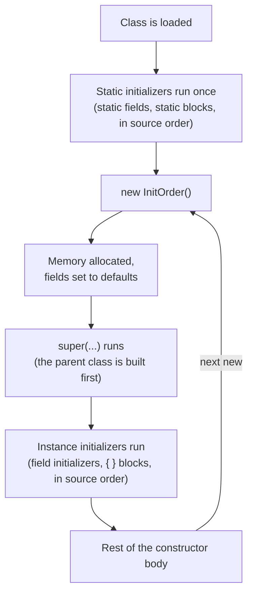

# 5. Constructors, `static` and Initializer Blocks

> [!TIP]
> You're reading the **complete edition**, the reference guide with every deep dive and runnable sample. For a focused read, see this chapter on the [website edition](https://hikefromjava7.com/part2/ch05-constructors-static-init/).

> **In this chapter:** how an object comes to life, in what order Java runs your initialization code, what `static` really means, and the Java 25 change that finally lets constructors do work before calling `super()`.

> [!TIP]
> **Key points**
>
> - A **constructor** initializes a new object. If you write none, the compiler adds a no-argument one.
> - **Order:** static blocks run once when the class initializes; then, for each object, instance initializers run, then the constructor body.
> - **`this(...)`** calls another constructor of the same class; **`super(...)`** calls the parent's. Until **Java 25** one of them had to be the very first statement.
> - **`static`** members belong to the class, shared by all objects. Static methods have no `this`.
> - Since **Java 7**, a class needs a `main` to be launched; its static block no longer runs first.
> - **Java 25** (flexible constructor bodies): you can validate and prepare arguments *before* `super(...)`.

## Constructors

A constructor looks like a method with the class's name and no return type. It runs exactly once per object, right after memory is allocated and fields are set to their defaults.

The notebook distinguished two styles:

- A **default** (no-argument) constructor gives every object the same starting values.
- A **parameterized** constructor gives each object its own values.

> [!NOTE]
> **From the notebook**
>
> *"Rule → If there is no constructor in a class then the non-parameterized constructor is in-built. The compiler adds it at compilation."*
>
> True, with one consequence that surprises people: as soon as you write **any** constructor, the compiler stops adding the no-argument one.

### Constructor chaining with `this(...)`

**Example:** [`code/ch05/Chaining.java`](../../code/ch05/Chaining.java) · [how to run it](../../code/ch05/README.md#chainingjava) · any Java

```java
public class Chaining {
    final String name;
    final int age;

    Chaining() {
        this("unknown");                  // must be the first statement (before Java 25)
        System.out.println("  no-arg constructor");
    }
    Chaining(String name) {
        this(name, 0);
        System.out.println("  one-arg constructor");
    }
    Chaining(String name, int age) {      // the one constructor that does the real work
        this.name = name;
        this.age = age;
        System.out.println("  two-arg constructor");
    }

    public static void main(String[] args) {
        Chaining c = new Chaining();
        System.out.println(c.name + ", " + c.age);
    }
}
```

```text
  two-arg constructor
  one-arg constructor
  no-arg constructor
unknown, 0
```

Each constructor delegates to a more complete one, so the real initialization lives in one place. The output runs "backwards" because each `this(...)` call finishes before the rest of the calling constructor runs.

> [!NOTE]
> **From the notebook**
>
> *"Rule → During constructor chaining, always keep one constructor which does not call `this()`, otherwise recursion will occur."*
>
> The compiler enforces this today: a cycle of `this(...)` calls is a compile error ("recursive constructor invocation").

## Initialization order

**Example:** [`code/ch05/InitOrder.java`](../../code/ch05/InitOrder.java) · [how to run it](../../code/ch05/README.md#initorderjava) · any Java

```java
public class InitOrder {
    static int created;

    static {                                   // runs once, when the class is initialized
        System.out.println("1. static block");
    }

    {                                          // runs for every object, before the constructor body
        created++;
        System.out.println("2. instance initializer (object #" + created + ")");
    }

    InitOrder() {
        System.out.println("3. constructor");
    }

    public static void main(String[] args) {
        System.out.println("main starts");
        new InitOrder();
        new InitOrder();
        System.out.println("objects created: " + InitOrder.created);
    }
}
```

```text
1. static block
main starts
2. instance initializer (object #1)
3. constructor
2. instance initializer (object #2)
3. constructor
objects created: 2
```



Notice that the static block printed **before** `main starts`. The class had to be initialized before the JVM could call its static `main`.

- A **static block** (`static { … }`) runs once, when the class is first initialized. Use it for setup that needs more than a one-line field initializer, such as filling a lookup table.
- An **instance initializer** (`{ … }`) runs for every object, before the constructor body. It's rarely needed in practice, but it's handy in anonymous classes, which can't declare constructors (Chapter 10).

## `static`: belonging to the class

**Example:** [`code/ch05/StaticRules.java`](../../code/ch05/StaticRules.java) · [how to run it](../../code/ch05/README.md#staticrulesjava) · any Java

```java
public class StaticRules {
    static int instances;          // one copy, shared by every object
    int id;                        // one copy per object

    StaticRules() { id = ++instances; }

    static String describe() {
        // return "id " + id;      // would not compile: no 'this' in a static method
        return instances + " instances so far";
    }

    public static void main(String[] args) {
        StaticRules a = new StaticRules();
        StaticRules b = new StaticRules();
        System.out.println("a.id=" + a.id + " b.id=" + b.id);
        System.out.println(StaticRules.describe());
    }
}
```

```text
a.id=1 b.id=2
2 instances so far
```

A `static` field exists once per class, no matter how many objects there are. A `static` method runs without an object, so it has no `this` and can't touch instance fields directly.

> [!NOTE]
> **From the notebook**
>
> *"Rule → Always keep those properties of an object as static data members whose values are same for each object. Keep those behaviours as static functions which are not performing a task for a particular object."*
>
> Good guidance that holds up. Two modern refinements: shared **mutable** static state is a common source of bugs in multithreaded code (Chapter 18), and static fields should usually be `final` constants.

### What is `System.out.println`, exactly?

The notebook took this apart, and it's a perfect example of `static` at work:

- `System` is a class in `java.lang`, which every file imports automatically.
- `out` is a `public static final` field of `System`, of type `PrintStream`. Being `static` is why you don't need a `System` object.
- `println` is an ordinary **instance** method of `PrintStream`, called on the object that `out` refers to.

Java 25's `IO.println` (Chapter 1) wraps the same idea in a simpler name for beginners.

## Running code without `main`

The notebook recorded a famous trick and the fact that Java 7 killed it:

> [!NOTE]
> **From the notebook**
>
> *"IQ) Can we execute any code of a program without executing main()? → Yes, but after JDK 1.7, NO."*

In Java 6, running a class with only a static block printed the block's output, then complained about the missing `main`. Since Java 7, the launcher checks for `main` **before** initializing the class:

**Example:** [`code/ch05/NoMain.java`](../../code/ch05/NoMain.java) · [how to run it](../../code/ch05/README.md#nomainjava) · Java 24 and earlier

```java
class NoMain {
    static {
        System.out.println("static work");     // Java 6: printed, then an error
    }
}
```

```text
Error: Main method not found in class NoMain, please define the main method as:
static block lines printed: 0
```

The static block never runs. (This book's test for it covers Java 7–24. Java 25's launcher accepts more `main` shapes, so its error text may differ, but a class with no `main` at all is still refused.)

## Work before `super()`: Java 25

For almost thirty years, `super(...)` or `this(...)` had to be the **first** statement of a constructor. That made a simple task awkward: checking or transforming an argument before passing it to the parent.

The old workaround hid the logic in a static helper:

**Example:** [`code/ch05/ValidateBeforeSuper7.java`](../../code/ch05/ValidateBeforeSuper7.java) · [how to run it](../../code/ch05/README.md#validatebeforesuper7java) · any Java

```java
public class ValidateBeforeSuper7 {
    static class Account {
        Account(String id) { System.out.println("Account " + id); }
    }

    static class Savings extends Account {
        Savings(String id) {
            super(normalize(id));                 // before Java 25: work hides in a static helper
        }
        private static String normalize(String id) {
            if (id.isBlank()) throw new IllegalArgumentException("empty id");
            return id.strip().toUpperCase();
        }
    }

    public static void main(String[] args) {
        new Savings("  sb-01 ");
        try {
            new Savings("   ");
        } catch (IllegalArgumentException e) {
            System.out.println("rejected: " + e.getMessage());
        }
    }
}
```

```text
Account SB-01
rejected: empty id
```

**Java 25** finalized **flexible constructor bodies** ([JEP 513](https://openjdk.org/jeps/513)). Statements may now come before `super(...)`, as long as they don't use the object being built (no reading its fields or calling its instance methods):

**Example:** [`code/ch05/ValidateBeforeSuper25.java`](../../code/ch05/ValidateBeforeSuper25.java) · [how to run it](../../code/ch05/README.md#validatebeforesuper25java) · Java 25+

```java
public class ValidateBeforeSuper25 {
    static class Account {
        Account(String id) { System.out.println("Account " + id); }
    }

    static class Savings extends Account {
        Savings(String id) {
            if (id.isBlank()) throw new IllegalArgumentException("empty id");   // Java 25:
            String clean = id.strip().toUpperCase();                            // statements
            super(clean);                                                       // before super()
        }
    }

    public static void main(String[] args) {
        new Savings("  sb-01 ");
        try {
            new Savings("   ");
        } catch (IllegalArgumentException e) {
            System.out.println("rejected: " + e.getMessage());
        }
    }
}
```

```text
Account SB-01
rejected: empty id
```

Same behavior, written the obvious way. The part before `super(...)` is called the constructor's **prologue**. It can also assign the class's own fields before calling `super(...)`, which closes a long-standing hole where a parent constructor could call an overridden method and see the child's fields still unset.

> [!NOTE]
> **From the notebook**
>
> *"Rule → Whenever we are achieving constructor chaining using this() / this(args), then it must be the first statement."*
>
> True from Java 1.0 to Java 24. Since Java 25, it must be the first statement that touches `this`; validation can come before it.

## Exercises

1. Add a second static block and a static field initializer between the two blocks in `InitOrder`. Predict the order, then run it.
2. Give a parent class a constructor that calls an overridable method, and override it in a child that reads one of its own fields. What does it print? How does Java 25's prologue let you fix it?
3. Make a class with a `private` constructor and a `static` factory method `of(...)`. Why do so many JDK APIs (`List.of`, `Integer.valueOf`) prefer factories over constructors?
4. Write a class that counts how many objects have been created, safely, from many threads. (Hint: Chapter 18's `AtomicInteger`.)

## IQ corner

1. **Can a constructor be `private`?** Yes. It prevents outside code from creating objects, which is used for singletons, factories and utility classes.
2. **Can a constructor be `static`, `final` or `abstract`?** No. None of those make sense for something that runs once per object.
3. **Does a constructor return anything?** No declared value, though `new` produces the reference to the new object.
4. **When does a static block run?** Once, when the class is initialized: on first use, such as creating an object, calling a static method, or reading a non-constant static field.
5. **Can you call `super(...)` after other statements?** From Java 25, yes, as long as those statements don't use `this`.

## Summary

- Constructors initialize objects; the compiler adds a no-argument one only if you write none.
- Order: static initializers once; then per object, `super(...)`, instance initializers, constructor body.
- `static` members belong to the class. Static methods have no `this`.
- Since Java 7, no `main` means the class isn't launched at all.
- Java 25 lets constructors validate and prepare arguments before `super(...)`.

**Next:** Chapter 6 looks at methods: overloading rules, how arguments are passed, and how Java decides which method actually runs.
