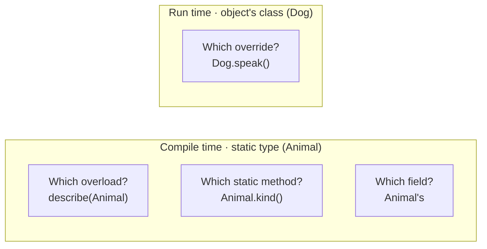

# 6. Methods and Polymorphism

> [!TIP]
> You're reading the **complete edition**, the reference guide with every deep dive and runnable sample. For a focused read, see this chapter on the [website edition](https://hikefromjava7.com/part2/ch06-methods-and-polymorphism/).

> **In this chapter:** how Java passes arguments, the rules for overloading, the difference between decisions the compiler makes and decisions the JVM makes at run time, and how Java 8 turned methods themselves into values.

> [!TIP]
> **Key points**
>
> - Java is **always pass-by-value**. For objects, the value passed is a *reference*, so a method can change the object but can't make the caller's variable point elsewhere.
> - **Overloading** = same name, different parameter lists. The return type alone doesn't count. The compiler picks the overload from **static types**.
> - **Overriding** = a subclass replaces an inherited method. The JVM picks the override from the **object's runtime type** (dynamic binding).
> - Static methods are **hidden**, not overridden.
> - **Varargs** (**Java 5**) accept zero or more arguments. **Method references** (**Java 8**) such as `Integer::parseInt` turn a method into a value.

## Pass-by-value, always

**Example:** [`code/ch06/PassByValue.java`](../../code/ch06/PassByValue.java) · [how to run it](../../code/ch06/README.md#passbyvaluejava) · any Java

```java
public class PassByValue {
    static class Box { int value; }

    static void swap(int a, int b) { int t = a; a = b; b = t; }            // swaps copies
    static void replace(Box box)   { box = new Box(); box.value = 99; }    // repoints the copy
    static void mutate(Box box)    { box.value = 42; }                     // changes the shared object

    public static void main(String[] args) {
        int x = 1, y = 2;
        swap(x, y);
        System.out.println("after swap:    x=" + x + " y=" + y);

        Box b = new Box();
        replace(b);
        System.out.println("after replace: " + b.value);
        mutate(b);
        System.out.println("after mutate:  " + b.value);
    }
}
```

```text
after swap:    x=1 y=2
after replace: 0
after mutate:  42
```

Every argument is **copied** into the method's parameters:

- `swap` swaps its own copies of `x` and `y`; the caller never notices.
- `replace` gets a copy of the reference. Pointing that copy at a new `Box` changes nothing for the caller.
- `mutate` uses its copy of the reference to reach the **same object** the caller has, so the change is visible.

> [!NOTE]
> **From the notebook**
>
> *"Rule → Java does not support call by reference."*
>
> Exactly right, and one of the most common interview questions. The precise phrase is "Java passes references by value."

## Overloading

Overloaded methods share a name and differ in their **parameter lists**: the number, types or order of parameters.

> [!NOTE]
> **From the notebook**
>
> *"Rule → Return type of function do not play any role in case of function overloading. Access specifiers and modifiers do not play any role either."*

**Example:** [`code/ch06/ReturnTypeOverload.java`](../../code/ch06/ReturnTypeOverload.java) · [how to run it](../../code/ch06/README.md#returntypeoverloadjava) · any Java

```java
public class ReturnTypeOverload {
    int show(int n)    { return n; }
    String show(int n) { return "n"; }     // differs only by return type
}
```

```text
ReturnTypeOverload.java:3: error: method show(int) is already defined in class ReturnTypeOverload
    String show(int n) { return "n"; }     // differs only by return type
           ^
1 error
```

The reason is practical: a call like `show(5);` that ignores the result gives the compiler no way to choose. Among overloads that differ by parameter type, the compiler tries, in order: an exact match, then widening (`int` to `long`), then boxing (`int` to `Integer`), then varargs.

### Varargs (Java 5)

**Example:** [`code/ch06/Varargs.java`](../../code/ch06/Varargs.java) · [how to run it](../../code/ch06/README.md#varargsjava) · any Java

```java
public class Varargs {
    static String sum(int a, int b)   { return "sum(int, int) = " + (a + b); }
    static String sum(int... values) {                          // Java 5
        int total = 0;
        for (int v : values) total += v;
        return "sum(int...) over " + values.length + " values = " + total;
    }

    public static void main(String[] args) {
        System.out.println(sum(1, 2));        // fixed-arity wins when it fits
        System.out.println(sum(1, 2, 3));
        System.out.println(sum());            // zero arguments is fine
        System.out.println(String.join(", ", "varargs", "in", "the", "JDK"));   // Java 8
    }
}
```

```text
sum(int, int) = 3
sum(int...) over 3 values = 6
sum(int...) over 0 values = 0
varargs, in, the, JDK
```

`int... values` is an `int[]` inside the method, and the compiler builds the array at each call. A fixed-arity overload always beats a varargs one when both fit, because varargs is the last phase of overload resolution. That's also why `main(String... args)` (in the notebook) and `main(String[] args)` are the same thing.

### Operator overloading

> [!NOTE]
> **From the notebook**
>
> *"Rule → Java does not support any kind of operator overloading explicitly."*

You can't define `+` for your own classes, and still can't in Java 27. The language itself overloads `+` for `String` concatenation, which is the one built-in exception.

## Static vs. dynamic binding

This is the heart of polymorphism: **which method body runs?**

**Example:** [`code/ch06/Binding.java`](../../code/ch06/Binding.java) · [how to run it](../../code/ch06/README.md#bindingjava) · any Java

```java
public class Binding {
    static class Animal {
        String speak()            { return "..."; }
        static String kind()      { return "animal"; }
    }
    static class Dog extends Animal {
        @Override String speak()  { return "Woof"; }      // overrides
        static String kind()      { return "dog"; }       // hides; does not override
    }

    static String describe(Animal a) { return "describe(Animal)"; }
    static String describe(Dog d)    { return "describe(Dog)"; }

    public static void main(String[] args) {
        Animal a = new Dog();                 // static type Animal, runtime type Dog
        System.out.println(a.speak());        // dynamic binding: chosen at run time -> Dog
        System.out.println(Animal.kind() + " / " + Dog.kind());
        System.out.println(describe(a));      // overloads: chosen at compile time -> Animal
    }
}
```

```text
Woof
animal / dog
describe(Animal)
```



- **Overload resolution happens at compile time**, using the declared (static) type of each argument. `a` is declared `Animal`, so `describe(Animal)` is chosen, even though the object is a `Dog`.
- **Overridden instance methods are chosen at run time** from the object's actual class. That's *dynamic binding* (also called *late binding* or *virtual dispatch*), and it's why `a.speak()` says "Woof."
- **Static methods are not overridden.** A static method with the same signature in a subclass *hides* the parent's. Which one runs depends only on the type you name.

> [!NOTE]
> **From the notebook**
>
> *"Rule → Polymorphism is always achieved by behaviour of an object."*
>
> In other words: runtime polymorphism comes from overriding instance methods. Overloading is sometimes called "compile-time polymorphism," but it's really just a naming convenience.

## Methods as values: method references (Java 8)

Java 8 added lambdas (Chapter 10) and **method references**, which let you pass an existing method where a functional interface is expected:

**Example:** [`code/ch06/MethodRefs.java`](../../code/ch06/MethodRefs.java) · [how to run it](../../code/ch06/README.md#methodrefsjava) · Java 8+

```java
import java.util.function.BiFunction;
import java.util.function.Function;
import java.util.function.Supplier;

public class MethodRefs {
    public static void main(String[] args) {
        Function<String, Integer> parse   = Integer::parseInt;      // static method
        Function<String, String>  upper   = String::toUpperCase;    // instance method of the argument
        String prefix = "Java ";
        Function<String, String>  addTo   = prefix::concat;         // instance method of a fixed object
        Supplier<StringBuilder>   fresh   = StringBuilder::new;     // constructor
        BiFunction<Integer, Integer, Integer> max = Math::max;

        System.out.println(parse.apply("27") + 1);
        System.out.println(upper.apply("seven"));
        System.out.println(addTo.apply("27"));
        System.out.println(fresh.get().append("built").reverse());
        System.out.println(max.apply(7, 27));
    }
}
```

```text
28
SEVEN
Java 27
tliub
27
```

| Form | Example | Means |
|---|---|---|
| `Class::staticMethod` | `Integer::parseInt` | `s -> Integer.parseInt(s)` |
| `Class::instanceMethod` | `String::toUpperCase` | `s -> s.toUpperCase()` |
| `object::instanceMethod` | `prefix::concat` | `s -> prefix.concat(s)` |
| `Class::new` | `StringBuilder::new` | `() -> new StringBuilder()` |

The compiler matches the method's parameters and return type against the functional interface's single abstract method.

## Overriding rules in one place

Chapter 7 covers inheritance, but the rules for a valid override belong next to binding:

1. Same name and parameter types.
2. Return type the same or a **subtype** (covariant returns, Java 5).
3. Access **not weaker** than the overridden method.
4. **No new or broader checked exceptions** (Chapter 13).
5. `static`, `private` and `final` methods can't be overridden.

Annotate overrides with `@Override` (Java 5; allowed on interface methods since Java 6). The compiler then rejects a method that only *looks* like an override, such as `equals(Money m)` instead of `equals(Object o)`, a bug that otherwise compiles silently.

## Exercises

1. Write `static void swap(int[] arr, int i, int j)`. Why does it work when `swap(int, int)` doesn't?
2. Add `describe(Object o)` to `Binding` and call `describe(null)`. Which overload is chosen, and why? Then add `describe(String s)` and try again.
3. Overload `print(Integer)` and `print(long)`. What does `print(5)` call?
4. Replace each method reference in `MethodRefs` with the equivalent lambda.

## IQ corner

1. **Is Java pass-by-reference for objects?** No. It passes the reference by value.
2. **Can you overload `main`?** Yes (Chapter 1). Only the launcher's chosen signature is the entry point.
3. **Can static methods be overridden?** No, only hidden.
4. **Which overload does `describe(a)` call when `a` is `Animal a = new Dog()`?** `describe(Animal)`. Overloads use the static type.
5. **What is a covariant return type?** An override returning a subtype of the parent method's return type, allowed since Java 5.

## Summary

- Java always passes copies; for objects, copies of references.
- Overloads differ by parameters, never by return type alone, and are chosen at compile time.
- Overrides are chosen at run time from the object's class. Static methods are hidden.
- Varargs (Java 5) and method references (Java 8) widened what a method signature can do.

**Next:** Chapter 7 builds classes on other classes: inheritance, `super`, `final`, composition, and Java 17's sealed classes.
