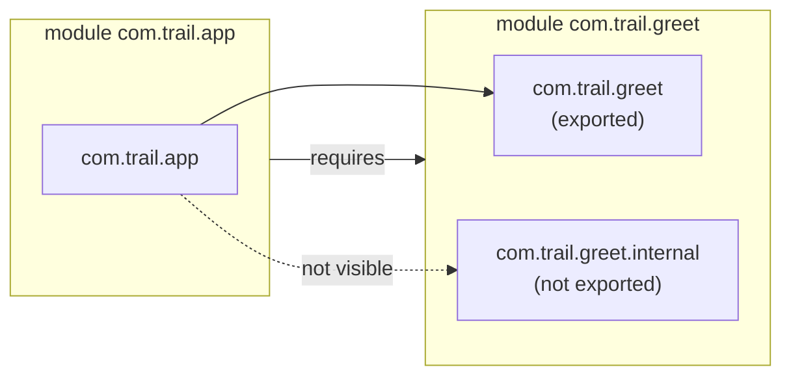

# 9. Packages, Access and Modules

> [!TIP]
> You're reading the **complete edition**, the reference guide with every deep dive and runnable sample. For a focused read, see this chapter on the [website edition](https://hikefromjava7.com/part3/ch09-packages-access-modules/).

> **In this chapter:** how Java organizes classes into packages, what each access modifier really allows, and how the Java 9 module system added the layer of encapsulation the classpath never had.

> [!TIP]
> **Key points**
>
> - A **package** is a namespace and a folder: `package com.trail.util;` lives in `com/trail/util/`. Compile with `javac -d out` to build the folder tree.
> - Four access levels: `private` < package-private (no keyword) < `protected` < `public`. `protected` from another package works **only through inheritance**.
> - Before **Java 9**, `public` meant "anyone on the classpath." **Modules** (`module-info.java`) add `requires` and `exports`, so a public class in an unexported package is invisible outside its module.
> - Since **Java 16/17**, JDK internals are strongly encapsulated; `--illegal-access` is gone.
> - **Java 25** added `import module java.base;` to import every package a module exports in one line.

## Packages

A package groups related classes and gives them a unique name. The rule of thumb is a reversed domain name, like `com.trail.util`. Two rules connect packages to the file system:

- The `package` statement is the first statement in the file.
- The compiled [class file](https://docs.oracle.com/javase/specs/jvms/se25/html/jvms-4.html#jvms-4.1) must live in a folder path that matches the package.

**Example:** [`code/ch09/packages/com/trail/app/Main.java`](../../code/ch09/packages/com/trail/app/Main.java) · [how to run it](../../code/ch09/README.md#packagescomtrailappmainjava) · any Java

```java
package com.trail.app;

import com.trail.util.Greeter;                 // a single-type import
import static java.lang.Math.max;              // a static import (Java 5)

public class Main {
    public static void main(String[] args) {
        System.out.println(Greeter.greet("packages"));
        System.out.println("max = " + max(7, 27));
    }
}
```

```text
$ javac -d out packages/com/trail/util/Greeter.java packages/com/trail/app/Main.java
$ java -cp out com.trail.app.Main
Hello, packages
max = 27
```

`-d out` tells [`javac`](https://docs.oracle.com/en/java/javase/25/docs/specs/man/javac.html) to create `out/com/trail/app/Main.class` and so on, building the folders for you. `-cp out` (the **classpath**) tells the JVM where those folders start, and the class is named by its fully qualified name.

> [!NOTE]
> **The classic rule**
>
> *"Golden Rule → No class exists in Java without any package. A class made without a package is stored in the default package, which can not be used outside the package."*
>
> Right: classes in the unnamed (default) package can't be imported by classes in named packages. Fine for a quick experiment, never for real code.

### Imports

- `import com.trail.util.Greeter;` imports one type.
- `import com.trail.util.*;` imports every type in that package, but **not** its sub-packages. `com.trail` and `com.trail.util` are unrelated as far as access goes; the dot only *looks* hierarchical.
- `java.lang` is imported automatically, which is why [`String`](https://docs.oracle.com/en/java/javase/25/docs/api/java.base/java/lang/String.html) and `System` need no import.
- `import static java.lang.Math.max;` (Java 5) imports static members, so you can write `max(7, 27)`.

> [!NOTE]
> **The classic rule**
>
> *"Golden Rule → You can have only one public class in a single .java file, and the file name must be the same as the public class name."*
>
> Still enforced. The practical reason is that `javac` can find the source of any public class from its name alone.

## Access modifiers

| Modifier | Same class | Same package | Subclass, other package | Everywhere |
|---|---|---|---|---|
| `private` | Yes | No | No | No |
| *(none)* package-private | Yes | Yes | No | No |
| `protected` | Yes | Yes | Yes, through inheritance | No |
| `public` | Yes | Yes | Yes | Yes (but see modules) |

Top-level classes can only be `public` or package-private. Nested classes can use all four.

### The `protected` subtlety

**Example:** [`code/ch09/protectedaccess/sale/Discounted.java`](../../code/ch09/protectedaccess/sale/Discounted.java) · [how to run it](../../code/ch09/README.md#protectedaccesssalediscountedjava) · any Java

```java
package sale;

import shop.Product;

public class Discounted extends Product {
    // OK: through inheritance, on this object
    double halfPrice() { return price / 2; }

    // not OK: through another Product reference
    double peek(Product other) { return other.price; }
}
```

```text
protectedaccess/sale/Discounted.java:10: error: price has protected access in Product
    double peek(Product other) { return other.price; }
                                             ^
1 error
```

> [!NOTE]
> **The classic rule**
>
> *"Rule → Protected data members and member functions can only be used through inheritance in a class of another package, i.e., association is not allowed."*
>
> Exactly what the compiler enforces: a subclass in another package may use the inherited `price` of *itself* (`this.price`), but not reach into an arbitrary `Product` object.

## The classpath problem

Before Java 9, the JVM saw your program and all its libraries as one flat list of JAR files, the classpath. That caused well-known pain:

- **No real encapsulation.** A library's "internal" classes had to be `public` for its own packages to use them, so everyone else could use them too, and then relied on them.
- **Classpath order decides.** Two JARs with the same class name? The first one wins, silently.
- **Missing dependencies show up late**, as `NoClassDefFoundError` at run time instead of at startup.
- **The JDK itself** was one monolithic `rt.jar`, and applications reached into internals like `sun.misc.Unsafe`.

## Modules (Java 9)

The Java Platform Module System ([JEP 261](https://openjdk.org/jeps/261), Project Jigsaw) adds a unit above the package. A module declares, in `module-info.java`, what it needs and what it shares:



**Example:** [`code/ch09/modules/com.trail.greet/module-info.java`](../../code/ch09/modules/com.trail.greet/module-info.java) · [how to run it](../../code/ch09/README.md#modulescomtrailgreetmodule-infojava) · Java 9+

```java
module com.trail.greet {
    exports com.trail.greet;  // only this package is visible to other modules
}
```

**Example:** [`code/ch09/modules/com.trail.app/module-info.java`](../../code/ch09/modules/com.trail.app/module-info.java) · [how to run it](../../code/ch09/README.md#modulescomtrailappmodule-infojava) · Java 9+

```java
module com.trail.app {
    requires com.trail.greet;           // an explicit, checked dependency
}
```

```text
$ javac -d mods --module-source-path modules --module com.trail.app
$ java -p mods -m com.trail.app/com.trail.app.App
[ Hello, modules ]
running in module: com.trail.app
```

`-p` is the **module path**, the modular replacement for the classpath, and `-m module/class` names what to run. Now try to use the internal package from another module:

```text
sneaky/com.trail.sneaky/com/trail/sneaky/Sneaky.java:4: error: package com.trail.greet.internal is not visible
import com.trail.greet.internal.Formatter;
                      ^
  (package com.trail.greet.internal is declared in module com.trail.greet, which does not export it)
1 error
```

`Formatter` is a `public` class, and it's still unreachable. **`public` now means public to the modules that can read the package**, which is the encapsulation the classpath never had.

The main directives:

| Directive | Meaning |
|---|---|
| `requires m;` | This module depends on module `m`. Checked at compile time and startup. |
| `exports p;` | Package `p` is accessible to other modules. |
| `exports p to m;` | Accessible only to module `m`. |
| `opens p;` | Allows deep reflection into `p` at run time, which frameworks need for dependency injection and serialization. |
| `uses` / `provides … with` | Declares a service and its implementations (`ServiceLoader`). |

> [!NOTE]
> **What changed: the JDK locked its own internals**
>
> The JDK itself was split into modules, so `java.base` holds `java.lang`, `java.util` and friends, and internal packages like `sun.*` stopped being exported. Java 9 still allowed illegal reflective access with a warning. Java 16 denied it by default ([JEP 396](https://openjdk.org/jeps/396)), and Java 17 removed the `--illegal-access` escape hatch entirely ([JEP 403](https://openjdk.org/jeps/403)). Old libraries that poked into JDK internals were the biggest single cause of pain when upgrading from Java 8.

> [!IMPORTANT]
> **Do you have to use modules?**
>
> No. Code on the classpath runs in the **unnamed module** and works as before; most applications still do this. Modules pay off for libraries that want real encapsulation, and for building small runtimes with [`jlink`](https://docs.oracle.com/en/java/javase/25/docs/specs/man/jlink.html) (Chapter 20). A common middle step is adding an `Automatic-Module-Name` to a library JAR's manifest so modular users can depend on a stable name.

## One import for a whole module: Java 25

Java 25 added **module import declarations** ([JEP 511](https://openjdk.org/jeps/511)): one line imports every public type in every package a module exports.

**Example:** [`code/ch09/ModuleImport.java`](../../code/ch09/ModuleImport.java) · [how to run it](../../code/ch09/README.md#moduleimportjava) · Java 25+

```java
import module java.base;  // Java 25: every exported package of java.base

public class ModuleImport {
    public static void main(String[] args) {
        List<String> versions = List.of("7", "17", "27");  // java.util
        Map<String, Integer> lengths = new TreeMap<>();
        for (String v : versions) lengths.put(v, v.length());
        System.out.println(lengths);
        // java.nio.file
        System.out.println(Path.of("book", "chapter09.md").getFileName());
    }
}
```

```text
{17=2, 27=2, 7=1}
chapter09.md
```

`List`, `Map` and `TreeMap` come from `java.util`, `Path` from `java.nio.file`, and no individual imports are needed. Compact source files (Chapter 1) get `import module java.base;` automatically. In larger code bases, explicit imports remain the clearer choice.

## Exercises

1. Call `Greeter.secret()` from `com.trail.app.Main`. Read the error.
2. Move `Discounted` into the `shop` package. Does `peek` compile now? Why?
3. Add `exports com.trail.greet.internal to com.trail.sneaky;` to `com.trail.greet` and recompile `Sneaky`.
4. Run `java --describe-module java.base | head -20`. Which packages does it export?

## IQ corner

1. **Can a top-level class be `protected` or `private`?** No. Only `public` or package-private. Nested classes may use all four.
2. **Does importing `com.trail.*` import `com.trail.util`?** No. Sub-packages must be imported separately.
3. **Difference between classpath and module path?** The classpath is a flat list with no boundaries. The module path holds modules with declared dependencies and exported packages.
4. **Is a `public` class always accessible?** Not since Java 9: only if its module exports its package to you.
5. **What does `opens` do that `exports` doesn't?** It allows deep reflection, including private members, at run time.

## Summary

- Packages are namespaces mapped to folders; `-d` builds the tree and `-cp` finds it.
- Four access levels; `protected` across packages works only through inheritance.
- Modules (Java 9) add `requires`/`exports`, so `public` no longer means "everyone."
- The JDK's internals are strongly encapsulated since Java 16/17.
- Java 25's `import module` imports a whole module's API in one line.

**Next:** Chapter 10 follows classes inside classes, from inner and anonymous classes to the lambdas that replaced most of them.
