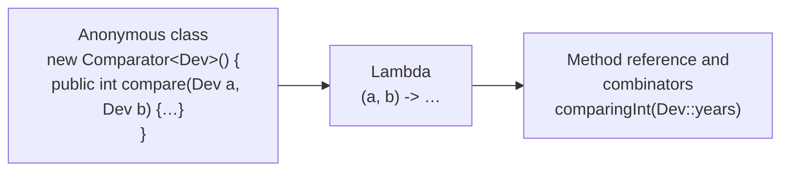

# 10. Nested and Anonymous Classes → Lambdas

> [!TIP]
> You're reading the **complete edition**, the reference guide with every deep dive and runnable sample. For a focused read, see this chapter on the [website edition](https://hikefromjava7.com/part3/ch10-nested-classes-to-lambdas/).

> **In this chapter:** the four kinds of classes inside classes, what each can see, and the Java 8 change that replaced most anonymous classes with lambdas. Several classic rules about them changed in Java 8 and Java 16.

> [!TIP]
> **Key points**
>
> - **Static nested** class: a class inside a class, with no tie to an outer object.
> - **Inner** class: tied to an outer object (`outer.new Inner()`), and sees its fields.
> - **Local** and **anonymous** classes live inside a method. Since **Java 8** they (and lambdas) can use local variables that are **[effectively final](https://docs.oracle.com/javase/specs/jls/se25/html/jls-4.html#jls-4.12.4)**; before, those variables had to be declared `final`.
> - **Lambdas** (**Java 8**) replace one-method anonymous classes. Inside a lambda, `this` means the *enclosing* object.
> - **Java 16** let [inner classes](https://docs.oracle.com/javase/specs/jls/se25/html/jls-8.html#jls-8.1.3) declare static members, even `main`, and allowed local records, [enums](https://docs.oracle.com/javase/specs/jls/se25/html/jls-8.html#jls-8.9) and interfaces.

## Four kinds of nested class

> [!NOTE]
> **Picture it: a hiking club**
>
> - A **static nested** class is the club's **rulebook**. It belongs with the club, but you can read it without any particular trip.
> - An **inner** class is a trip's **sign-up sheet**. Every sheet belongs to one specific trip and can read that trip's date and leader.
> - A **local** class is a **note** written at one stop of one trip. It exists only there.
> - An **anonymous** class is a **volunteer** who helps once and never gives a name.

**Example:** [`code/ch10/NestedKinds.java`](../../code/ch10/NestedKinds.java) · [how to run it](../../code/ch10/README.md#nestedkindsjava) · Java 8+

```java
public class NestedKinds {
    private int counter = 7;

    static class StaticNested {                     // no outer object needed
        String hi() { return "static nested"; }
    }

    class Inner {                                   // tied to an outer object
        String hi() { return "inner sees counter = " + counter; }
    }

    Runnable makeTasks(String label) {
        class Local implements Runnable {  // visible only inside this method
            public void run() {
                System.out.println("local class: " + label);
            }
        }
        Runnable anonymous = new Runnable() {       // no name; one instance
            public void run() {
                System.out.println("anonymous class: " + label);
            }
        };
        new Local().run();
        return anonymous;
    }

    public static void main(String[] args) {
        System.out.println(new StaticNested().hi());
        NestedKinds outer = new NestedKinds();
        // note the outer.new syntax
        NestedKinds.Inner inner = outer.new Inner();
        System.out.println(inner.hi());
        outer.makeTasks("hello").run();
        Runnable lambda =
                () -> System.out.println("lambda: no class file of its own");
        lambda.run();
    }
}
```

```text
static nested
inner sees counter = 7
local class: hello
anonymous class: hello
lambda: no class file of its own
--- class files:
NestedKinds$1.class
NestedKinds$1Local.class
NestedKinds$Inner.class
NestedKinds$StaticNested.class
NestedKinds.class
```

| Kind | Declared | Needs an outer object? | Typical use |
|---|---|---|---|
| Static nested | in a class, with `static` | No | Helper types that belong with their outer class, like `Map.Entry` |
| Inner | in a class, without `static` | Yes | Objects that need their outer object's state, like an iterator over a collection |
| Local | inside a method | If the method isn't static | Rare: a named helper used in one method |
| Anonymous | inside an expression | If the method isn't static | One-off implementations; mostly replaced by lambdas |

> [!NOTE]
> **The classic rule**
>
> *"IQ → Is a separate .class file created for a nested class?"*
>
> Yes, as the listing shows: `Outer$Inner.class` for member classes, `Outer$1.class` for the first anonymous class, `Outer$1Local.class` for a local class. The lambda produced **no** [class file](https://docs.oracle.com/javase/specs/jvms/se25/html/jvms-4.html#jvms-4.1). The compiler turns it into a private method and the JVM builds its implementation at run time with `invokedynamic`.

The Java Language Specification calls all of these "nested" and only the non-static kind "inner": every inner class is nested, but static nested classes are not inner.

### Inner classes hold a hidden reference

An inner class object keeps a reference to the outer object it was created from (`NestedKinds.this`). That's how `Inner.hi()` reads `counter`. It's also a classic memory leak: an inner-class object that outlives its outer object keeps the outer one alive. **Make nested classes `static` unless they really need the outer object.**

## Capturing local variables: `final` → effectively final

Local and anonymous classes, and lambdas, can use local variables from the enclosing method. They capture a **copy** of the value, so the variable must not change afterwards, or the copy and the variable would disagree.

> [!NOTE]
> **Picture it: a photo of the whiteboard**
>
> A lambda doesn't watch a local variable live. It takes a **photo** of the value when it's created. If the method could keep rewriting the whiteboard afterwards, the photo and the board would disagree, and nobody could tell which one the code meant. So Java doesn't allow the rewrite: the variable must stay unchanged.

> [!NOTE]
> **The classic rule**
>
> *"Rule → Local Inner Class can access local variables of the method only if they are `final`."*
>
> True in Java 7. Since **Java 8**, the variable only has to be **effectively final**: never reassigned after initialization. You no longer need the keyword, but the rule underneath is unchanged:

**Example:** [`code/ch10/NotEffectivelyFinal.java`](../../code/ch10/NotEffectivelyFinal.java) · [how to run it](../../code/ch10/README.md#noteffectivelyfinaljava) · Java 8+

```java
public class NotEffectivelyFinal {
    public static void main(String[] args) {
        int count = 0;
        Runnable r = () -> System.out.println(count);
        count++;  // reassigned: no longer effectively final
    }
}
```

```text
NotEffectivelyFinal.java:4: error: local variables referenced from a lambda expression must be final or effectively final
        Runnable r = () -> System.out.println(count);
                                              ^
1 error
```

## From anonymous classes to lambdas (Java 8)

Anonymous classes were Java 7's only way to pass behavior around, and most of each one was ceremony. Java 8's lambdas ([JSR 335](https://jcp.org/en/jsr/detail?id=335)) kept only the part that matters:

**Example:** [`code/ch10/SortingJourney.java`](../../code/ch10/SortingJourney.java) · [how to run it](../../code/ch10/README.md#sortingjourneyjava) · Java 16+

```java
import java.util.ArrayList;
import java.util.Arrays;
import java.util.Collections;
import java.util.Comparator;
import java.util.List;

public class SortingJourney {
    record Dev(String name, int years) { }

    public static void main(String[] args) {
        List<Dev> devs = new ArrayList<>(Arrays.asList(
                new Dev("Asha", 9), new Dev("Ravi", 3),
                new Dev("Mia", 9), new Dev("Leo", 5)));

        // Java 7: an anonymous Comparator
        Collections.sort(devs, new Comparator<Dev>() {
            @Override public int compare(Dev a, Dev b) {
                return Integer.compare(b.years(), a.years());
            }
        });
        System.out.println("Java 7  " + devs);

        // Java 8: a lambda
        devs.sort((a, b) -> a.name().compareTo(b.name()));
        System.out.println("lambda  " + devs);

        // Java 8: comparator combinators and method references
        devs.sort(Comparator.comparingInt(Dev::years).reversed()
                .thenComparing(Dev::name));
        System.out.println("combin. " + devs);
    }
}
```

```text
Java 7  [Dev[name=Asha, years=9], Dev[name=Mia, years=9], Dev[name=Leo, years=5], Dev[name=Ravi, years=3]]
lambda  [Dev[name=Asha, years=9], Dev[name=Leo, years=5], Dev[name=Mia, years=9], Dev[name=Ravi, years=3]]
combin. [Dev[name=Asha, years=9], Dev[name=Mia, years=9], Dev[name=Leo, years=5], Dev[name=Ravi, years=3]]
```



A lambda can stand in wherever a **[functional interface](https://docs.oracle.com/javase/specs/jls/se25/html/jls-9.html#jls-9.8)** (one abstract method, Chapter 8) is expected. The compiler infers parameter types from context. Combinators like `Comparator.comparingInt(...).reversed().thenComparing(...)` then let you build behavior from small pieces.

### Lambdas are not just shorter anonymous classes

> [!NOTE]
> **Picture it: hiring a helper vs leaving a note**
>
> An anonymous class is like **hiring a temporary helper**. They get their own name badge (a class file) and their own desk (fields), and when they say "I", they mean themselves (`this`).
>
> A lambda is like **leaving a note** with instructions. The note doesn't speak for itself, so "I" in the note still means you, the object that wrote it.

**Example:** [`code/ch10/ThisMeaning.java`](../../code/ch10/ThisMeaning.java) · [how to run it](../../code/ch10/README.md#thismeaningjava) · Java 8+

```java
public class ThisMeaning {
    void show() {
        Runnable anon = new Runnable() {
            public void run() {
                System.out.println("anonymous this: "
                        + this.getClass().getName());
            }
        };
        Runnable lambda = () -> System.out.println("lambda this:    "
                + this.getClass().getName());
        anon.run();
        lambda.run();
    }

    public static void main(String[] args) {
        new ThisMeaning().show();
    }
}
```

```text
anonymous this: ThisMeaning$1
lambda this:    ThisMeaning
```

- In an anonymous class, `this` is the anonymous object. In a lambda, `this` is the **enclosing** object, because a lambda doesn't create a new scope.
- A lambda can't declare fields or have state of its own.
- A lambda isn't a new class at compile time, so it's cheaper to load.

Anonymous classes still have a place when you need state, several methods, or to extend an abstract class.

## Java 16: inner classes catch up

Records (Java 16, [JEP 395](https://openjdk.org/jeps/395)) brought a quiet relaxation: inner classes may now declare **static members**, and records, enums and interfaces may be declared **locally** inside a method.

> [!NOTE]
> **The classic rule**
>
> *"Q) Can we keep main in a non-static nested class?"* The 2013 answer was no: inner classes couldn't declare static methods.

**Example:** [`code/ch10/InnerWithMain.java`](../../code/ch10/InnerWithMain.java) · [how to run it](../../code/ch10/README.md#innerwithmainjava) · Java 16+

```java
public class InnerWithMain {
    class Inner {                // an inner (non-static) class
        static int created = 0;  // static members allowed since Java 16
        public static void main(String[] args) {
            System.out.println("main inside an inner class");
        }
    }
}
```

```text
$ java -cp out 'InnerWithMain$Inner'
main inside an inner class
```

Since Java 16 the answer is yes. Local records are the more useful change in practice: you can declare a small record inside a method to hold an intermediate result, such as a pair, without polluting the class.

## More classic rules, checked

- *"Anonymous class does not have any name, so it is constructor-less."* Still true. Use an instance initializer block (Chapter 5) for setup.
- *"We can not use access specifiers with a local inner class."* Still true: `public class Local` inside a method doesn't compile.
- *"Non-static nested class can be inherited, but we have to use the outer class reference while calling super()."* Still true, with the rarely seen syntax `outer.super()`.
- *"Static nested class can be inherited directly."* True.
- Java 9 added the diamond for anonymous classes: `new Comparator<>() { … }` now compiles.

## Exercises

1. Make `Inner` in `NestedKinds` static. What breaks, and why?
2. Rewrite the anonymous `Runnable` in `NestedKinds` as a lambda and check which class file disappears.
3. Write a method that declares a local `record Pair(String key, int count)` and returns a sorted list of pairs.
4. Find a listener or callback in your own code written as an anonymous class and convert it to a lambda or [method reference](https://docs.oracle.com/javase/specs/jls/se25/html/jls-15.html#jls-15.13).

## IQ corner

1. **Inner class vs. nested class?** All inner classes are nested; static nested classes aren't inner and don't need an outer object.
2. **Why must captured locals be effectively final?** The class or lambda captures a copy; allowing changes would make the copy and the variable disagree.
3. **What does `this` mean inside a lambda?** The enclosing instance.
4. **Does a lambda create a `.class` file?** No. The JVM creates its implementation at run time via `invokedynamic`.
5. **Can an inner class have a static method?** Since Java 16, yes.

## Summary

- Static nested classes stand alone; inner classes carry their outer object. Prefer `static`.
- Captured locals must be effectively final (Java 8), not necessarily declared `final`.
- Lambdas (Java 8) replaced one-method anonymous classes; `this` means the enclosing object.
- Java 16 allowed static members in inner classes and local records, enums and interfaces.

**Next:** Part IV turns to data and memory, starting with how arrays gave way to collections.
