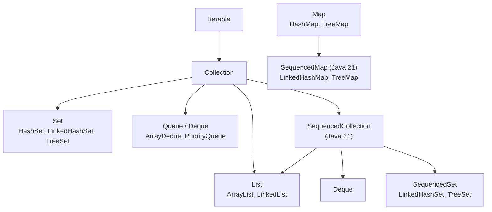

# 11. Arrays → Collections

> [!TIP]
> You're reading the **complete edition**, the reference guide with every deep dive and runnable sample. For a focused read, see this chapter on the [website edition](https://hikefromjava7.com/part4/ch11-arrays-to-collections/).

> **In this chapter:** what arrays are and why their size is fixed, two array traps every Java developer meets, and how the collections API grew from the Java 7 diamond to Java 21's sequenced collections.

> [!TIP]
> **Key points**
>
> - An **array** has a fixed length, set at creation. Elements get default values. `arr.length` is a field.
> - A 2-D array is an **array of arrays**; rows can have different lengths.
> - Arrays are **covariant**: a `String[]` is an `Object[]`, and storing the wrong type fails at run time with `ArrayStoreException`. Generic collections catch it at compile time.
> - `Arrays.asList` is fixed-size; `List.of` (**Java 9**) is unmodifiable and rejects `null`.
> - **Java 21** sequenced collections added `getFirst()`, `getLast()`, `addFirst()` and `reversed()` to lists, ordered sets and ordered maps.

## Arrays

**Example:** [`code/ch11/ArrayBasics.java`](../../code/ch11/ArrayBasics.java) · [how to run it](../../code/ch11/README.md#arraybasicsjava) · any Java

```java
import java.util.Arrays;

public class ArrayBasics {
    public static void main(String[] args) {
        int[] scores = new int[3];                         // fixed size, filled with defaults
        String[] names = new String[2];
        System.out.println(Arrays.toString(scores) + " " + Arrays.toString(names));

        int[] primes = {2, 3, 5, 7};                       // array initializer
        System.out.println("length = " + primes.length);   // a field, not a method

        int[][] triangle = new int[3][];                   // an array of arrays; rows can differ
        for (int r = 0; r < triangle.length; r++) {
            triangle[r] = new int[r + 1];
            Arrays.fill(triangle[r], r + 1);
        }
        System.out.println(Arrays.deepToString(triangle));

        System.out.println(sum(new int[] {10, 20, 30}));   // an anonymous array

        try {
            System.out.println(primes[4]);
        } catch (ArrayIndexOutOfBoundsException e) {
            System.out.println(e.getMessage());
        }
    }

    static int sum(int[] values) {
        int total = 0;
        for (int v : values) total += v;
        return total;
    }
}
```

```text
[0, 0, 0] [null, null]
length = 4
[[1], [2, 2], [3, 3, 3]]
60
Index 4 out of bounds for length 4
```

An array is an object that holds a fixed number of values of one type, stored side by side. The notebook listed its two advantages: one name for many values, and fast access by index.

> [!NOTE]
> **From the notebook**
>
> *"Rule → Once an array's memory is allocated, either statically or dynamically, it can't be changed."*
>
> Correct: to "grow" an array you create a bigger one and copy (`Arrays.copyOf`). That's exactly what `ArrayList` does for you behind the scenes.

> [!NOTE]
> **From the notebook**
>
> *"Q) Why does array index start with 0?"*
>
> Because the index is an **offset**: element `i` sits at *start + i × element size*, so the first element is at offset 0. Java inherited the convention from C.

A few array facts that still trip people up:

- `int[] a` and `int a[]` both compile; the first is the Java style.
- `new int[]{10, 20, 30}` is an **anonymous array**, handy for passing values directly.
- Out-of-range indexes throw `ArrayIndexOutOfBoundsException`. Since **Java 11** the message reads "Index 4 out of bounds for length 4"; Java 7 printed just "4."
- `Arrays.toString` prints one level; `Arrays.deepToString` prints nested arrays.

## Trap: arrays are covariant

**Example:** [`code/ch11/ArrayCovariance.java`](../../code/ch11/ArrayCovariance.java) · [how to run it](../../code/ch11/README.md#arraycovariancejava) · any Java

```java
public class ArrayCovariance {
    public static void main(String[] args) {
        Object[] things = new String[2];       // compiles: String[] is an Object[]
        things[0] = "fine";
        try {
            things[1] = 42;                    // compiles too, but fails at run time
        } catch (ArrayStoreException e) {
            System.out.println("ArrayStoreException: " + e.getMessage());
        }
        // List<Object> list = new ArrayList<String>();   // generics reject this at compile time
    }
}
```

```text
ArrayStoreException: java.lang.Integer
```

Because `String[]` is a subtype of `Object[]`, the compiler accepts storing an `Integer` through an `Object[]` reference. The JVM checks every array store at run time and throws. Generics, added in Java 5, deliberately made `List<String>` **not** a `List<Object>`, so the same mistake is a compile error. This is one of the main reasons to prefer collections over arrays for objects.

## The collections framework

Java 1.2's collections framework is still the foundation: `List` (ordered, indexed), `Set` (no duplicates), `Map` (key → value) and `Queue`/`Deque`, with implementations like `ArrayList`, `HashSet`, `HashMap` and `ArrayDeque`.



### Less typing: Java 5 → 10

**Example:** [`code/ch11/GenericsDiamond.java`](../../code/ch11/GenericsDiamond.java) · [how to run it](../../code/ch11/README.md#genericsdiamondjava) · Java 10+

```java
import java.util.ArrayList;
import java.util.HashMap;
import java.util.List;
import java.util.Map;

public class GenericsDiamond {
    public static void main(String[] args) {
        Map<String, List<Integer>> java6 = new HashMap<String, List<Integer>>();   // Java 5/6
        Map<String, List<Integer>> java7 = new HashMap<>();                         // Java 7: diamond
        var java10 = new HashMap<String, List<Integer>>();                         // Java 10: var

        java7.computeIfAbsent("asha", k -> new ArrayList<>()).add(90);             // Java 8: Map defaults
        java7.computeIfAbsent("asha", k -> new ArrayList<>()).add(85);
        java7.merge("count", List.of(1), (a, b) -> a);
        System.out.println(java7.get("asha") + " " + java6.isEmpty() + " " + java10.isEmpty());

        Map<String, Integer> lengths = Map.of("seven", 5, "twenty-seven", 12);     // Java 9
        System.out.println(lengths.get("twenty-seven") + " " + lengths.getOrDefault("eight", 0));
    }
}
```

```text
[90, 85] true true
12 0
```

- **Java 7: the diamond `<>`** infers type arguments on the right-hand side.
- **Java 8: default methods on `Map`**, such as `computeIfAbsent`, `merge` and `getOrDefault`, replaced many "check, then put" blocks.
- **Java 9: `List.of`, `Set.of`, `Map.of`** create small unmodifiable collections in one call.
- **Java 10: `var`** infers the whole declaration (Chapter 2).

### Fixed-size vs. unmodifiable

**Example:** [`code/ch11/FixedAndImmutable.java`](../../code/ch11/FixedAndImmutable.java) · [how to run it](../../code/ch11/README.md#fixedandimmutablejava) · Java 9+

```java
import java.util.ArrayList;
import java.util.Arrays;
import java.util.List;

public class FixedAndImmutable {
    static void attempt(String what, Runnable action) {
        try {
            action.run();
            System.out.println(what + ": ok");
        } catch (RuntimeException e) {
            System.out.println(what + ": " + e.getClass().getSimpleName());
        }
    }

    public static void main(String[] args) {
        List<String> asList = Arrays.asList("a", "b");          // Java 1.2: fixed-size view of an array
        List<String> listOf = List.of("a", "b");                // Java 9: truly unmodifiable
        List<String> growable = new ArrayList<>(listOf);        // diamond <>: Java 7

        attempt("Arrays.asList set", () -> asList.set(0, "z"));
        attempt("Arrays.asList add", () -> asList.add("c"));
        attempt("List.of set     ", () -> listOf.set(0, "z"));
        attempt("List.of null    ", () -> List.of("a", null));
        attempt("ArrayList add   ", () -> growable.add("c"));
        System.out.println(asList + " " + listOf + " " + growable);
    }
}
```

```text
Arrays.asList set: ok
Arrays.asList add: UnsupportedOperationException
List.of set     : UnsupportedOperationException
List.of null    : NullPointerException
ArrayList add   : ok
[z, b] [a, b] [a, b, c]
```

| Factory | Change elements? | Add/remove? | `null` allowed? |
|---|---|---|---|
| `Arrays.asList(...)` | Yes (writes through to the array) | No | Yes |
| `List.of(...)` (Java 9) | No | No | No |
| `List.copyOf(...)` (Java 10) | No | No | No |
| `new ArrayList<>(...)` | Yes | Yes | Yes |
| `stream.toList()` (Java 16) | No | No | Yes |

> [!IMPORTANT]
> **Migration tip**
>
> Replace `Collections.unmodifiableList(Arrays.asList(...))` with `List.of(...)`, but check for `null` elements first. `List.of` rejects them, and the old code allowed them.

## Sequenced collections (Java 21)

For 25 years, getting the last element of a `List` meant `list.get(list.size() - 1)`, and of a `LinkedHashSet` meant iterating through the whole thing. Java 21 added three interfaces that capture "has a defined order" ([JEP 431](https://openjdk.org/jeps/431)):

**Example:** [`code/ch11/Sequenced.java`](../../code/ch11/Sequenced.java) · [how to run it](../../code/ch11/README.md#sequencedjava) · Java 21+

```java
import java.util.ArrayList;
import java.util.LinkedHashMap;
import java.util.LinkedHashSet;
import java.util.List;
import java.util.SequencedMap;

public class Sequenced {
    public static void main(String[] args) {
        List<Integer> releases = new ArrayList<>(List.of(17, 21, 25));
        releases.addFirst(11);                          // Java 21
        releases.addLast(27);
        System.out.println(releases + " first=" + releases.getFirst() + " last=" + releases.getLast());
        System.out.println("reversed view: " + releases.reversed());

        var visited = new LinkedHashSet<>(List.of("Java 7", "Java 8", "Java 11"));
        System.out.println("last visited: " + visited.getLast());

        SequencedMap<String, Integer> lts = new LinkedHashMap<>();
        lts.put("Java 8", 2014);
        lts.put("Java 21", 2023);
        lts.put("Java 25", 2025);
        System.out.println("oldest: " + lts.firstEntry() + ", newest: " + lts.lastEntry());

        // Java 7 equivalents, for comparison
        System.out.println(releases.get(releases.size() - 1) + " " + new ArrayList<>(visited).get(visited.size() - 1));
    }
}
```

```text
[11, 17, 21, 25, 27] first=11 last=27
reversed view: [27, 25, 21, 17, 11]
last visited: Java 11
oldest: Java 8=2014, newest: Java 25=2025
27 Java 11
```

- `SequencedCollection` adds `getFirst`, `getLast`, `addFirst`, `addLast`, `removeFirst`, `removeLast` and `reversed`.
- `SequencedSet` (for `LinkedHashSet`, `TreeSet`) and `SequencedMap` (for `LinkedHashMap`, `TreeMap`, with `firstEntry`, `lastEntry`, `pollFirstEntry`…) do the same for sets and maps.
- `reversed()` returns a **view**, not a copy, so it costs nothing.

## Exercises

1. Write `static int[] grow(int[] a)` that doubles an array's capacity with `Arrays.copyOf`. Compare with how `ArrayList` grows.
2. Change `ArrayCovariance` to use `List<Object> things = new ArrayList<String>();`. Read the compiler error.
3. Use `Map.merge` to count word frequencies in a sentence in one line inside a loop.
4. Using a sequenced map, keep only the five most recently used keys (an LRU cache) with `LinkedHashMap` and `pollFirstEntry`.

## IQ corner

1. **`length` vs. `length()` vs. `size()`?** Arrays have a `length` field; `String` has `length()`; collections have `size()`.
2. **Can you change an array's size?** No. Create a new array and copy.
3. **Why do `List.of` collections reject `null`?** To avoid ambiguity (`get` returning `null`) and to catch bugs early.
4. **What's an `ArrayStoreException`?** Storing a value of the wrong type into a covariant array, detected at run time.
5. **What does `reversed()` return?** A reversed *view* backed by the original collection.

## Summary

- Arrays have fixed size and run-time type checks on stores; collections are flexible and type-checked at compile time.
- `Arrays.asList` is fixed-size; `List.of`/`copyOf` are unmodifiable and null-hostile.
- The diamond (7), `Map` defaults (8), collection factories (9) and `var` (10) cut collection boilerplate.
- Java 21's sequenced collections gave ordered collections first/last/reverse operations.

**Next:** Chapter 12 follows those objects to the end of their lives: garbage collection, and how Java's collectors changed from Java 7 to Java 27.
