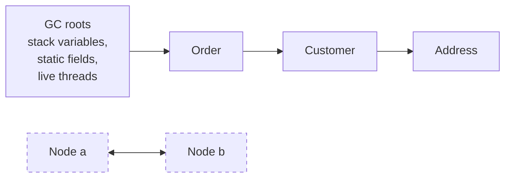
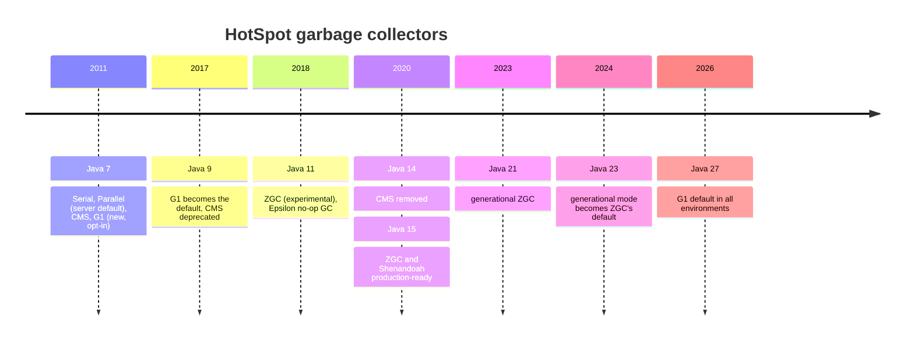

# 12. Garbage Collection and Memory

> [!TIP]
> You're reading the **complete edition**, the reference guide with every deep dive and runnable sample. For a focused read, see this chapter on the [website edition](https://hikefromjava7.com/part4/ch12-garbage-collection-and-memory/).

> **In this chapter:** which objects the JVM can reclaim and when, why `finalize()` was a mistake and what replaced it, and the remarkable run of garbage collectors from Java 7's Parallel and CMS to Java 27's defaults.

> [!TIP]
> **Key points**
>
> - An object becomes **eligible for collection** when no chain of references from a *GC root* (live stack variables, static fields, active threads) reaches it. Cycles don't keep objects alive.
> - `System.gc()` is only a **request**.
> - `finalize()` was deprecated in **Java 9** and marked for removal in **Java 18**. Use `try`-with-resources, and [`Cleaner`](https://docs.oracle.com/en/java/javase/25/docs/api/java.base/java/lang/ref/Cleaner.html) (**Java 9**) as a safety net.
> - **Collectors:** Parallel was the server default in Java 7; **[G1](https://docs.oracle.com/en/java/javase/25/gctuning/garbage-first-g1-garbage-collector1.html)** became the default in **Java 9**; **[ZGC](https://docs.oracle.com/en/java/javase/25/gctuning/z-garbage-collector1.html)** and **Shenandoah** became production-ready in **Java 15**; CMS was removed in **Java 14**.
> - **Java 27** makes G1 the default everywhere and turns on **compact object headers** by default.

## When is an object garbage?

Java doesn't count references. Instead, the collector starts from **GC roots** and marks everything it can reach. Anything unmarked is garbage.

> [!NOTE]
> **Picture it: climbers on ropes**
>
> Think of the GC roots as **base camp**. Every climber roped to base camp, directly or through other climbers, is safe. A climber who unclips is left behind, and so are two climbers roped only to each other: they hold on to one another, but nothing connects them to camp. The collector follows the ropes out from camp and treats everyone it can't reach as garbage.



The dashed pair is an **island of isolation**: the two objects point at each other, but nothing reachable points at them. A reference-counting collector would leak them; Java's tracing collectors don't.

> [!NOTE]
> **The classic rule**
>
> *"Which objects are available for Garbage Collection? (1) When a function ends… (2) when the reference is made null… (3) when the reference is reassigned… (4) island of isolation."*
>
> All four still hold. Here they are, observed with weak references, which watch an object without keeping it alive:

**Example:** [`code/ch12/Eligibility.java`](../../code/ch12/Eligibility.java) · [how to run it](../../code/ch12/README.md#eligibilityjava) · any Java

```java
import java.lang.ref.WeakReference;

public class Eligibility {
    static class Node { Node next; }

    public static void main(String[] args) throws InterruptedException {
        Object data = new Object();
        // does not keep the object alive
        WeakReference<Object> watch = new WeakReference<>(data);
        data = null;  // last strong reference gone

        Node a = new Node(), b = new Node();
        a.next = b; b.next = a;  // an island: a <-> b
        WeakReference<Node> island = new WeakReference<>(a);
        a = null; b = null;  // nothing outside points in

        System.gc();  // a request, not a command
        Thread.sleep(100);
        System.out.println("plain object collected: "
                + (watch.get() == null));
        System.out.println("island collected:       "
                + (island.get() == null));
    }
}
```

```text
plain object collected: true
island collected:       true
```

(The sample runs with `-XX:+UseSerialGC` so that `System.gc()` reliably triggers a full collection. Other collectors are free to treat the request differently, or ignore it.)

## Reference strength

Java has four kinds of references. They're unchanged since Java 1.2:

| Type | Collected when… | Used for |
|---|---|---|
| Strong (normal) | never, while reachable | everything |
| `SoftReference` | memory is low | memory-sensitive caches |
| `WeakReference` | at the next collection | `WeakHashMap`, listeners, canonicalizing maps |
| `PhantomReference` | after collection, before memory is reclaimed | cleanup actions (what `Cleaner` uses) |

## `finalize()`: the method that shouldn't have been

`finalize()` was meant to run cleanup before an object is collected. In practice it was unpredictable (no guarantee it runs at all), slow (it delays collection), and dangerous (it can bring an object back to life).

> [!NOTE]
> **The classic rule**
>
> *"Can we call this finalize function explicitly? → Yes, we can call it explicitly and nothing will happen; it will run normally."*
>
> True, and a hint of the problem: it's just a method, with no special guarantees.

Java has been removing it in stages:

- **Java 9** deprecated `Object.finalize()`.
- **Java 18** deprecated it **for removal** ([JEP 421](https://openjdk.org/jeps/421)) and added `--finalization=disabled` so you can test your application without it.

**Example:** [`code/ch12/FinalizeDemo.java`](../../code/ch12/FinalizeDemo.java) · [how to run it](../../code/ch12/README.md#finalizedemojava) · Java 18+

```java
public class FinalizeDemo {
    @Override
    protected void finalize() {  // deprecated (Java 9), for removal (Java 18)
        System.out.println("finalizing");
    }
}
```

```text
FinalizeDemo.java:3: warning: [removal] finalize() in Object has been deprecated and marked for removal
    protected void finalize() {  // deprecated (Java 9), for removal (Java 18)
                   ^
1 warning
```

### What to use instead

> [!NOTE]
> **Picture it: a rented kayak**
>
> `try`-with-resources is **returning the kayak yourself** the moment you're done. A `Cleaner` is the rental shop's rule to **fetch any kayak left on the beach**, some time after nobody is using it. `finalize()` was like hoping someone might notice the kayak one day, or never, with no promise about when.

**Example:** [`code/ch12/CleanerDemo.java`](../../code/ch12/CleanerDemo.java) · [how to run it](../../code/ch12/README.md#cleanerdemojava) · Java 9+

```java
import java.lang.ref.Cleaner;

public class CleanerDemo {
    private static final Cleaner CLEANER = Cleaner.create();  // Java 9

    static class TempFile implements AutoCloseable {
        private final Cleaner.Cleanable cleanable;
        TempFile(String name) {
            // The cleanup action must not refer to 'this',
            // or the object could never be collected.
            cleanable = CLEANER.register(this,
                    () -> System.out.println("deleted " + name));
        }
        // runs at most once
        @Override public void close() { cleanable.clean(); }
    }

    public static void main(String[] args) {
        // deterministic: close()
        try (TempFile f = new TempFile("report.tmp")) {
            System.out.println("using the file");
        }
        System.out.println("done");
    }
}
```

```text
using the file
deleted report.tmp
done
```

1. **Release resources explicitly**, with `try`-with-resources (Java 7, Chapter 13). This is deterministic and should be your main tool.
2. **Register a `Cleaner`** (Java 9) as a safety net in case someone forgets to `close()`. The cleanup action runs once, either on `close()` or after the object becomes unreachable. It must not refer to the object itself, or the object can never become unreachable.

## The garbage collectors, Java 7 → 27

Most objects die young, so HotSpot's collectors divide the [heap](https://docs.oracle.com/javase/specs/jvms/se25/html/jvms-2.html#jvms-2.5.3) into a **young generation**, collected often and cheaply, and an **old generation** for survivors. What changed over the years is *how* they collect, and how long the application pauses while they do.

> [!NOTE]
> **Picture it: a busy café**
>
> Most cups in a café are used once and washed within minutes; only a few, like the staff's mugs, stay out all day. So the café washes the **counter tray** (the young generation) often and quickly, and the **back shelf** (the old generation) rarely.
>
> The simplest collectors **close the café** while they wash: a *stop-the-world* pause. G1 closes it for short, planned breaks. ZGC and Shenandoah do almost all the washing while customers keep ordering.



| Collector | Flag | Strength |
|---|---|---|
| Serial | `-XX:+UseSerialGC` | Smallest footprint; one thread. Good for tiny heaps and single-CPU containers. |
| Parallel | `-XX:+UseParallelGC` | Highest throughput for batch jobs; longer pauses. Java 7–8's default on servers. |
| G1 | `-XX:+UseG1GC` | Balanced throughput and pause times; region-based. **The default since Java 9.** |
| ZGC | `-XX:+UseZGC` | Pauses typically under a millisecond, even on huge heaps. Generational since Java 21. |
| Shenandoah | `-XX:+UseShenandoahGC` | Low pauses via concurrent compaction (included in most OpenJDK builds). |
| Epsilon | `-XX:+UseEpsilonGC` | Allocates but never collects. For testing and very short-lived jobs. |

> [!NOTE]
> **What changed in Java 27**
>
> - **G1 everywhere** ([JEP 523](https://openjdk.org/jeps/523)). Until now, on machines the JVM considered small (fewer than 2 CPUs or less than about 1.8 GB of memory, which describes many containers), it silently chose Serial instead of G1. From Java 27, G1 is the default in all environments, so the same application behaves the same on your laptop and in a small pod.
> - **Compact object headers by default** ([JEP 534](https://openjdk.org/jeps/534)). Introduced as an opt-in product feature in Java 25 ([JEP 519](https://openjdk.org/jeps/519)), smaller object headers (Chapter 4) now apply automatically, which reduces heap use for object-heavy programs.

> [!IMPORTANT]
> **Migration tip: GC flags from Java 7/8**
>
> Old startup scripts often carry flags that newer JVMs reject or ignore: `-XX:+UseConcMarkSweepGC` (CMS, removed in 14), `-XX:PermSize`/`MaxPermSize` (PermGen, removed in 8) and `-XX:+PrintGCDetails` (replaced by unified logging, `-Xlog:gc*`, in Java 9). Remove them before upgrading, then start with the defaults and measure before tuning.

## Sizing the heap in containers

The JVM sizes its heap from the machine's memory: by default, a maximum of one quarter of physical memory. Before Java 10 (and 8u191), it read the **host's** memory even inside a container, so a JVM in a 512 MB container on a 64 GB host could plan for a 16 GB heap and get killed. Container awareness fixed that. Today, prefer `-XX:MaxRAMPercentage=75` over a fixed `-Xmx` in containers, so the heap scales with the container's limit.

## Watching the collector

```text
java -Xlog:gc -jar app.jar                # one line per collection (Java 9+)
jcmd <pid> GC.heap_info                   # heap usage of a running JVM
jcmd <pid> JFR.start duration=60s filename=rec.jfr   # record a profile (Chapter 20)
```

## Exercises

1. Remove `-XX:+UseSerialGC` from the `Eligibility` command and run it a few times with `-XX:+UseZGC`. Is the result always the same? Why might it not be?
2. Run any program with `-Xlog:gc` and identify a young collection and its pause time.
3. Replace `CleanerDemo`'s `try`-with-resources with a plain `new TempFile(...)` and no `close()`. When, if ever, is the file "deleted"?
4. Find out which collector your JVM picks with `java -XX:+PrintCommandLineFlags -version` on your laptop and in a small container.

## IQ corner

1. **Can you force garbage collection?** No. `System.gc()` is a hint that may be ignored.
2. **Does Java leak cyclic references?** No. Tracing collectors only keep what's reachable from roots.
3. **Why was `finalize()` deprecated?** It's unpredictable, slow and can resurrect objects. Use `try`-with-resources and `Cleaner`.
4. **Which collector is the default?** G1, since Java 9; in all environments since Java 27.
5. **Can a Java program still leak memory?** Yes: by keeping references it no longer needs, such as an ever-growing static map.

## Summary

- Objects are collected when unreachable from GC roots; cycles don't prevent it.
- `System.gc()` is a request. Reference types let you observe or soften reachability.
- `finalize()` is on its way out; use `try`-with-resources plus `Cleaner`.
- Collectors moved from Parallel/CMS (Java 7) to G1 (9), ZGC and Shenandoah (15), and G1 everywhere with compact headers (27).

**Next:** Part V begins with exceptions: the hierarchy, `finally`'s surprises, and Java 7's [try-with-resources](https://docs.oracle.com/javase/specs/jls/se25/html/jls-14.html#jls-14.20.3).
