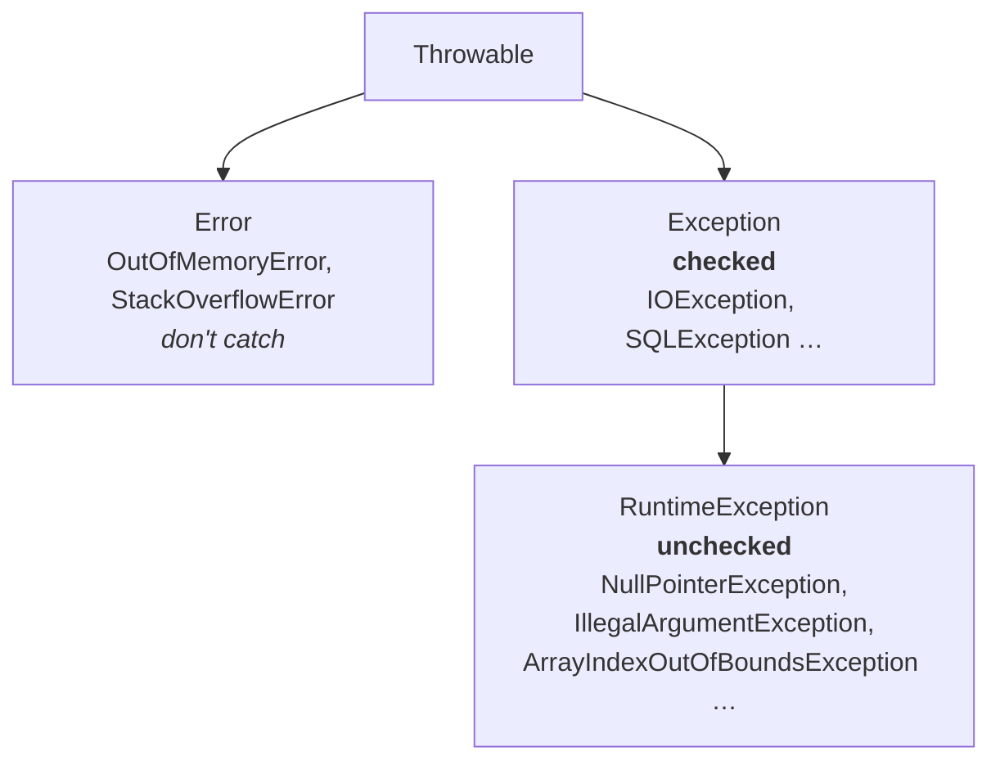

# 13. Exceptions

> [!TIP]
> You're reading the **complete edition**, the reference guide with every deep dive and runnable sample. For a focused read, see this chapter on the [website edition](https://hikefromjava7.com/part5/ch13-exceptions/).

> **In this chapter:** the exception hierarchy, checked versus unchecked exceptions, the classic `finally` puzzles, and the Java 7 features that made resource handling safe, plus Java 14's NullPointerException messages that finally say *what* was null.

> [!TIP]
> **Key points**
>
> - `Throwable` splits into `Error` (don't catch) and `Exception`. `RuntimeException` and its subclasses are **unchecked**; other exceptions are **checked** and must be caught or declared with `throws`.
> - Catch blocks are tried top to bottom, so put subclasses **before** their parents.
> - `finally` always runs, except when the JVM stops (`System.exit`, a crash). A `return` in `finally` overrides the `try`'s return.
> - **Java 7:** [try-with-resources](https://docs.oracle.com/javase/specs/jls/se25/html/jls-14.html#jls-14.20.3), multi-catch and suppressed exceptions. **Java 9:** try-with-resources on an existing [effectively final](https://docs.oracle.com/javase/specs/jls/se25/html/jls-4.html#jls-4.12.4) variable.
> - **Java 14/15:** helpful [`NullPointerException`](https://docs.oracle.com/en/java/javase/25/docs/api/java.base/java/lang/NullPointerException.html) messages name the exact `null` expression.

## The hierarchy



- **Checked exceptions** represent conditions a correct program should still expect, such as a missing file or a network failure. The compiler forces callers to handle or declare them.
- **Unchecked exceptions** usually mean a bug, such as a `null` where there shouldn't be one or an index out of range. No declaration is required.
- **Errors** mean the JVM itself is in trouble. Catching them is almost never useful.

> [!NOTE]
> **The classic rule**
>
> *"Rule → Unchecked exceptions are automatically forwarded in the calling chain."*
>
> Checked ones are too, once declared with `throws`: an exception travels up the call stack until some caller catches it, or the thread dies and prints the stack trace.

**Example:** [`code/ch13/Checked.java`](../../code/ch13/Checked.java) · [how to run it](../../code/ch13/README.md#checkedjava) · any Java

```java
public class Checked {
    // checked: extends Exception
    static class InsufficientFunds extends Exception {
        InsufficientFunds(long shortBy) {
            super("short by " + shortBy + " cents");
        }
    }

    static long balance = 5_000;

    // must be declared
    static void withdraw(long cents) throws InsufficientFunds {
        if (cents > balance) throw new InsufficientFunds(cents - balance);
        balance -= cents;
    }

    public static void main(String[] args) {
        try {
            withdraw(2_000);
            withdraw(4_000);
        } catch (InsufficientFunds e) {
            System.out.println("declined: " + e.getMessage()
                    + ", balance " + balance);
        }
        int[] data = new int[2];
        try {
            data[5] = 1;  // unchecked: no declaration
        } catch (RuntimeException e) {
            System.out.println("unchecked: " + e.getClass().getSimpleName());
        }
    }
}
```

```text
declined: short by 1000 cents, balance 3000
unchecked: ArrayIndexOutOfBoundsException
```

A custom [checked exception](https://docs.oracle.com/javase/specs/jls/se25/html/jls-11.html#jls-11.1.1) extends `Exception`; an unchecked one extends `RuntimeException`. Modern style leans toward unchecked exceptions for most application errors, and checked exceptions for conditions callers can genuinely recover from.

## Catch order

**Example:** [`code/ch13/CatchOrder.java`](../../code/ch13/CatchOrder.java) · [how to run it](../../code/ch13/README.md#catchorderjava) · any Java

```java
import java.io.FileNotFoundException;
import java.io.FileReader;
import java.io.IOException;

public class CatchOrder {
    public static void main(String[] args) {
        try {
            new FileReader("missing.txt").close();
        } catch (IOException e) {             // the parent first...
            System.out.println("I/O problem");
        } catch (FileNotFoundException e) {   // ...makes this unreachable
            System.out.println("no such file");
        }
    }
}
```

```text
CatchOrder.java:11: error: exception FileNotFoundException has already been caught
        } catch (FileNotFoundException e) {   // ...makes this unreachable
          ^
1 error
```

> [!NOTE]
> **The classic rule**
>
> *"Rule → You can make multiple catch blocks. At a time only one catch block will execute."*
>
> And because they're tried in order, a parent type placed first would catch everything its children could. The compiler rejects the unreachable child.

## `finally` and its puzzles

`finally` runs whether the `try` completes normally, returns or throws, which makes it the place for cleanup.

**Example:** [`code/ch13/FinallyReturn.java`](../../code/ch13/FinallyReturn.java) · [how to run it](../../code/ch13/README.md#finallyreturnjava) · any Java

```java
public class FinallyReturn {
    @SuppressWarnings("finally")
    static int show() {
        try {
            int x = 10;
            return 20;
        } finally {
            return 60;              // overrides the try block's return
        }
    }

    static int counter() {
        int n = 1;
        try {
            return n;               // the value 1 is saved here...
        } finally {
            n = 99;                 // ...so changing n now has no effect
        }
    }

    public static void main(String[] args) {
        System.out.println("show()    = " + show());
        System.out.println("counter() = " + counter());
    }
}
```

```text
show()    = 60
counter() = 1
```

> [!NOTE]
> **The classic rule**
>
> *"Q: What will be its value? try { return 20; } finally { return 60; } → Ans → 60. The rule of return breaks, because the finally block will execute."*

Two lessons, both still true:

- A `return` inside `finally` **replaces** the `try`'s return value, and even swallows an exception thrown in `try`. Never return from `finally`; the compiler warns with `-Xlint:finally`.
- When `try` returns a value, that value is **evaluated before** `finally` runs. Changing the variable in `finally` doesn't change what's returned.

> [!NOTE]
> **The classic rule**
>
> *"IQ) Is there any condition when the finally block does not execute?"*

**Example:** [`code/ch13/FinallyExit.java`](../../code/ch13/FinallyExit.java) · [how to run it](../../code/ch13/README.md#finallyexitjava) · any Java

```java
public class FinallyExit {
    public static void main(String[] args) {
        try {
            System.out.println("in try");
            System.exit(0);                     // the JVM stops here
        } finally {
            System.out.println("in finally");   // never printed
        }
    }
}
```

```text
in try
```

`System.exit` stops the JVM, so `finally` never gets its turn. A JVM crash, a killed process, or a daemon thread still running at shutdown are the other cases. (A classic follow-up, *"Why do we give 0 in exit()?"*: 0 is the conventional "success" exit status for the operating system; non-zero means failure.)

> [!NOTE]
> **The classic rule**
>
> *"IQ: What is the difference between final, finally and finalize?"*
>
> `final` is a modifier (Chapter 7), `finally` is a block, and `finalize()` is a method, now deprecated for removal (Chapter 12).

## Java 7: try-with-resources

In Java 7, closing a resource correctly needed a nested `try`/`finally` with null checks, and a failure in `close()` could hide the original exception. Java 7's try-with-resources ([JSR 334](https://jcp.org/en/jsr/detail?id=334), Project Coin) made it one construct:

**Example:** [`code/ch13/TryWithResources.java`](../../code/ch13/TryWithResources.java) · [how to run it](../../code/ch13/README.md#trywithresourcesjava) · Java 9+

```java
public class TryWithResources {
    static class Resource implements AutoCloseable {
        private final String name;
        private final boolean failOnClose;
        Resource(String name, boolean failOnClose) {
            this.name = name; this.failOnClose = failOnClose;
            System.out.println("open  " + name);
        }
        @Override public void close() {
            System.out.println("close " + name);
            if (failOnClose) {
                throw new IllegalStateException("close failed: " + name);
            }
        }
    }

    public static void main(String[] args) {
        try (Resource db = new Resource("db", true);              // Java 7
             Resource file = new Resource("file", false)) {
            System.out.println("working");
            throw new RuntimeException("work failed");
        } catch (RuntimeException e) {
            System.out.println("caught:     " + e.getMessage());
            for (Throwable s : e.getSuppressed()) {                // Java 7
                System.out.println("suppressed: " + s.getMessage());
            }
        }

        Resource shared = new Resource("shared", false);
        try (shared) {  // Java 9: an effectively final variable
            System.out.println("using shared");
        }
    }
}
```

```text
open  db
open  file
working
close file
close db
caught:     work failed
suppressed: close failed: db
open  shared
using shared
close shared
```

- Any [`AutoCloseable`](https://docs.oracle.com/en/java/javase/25/docs/api/java.base/java/lang/AutoCloseable.html) (a new Java 7 interface, extended by `Closeable`) can be declared in the parentheses.
- Resources close **automatically, in reverse order**, even when the body throws.
- If closing also throws, the body's exception wins and the close failure is attached as a **suppressed** exception (`getSuppressed()`, also Java 7) instead of replacing it.
- **Java 9** lets you name an existing effectively final variable: `try (shared) { … }`.

> [!NOTE]
> **The classic rule**
>
> *"Rule → In Java, two exceptions never occur at the same time."*
>
> Suppressed exceptions are the exception to the rule: one `catch` can now see several failures, the primary one plus any from `close()`.

## Java 7: multi-catch

**Example:** [`code/ch13/MultiCatch.java`](../../code/ch13/MultiCatch.java) · [how to run it](../../code/ch13/README.md#multicatchjava) · any Java

```java
public class MultiCatch {
    static Object parse(String kind, String text) throws Exception {
        try {
            if (kind.equals("int")) return Integer.parseInt(text);
            return Class.forName(text);
        // Java 7: one handler
        } catch (NumberFormatException | ClassNotFoundException e) {
            return "could not parse '" + text + "' ("
                    + e.getClass().getSimpleName() + ")";
        }
    }

    public static void main(String[] args) throws Exception {
        System.out.println(parse("int", "27"));
        System.out.println(parse("int", "twenty-seven"));
        System.out.println(parse("class", "com.example.Missing"));
    }
}
```

```text
27
could not parse 'twenty-seven' (NumberFormatException)
could not parse 'com.example.Missing' (ClassNotFoundException)
```

`catch (A | B e)` handles unrelated exception types with one block. The types can't be subclasses of each other, and `e` is implicitly final. Java 7 also added **precise rethrow**: a `catch (Exception e) { throw e; }` may declare only the checked exceptions the `try` can actually throw.

## Java 14: helpful NullPointerExceptions

**Example:** [`code/ch13/HelpfulNpe.java`](../../code/ch13/HelpfulNpe.java) · [how to run it](../../code/ch13/README.md#helpfulnpejava) · Java 15+

```java
public class HelpfulNpe {
    static class Address { String city; }
    static class Customer { Address address; }
    static class Order { Customer customer; }

    public static void main(String[] args) {
        Order order = new Order();
        order.customer = new Customer();
        try {
            System.out.println(order.customer.address.city.length());
        } catch (NullPointerException e) {
            // Java 14+: says exactly what was null
            System.out.println(e.getMessage());
        }
    }
}
```

```text
Cannot read field "city" because "order.customer.address" is null
```

In Java 7, this line produced a `NullPointerException` with **no message at all**, just a line number, leaving you to guess which of four references was `null`. Java 14 added detailed messages ([JEP 358](https://openjdk.org/jeps/358)), turned on by default from Java 15. Local variable names appear when the code is compiled with debug info (`-g`, which build tools enable by default); otherwise you'll see placeholders like `<local1>`.

> [!IMPORTANT]
> **Migration tip**
>
> Old code often wraps resources in `try`/`finally` with `if (x != null) x.close()`. Converting it to try-with-resources is one of the safest, most valuable cleanups you can do, and IDEs can automate it.

## Exercises

1. Make `show()` in `FinallyReturn` throw inside `try`. What does the caller see?
2. Remove `failOnClose` from `db` and make `file` fail instead. Which exception is primary, and which is suppressed?
3. Write a method that reads the first line of a file with `Files.newBufferedReader` in try-with-resources, and handles `NoSuchFileException` separately from other `IOException`s. Which catch must come first?
4. Write a `catch (Exception e) { throw e; }` inside a method that declares only `throws IOException`. Why does it compile in Java 7 but not Java 6?

## IQ corner

1. **Checked vs. unchecked?** Checked must be handled or declared; unchecked (`RuntimeException`, `Error`) need not be.
2. **When doesn't `finally` run?** When the JVM stops: `System.exit`, a crash, or the process being killed.
3. **What is a suppressed exception?** An exception from `close()` attached to the primary exception in try-with-resources.
4. **Can you catch two unrelated exceptions in one block?** Yes, with multi-catch (Java 7).
5. **Why might an NPE message show `<local1>`?** The class was compiled without local variable debug information (`-g`).

## Summary

- Checked exceptions must be handled or declared; unchecked ones signal bugs.
- Order catches from specific to general. Never `return` from `finally`.
- Java 7 brought try-with-resources, suppressed exceptions and multi-catch; Java 9 simplified try-with-resources.
- Java 14/15's helpful NPE messages name the `null` exactly.

**Next:** Chapter 14 covers strings: the pool, immutability, and fifteen years of new string features up to [text blocks](https://docs.oracle.com/javase/specs/jls/se25/html/jls-3.html#jls-3.10.6).
