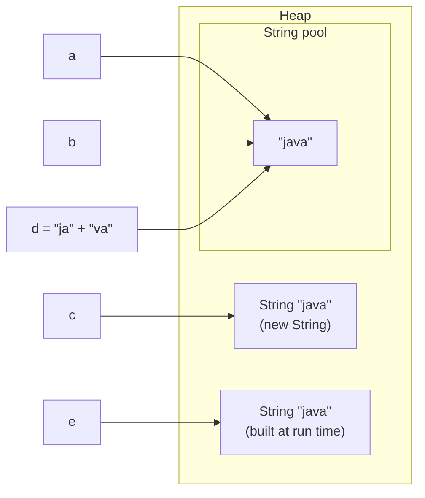

# 14. Strings and Text

> [!TIP]
> You're reading the **complete edition**, the reference guide with every deep dive and runnable sample. For a focused read, see this chapter on the [website edition](https://hikefromjava7.com/part5/ch14-strings-and-text/).

> **In this chapter:** why [`String`](https://docs.oracle.com/en/java/javase/25/docs/api/java.base/java/lang/String.html) is immutable, how the string pool works and where it moved in Java 7, the `==` trap, and the steady stream of string improvements from `String.join` in Java 8 to [text blocks](https://docs.oracle.com/javase/specs/jls/se25/html/jls-3.html#jls-3.10.6) in Java 15.

> [!TIP]
> **Key points**
>
> - `String` is **immutable**: methods like `concat` and `toUpperCase` return a new string. Use [`StringBuilder`](https://docs.oracle.com/en/java/javase/25/docs/api/java.base/java/lang/StringBuilder.html) (**Java 5**) to build text in loops.
> - String **literals** are pooled and shared. `new String("x")` always creates a new object. Compare with `equals()`, never `==`.
> - **Java 7** moved the pool from PermGen to the [heap](https://docs.oracle.com/javase/specs/jvms/se25/html/jvms-2.html#jvms-2.5.3). **Java 9** introduced compact strings and faster `+` concatenation.
> - New methods: `String.join` (**8**), `isBlank`, `strip`, `repeat`, `lines` (**11**), `formatted` (**15**).
> - **Text blocks** (**Java 15**) are multi-line literals with `"""`. String templates were previewed in Java 21–22 and **withdrawn**.

## Immutability

**Example:** [`code/ch14/Immutable.java`](../../code/ch14/Immutable.java) · [how to run it](../../code/ch14/README.md#immutablejava) · any Java

```java
public class Immutable {
    public static void main(String[] args) {
        String s = "hike";
        s.concat(" 27");  // returns a new String, which we discard
        s.toUpperCase();
        System.out.println(s);               // unchanged

        s = s.concat(" 27").toUpperCase(); // keep the result
        System.out.println(s);

        StringBuilder sb = new StringBuilder("hike");   // mutable (Java 5)
        sb.append(" 27").insert(0, "my ").reverse();
        System.out.println(sb);
    }
}
```

```text
hike
HIKE 27
72 ekih ym
```

Once created, a `String` never changes. Every "modifying" method returns a new string, so a call whose result you ignore does nothing. Immutability is why strings are safe to share between threads, safe as [`HashMap`](https://docs.oracle.com/en/java/javase/25/docs/api/java.base/java/util/HashMap.html) keys, and safe to pool.

When you build text piece by piece, use the mutable `StringBuilder`. Its older sibling `StringBuffer` (Java 1.0) does the same with synchronized methods, which you almost never need.

## The string pool

**Example:** [`code/ch14/StringPool.java`](../../code/ch14/StringPool.java) · [how to run it](../../code/ch14/README.md#stringpooljava) · any Java

```java
public class StringPool {
    public static void main(String[] args) {
        // literal: from the string pool
        String a = "java";
        // same pooled object
        String b = "java";
        // a new object on the heap, every time
        String c = new String("java");
        // compile-time constant: folded to "java"
        String d = "ja" + "va";
        String part = "ja";
        String e = part + "va";  // computed at run time: a new object

        System.out.println("a == b          " + (a == b));
        System.out.println("a == c          " + (a == c));
        System.out.println("a == d          " + (a == d));
        System.out.println("a == e          " + (a == e));
        System.out.println("a == e.intern() " + (a == e.intern()));
        System.out.println("a.equals(c)     " + a.equals(c));
    }
}
```

```text
a == b          true
a == c          false
a == d          true
a == e          false
a == e.intern() true
a.equals(c)     true
```



- Identical **literals** share one pooled object, so `a == b`.
- `"ja" + "va"` is a **compile-time constant**, so the compiler folds it into the literal `"java"`.
- `new String(...)` and run-time concatenation create **new** objects.
- `intern()` returns the pooled copy.

> [!NOTE]
> **The classic rule**
>
> *"Rule → `==` compares Reference ID, `equals()` compares data."*
>
> The most important string rule there is. The pool makes `==` *sometimes* work, which is worse than never working.

> [!WARNING]
> **A common misconception**
>
> Java 7-era explanations often said the pool lives in the class (method) area and that *"Garbage Collection is never done on a String object kept in the String constant pool."* That described Java 6. **Java 7 moved interned strings to the main heap**, and pooled strings that nothing references anymore *can* be garbage collected. One reason for the move was that heavy `intern()` use used to crash applications with `OutOfMemoryError: PermGen space`.

## Concatenation

**Example:** [`code/ch14/ConcatOperator.java`](../../code/ch14/ConcatOperator.java) · [how to run it](../../code/ch14/README.md#concatoperatorjava) · any Java

```java
public class ConcatOperator {
    public static void main(String[] args) {
        // left to right: 3 + "3"
        System.out.println(1 + 2 + "3");
        // "12" + 3
        System.out.println("1" + 2 + 3);
        // char + char is an int: 195 + "c"
        System.out.println('a' + 'b' + "c");
        System.out.println("a" + 'b' + 'c');
        String nothing = null;
        System.out.println("value: " + nothing);
    }
}
```

```text
33
123
195c
abc
value: null
```

`+` is evaluated left to right, and it only means concatenation once a `String` is involved. `1 + 2 + "3"` adds first, then concatenates. Two `char`s add as numbers ('a' is 97, 'b' is 98). `null` concatenates as the text `"null"`.

> [!NOTE]
> **The classic rule**
>
> *"Rule → Whenever we are doing String concatenation using the + operator, one operand must be a String."*

> [!NOTE]
> **What changed: faster `+` (Java 9)**
>
> Before Java 9, [`javac`](https://docs.oracle.com/en/java/javase/25/docs/specs/man/javac.html) compiled `a + b + c` into a chain of `StringBuilder.append` calls. Java 9 ([JEP 280](https://openjdk.org/jeps/280)) compiles it to a single `invokedynamic` call, letting the JVM choose the best strategy at run time, which is often faster and allocates less. The old advice "never use `+`, always use `StringBuilder`" now applies only to loops, where each iteration would otherwise build a new string.

Java 9 also made strings smaller in memory with **compact strings** (Chapter 2): Latin-1 text uses one byte per character.

## Splitting text

**Example:** [`code/ch14/SplitVsTokenizer.java`](../../code/ch14/SplitVsTokenizer.java) · [how to run it](../../code/ch14/README.md#splitvstokenizerjava) · any Java

```java
import java.util.StringTokenizer;

public class SplitVsTokenizer {
    public static void main(String[] args) {
        String line = "java,  seven ,,twenty-seven";

        // legacy, but still works
        StringTokenizer st = new StringTokenizer(line, ", ");
        StringBuilder tokens = new StringBuilder();
        while (st.hasMoreTokens()) {
            tokens.append(tokens.length() == 0 ? "" : "|");
            tokens.append(st.nextToken());
        }
        System.out.println("StringTokenizer: " + tokens);

        // keeps empties
        System.out.println("split(\",\"):    "
                + String.join("|", line.split(",")));
        System.out.println("split regex:     "
                + String.join("|", line.split("\\s*,+\\s*")));
    }
}
```

```text
StringTokenizer: java|seven|twenty-seven
split(","):    java|  seven ||twenty-seven
split regex:     java|seven|twenty-seven
```

Java 7-era code often used [`StringTokenizer`](https://docs.oracle.com/en/java/javase/25/docs/api/java.base/java/util/StringTokenizer.html), which still works but is a legacy class. `String.split` takes a regular expression, keeps empty fields between separators, and is the usual choice today. For heavy parsing, `Scanner` or `java.util.regex.Pattern` give more control.

## Fifteen years of new string methods

**Example:** [`code/ch14/ModernStringMethods.java`](../../code/ch14/ModernStringMethods.java) · [how to run it](../../code/ch14/README.md#modernstringmethodsjava) · Java 15+

```java
public class ModernStringMethods {
    public static void main(String[] args) {
        // em spaces: Unicode whitespace
        String padded = "\u2003 Java \u2003";
        // trim removes only chars <= ' '
        System.out.println("trim()  length " + padded.trim().length());
        // Java 11: Unicode-aware
        System.out.println("strip() length " + padded.strip().length());
        System.out.println("   ".isBlank());                // Java 11
        System.out.println("ab".repeat(3));                 // Java 11
        System.out.println("one\ntwo\nthree".lines().count());   // Java 11
        System.out.println(String.join(" -> ", "7", "17", "27"));  // Java 8
        System.out.println("Java %d is %s".formatted(27, "here")); // Java 15
    }
}
```

```text
trim()  length 8
strip() length 4
true
ababab
3
7 -> 17 -> 27
Java 27 is here
```

| Release | Added |
|---|---|
| Java 7 | `switch` on strings (Chapter 3) |
| Java 8 | `String.join`, `StringJoiner` |
| Java 11 | `isBlank`, `strip`/`stripLeading`/`stripTrailing` (Unicode-aware), `repeat`, `lines` |
| Java 12 | `indent`, `transform` |
| Java 15 | text blocks, `formatted`, `stripIndent`, `translateEscapes` |
| Java 21 | `StringBuilder.repeat`, `String.indexOf(ch, from, to)`, `splitWithDelimiters` |

`trim()` removes only characters up to `' '` (code 32), so it leaves Unicode spaces such as the em space in place. `strip()` removes all Unicode whitespace, which is why it returned the shorter result. Prefer `strip()` in new code.

## Text blocks (Java 15)

**Example:** [`code/ch14/TextBlocks.java`](../../code/ch14/TextBlocks.java) · [how to run it](../../code/ch14/README.md#textblocksjava) · Java 15+

```java
public class TextBlocks {
    public static void main(String[] args) {
        String java7 = "{\n" +
                       "  \"title\": \"A Hike from Java 7\",\n" +
                       "  \"chapters\": 20\n" +
                       "}";

        // Java 15: text block
        String java15 = """
                {
                  "title": "A Hike from Java 7",
                  "chapters": 20
                }""";

        System.out.println(java15);
        System.out.println("same text: " + java7.equals(java15));

        // \ at a line end joins it to the next line (Java 15)
        String sql = """
                SELECT name
                  FROM releases
                 WHERE lts = true \
                ORDER BY year""";
        System.out.println(sql);
    }
}
```

```text
{
  "title": "A Hike from Java 7",
  "chapters": 20
}
same text: true
SELECT name
  FROM releases
 WHERE lts = true ORDER BY year
```

A **text block** ([JEP 378](https://openjdk.org/jeps/378)) starts with `"""` and a line break. The compiler removes the common indentation (based on the closing `"""` or the least-indented line), normalizes line endings to `\n`, and lets you write quotes without escaping. A trailing `\` joins a line with the next. The result is an ordinary `String`, identical to the escaped version.

> [!WARNING]
> **String templates came and went**
>
> Java 21 and 22 previewed **string templates** (`STR."Hello \{name}"`). Java 23 withdrew the feature for redesign, so it isn't in Java 25 or 27. Use `formatted`, `String.format` or `MessageFormat` instead, and don't build production code on preview features.

## Exercises

1. Build a 10,000-word string with `+=` in a loop and with `StringBuilder`, and time both. Then compare `String.join` with a stream's `Collectors.joining`.
2. Predict `"a" + 1 + 2` and `1 + 2 + "a" + 1 + 2`, then check.
3. Write an HTML snippet as a text block and use `formatted` to insert a title.
4. Find every `trim()` in your code base. Which could receive non-ASCII whitespace?

## IQ corner

1. **Why is `String` immutable?** For safe sharing, pooling, use as hash keys and security (strings carry class names, file paths and URLs).
2. **How many objects does `new String("java")` create?** At most two: the pooled literal (if not already present) and the new heap object.
3. **Where is the string pool?** On the heap, since Java 7.
4. **`StringBuffer` vs `StringBuilder`?** Same API; `StringBuffer` is synchronized and slower. Use `StringBuilder`.
5. **`trim()` vs `strip()`?** `strip()` (Java 11) understands Unicode whitespace; `trim()` doesn't.

## Summary

- Strings are immutable; build text with `StringBuilder`.
- Literals are pooled (on the heap since Java 7); compare with `equals`.
- Java 9 made strings smaller and `+` faster.
- Text blocks (15) and many new methods (8, 11, 15, 21) modernized string handling; string templates were withdrawn.

**Next:** Chapter 15 covers the wrapper classes and boxing, including the cache that makes `127 == 127` true and `128 == 128` false.
