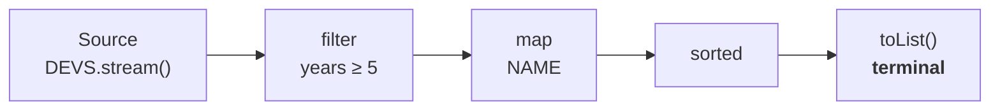
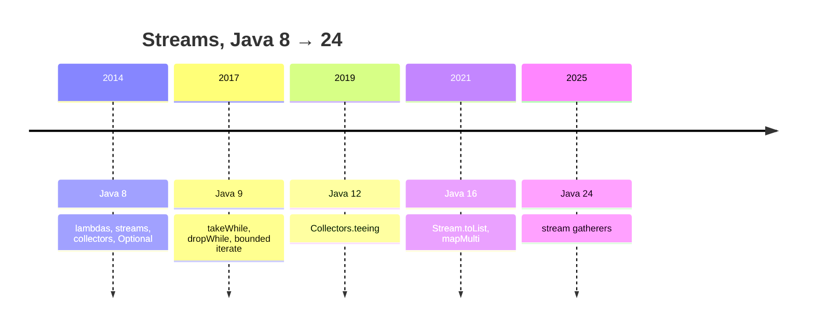

# 16. Functional Java: Streams

> [!TIP]
> You're reading the **complete edition**, the reference guide with every deep dive and runnable sample. For a focused read, see this chapter on the [website edition](https://hikefromjava7.com/part6/ch16-functional-java-streams/).

> **In this chapter:** the biggest change in Java's history. How streams express "what" instead of "how," why they're lazy, the collectors that replaced pages of loop code, and the additions from Java 9 through Java 24's gatherers.

> [!TIP]
> **Key points**
>
> - A stream pipeline is **source → intermediate operations → one terminal operation**: `list.stream().filter(…).map(…).toList()` (**Java 8**; `toList()` **Java 16**).
> - Streams are **lazy**: nothing runs until the terminal operation, and elements flow through one at a time, so `findFirst` can stop early.
> - **Collectors** group, partition, count and join: `groupingBy`, `partitioningBy`, `joining`.
> - `Optional` (**Java 8**) represents "maybe a value." Use it for return types, not fields or parameters.
> - Later additions: `takeWhile`, `dropWhile`, bounded `iterate` (**9**), `teeing` (**12**), `mapMulti` (**16**), and **gatherers** (**24**) for custom intermediate operations.

## From "how" to "what"

**Example:** [`code/ch16/LoopVsStream.java`](../../code/ch16/LoopVsStream.java) · [how to run it](../../code/ch16/README.md#loopvsstreamjava) · Java 16+

```java
import java.util.ArrayList;
import java.util.Collections;
import java.util.List;

public class LoopVsStream {
    record Dev(String name, String team, int years) { }

    static final List<Dev> DEVS = List.of(
            new Dev("Asha", "platform", 9), new Dev("Ravi", "mobile", 3),
            new Dev("Mia", "platform", 6), new Dev("Leo", "web", 5), new Dev("Zoe", "platform", 2));

    public static void main(String[] args) {
        // Java 7: say how
        List<String> seniors7 = new ArrayList<>();
        for (Dev d : DEVS) {
            if (d.years() >= 5) seniors7.add(d.name().toUpperCase());
        }
        Collections.sort(seniors7);
        System.out.println(seniors7);

        // Java 8+: say what
        List<String> seniors = DEVS.stream()
                .filter(d -> d.years() >= 5)
                .map(d -> d.name().toUpperCase())
                .sorted()
                .toList();                              // Java 16 (collect(Collectors.toList()) in 8)
        System.out.println(seniors);

        int totalYears = DEVS.stream().mapToInt(Dev::years).sum();
        System.out.println("total years: " + totalYears);
    }
}
```

```text
[ASHA, LEO, MIA]
[ASHA, LEO, MIA]
total years: 25
```

The Java 7 version tells the computer **how**: make a list, loop, test, add, sort. The stream version says **what**: the names of developers with five or more years, uppercased and sorted. Each step is one line, and the order of steps reads like the requirement.



- A **source** creates the stream: a collection, an array (`Arrays.stream`), `Stream.of`, a file's lines (`Files.lines`), a range (`IntStream.range`).
- **Intermediate operations** (`filter`, `map`, `sorted`, `distinct`, `limit`, `flatMap`…) return a new stream.
- One **terminal operation** (`toList`, `collect`, `forEach`, `count`, `sum`, `findFirst`, `anyMatch`…) produces a result and ends the stream. A stream can't be reused.
- Primitive streams (`IntStream`, `LongStream`, `DoubleStream`) avoid boxing and add `sum`, `average` and `range`.

## Laziness

**Example:** [`code/ch16/Laziness.java`](../../code/ch16/Laziness.java) · [how to run it](../../code/ch16/README.md#lazinessjava) · Java 8+

```java
import java.util.List;

public class Laziness {
    public static void main(String[] args) {
        String first = List.of("seven", "eleven", "seventeen", "twenty-one", "twenty-seven").stream()
                .peek(s -> System.out.println("  looking at " + s))
                .filter(s -> s.startsWith("twenty"))
                .map(String::toUpperCase)
                .findFirst()                           // short-circuits: stops at the first match
                .orElse("none");
        System.out.println("found " + first);
    }
}
```

```text
  looking at seven
  looking at eleven
  looking at seventeen
  looking at twenty-one
found TWENTY-ONE
```

Elements don't pass through each stage as a batch. Each element travels down the whole pipeline before the next one starts, and `findFirst` stops the stream as soon as it has an answer. "twenty-seven" was never looked at. This is also why intermediate operations alone do nothing: without a terminal operation, there's no one to pull elements through.

> [!WARNING]
> **Streams are not always better**
>
> Streams shine for transforming and summarizing data. They're a poor fit for code with complex control flow, side effects, or checked exceptions in the lambdas. `parallel()` is not a free speed-up either: it pays off only for large, CPU-bound, easily split workloads. A plain loop is still fine Java.

## Collectors

**Example:** [`code/ch16/Grouping.java`](../../code/ch16/Grouping.java) · [how to run it](../../code/ch16/README.md#groupingjava) · Java 16+

```java
import java.util.List;
import java.util.Map;
import java.util.TreeMap;
import java.util.stream.Collectors;

public class Grouping {
    record Release(int version, int year, boolean lts) { }

    public static void main(String[] args) {
        List<Release> releases = List.of(
                new Release(8, 2014, true), new Release(11, 2018, true), new Release(17, 2021, true),
                new Release(21, 2023, true), new Release(22, 2024, false), new Release(23, 2024, false),
                new Release(25, 2025, true), new Release(26, 2026, false), new Release(27, 2026, false));

        Map<Integer, Long> perYear = releases.stream()
                .collect(Collectors.groupingBy(Release::year, TreeMap::new, Collectors.counting()));
        System.out.println(perYear);

        Map<Boolean, List<Integer>> byLts = releases.stream()
                .collect(Collectors.partitioningBy(Release::lts,
                         Collectors.mapping(Release::version, Collectors.toList())));
        System.out.println("LTS " + byLts.get(true) + "  non-LTS " + byLts.get(false));

        String joined = releases.stream().filter(Release::lts)
                .map(r -> "Java " + r.version()).collect(Collectors.joining(", ", "[", "]"));
        System.out.println(joined);
    }
}
```

```text
{2014=1, 2018=1, 2021=1, 2023=1, 2024=2, 2025=1, 2026=2}
LTS [8, 11, 17, 21, 25]  non-LTS [22, 23, 26, 27]
[Java 8, Java 11, Java 17, Java 21, Java 25]
```

In Java 7, "count releases per year" meant a `Map`, a loop, and the "get, check for null, put" dance. `Collectors.groupingBy` does it in one expression, with optional arguments for the map type (`TreeMap::new` gives sorted keys) and a downstream collector (`counting()`, `mapping(…)`, `toList()`).

## `Optional`

**Example:** [`code/ch16/OptionalDemo.java`](../../code/ch16/OptionalDemo.java) · [how to run it](../../code/ch16/README.md#optionaldemojava) · Java 11+

```java
import java.util.Map;
import java.util.Optional;

public class OptionalDemo {
    static final Map<String, String> EMAILS = Map.of("asha", "asha@example.com");

    static Optional<String> email(String user) {           // Java 8: "maybe a value"
        return Optional.ofNullable(EMAILS.get(user));
    }

    public static void main(String[] args) {
        System.out.println(email("asha").map(String::toUpperCase).orElse("no email"));
        System.out.println(email("ravi").map(String::toUpperCase).orElse("no email"));
        System.out.println(email("ravi").isEmpty());                         // Java 11
        email("asha").ifPresentOrElse(e -> System.out.println("send to " + e),
                                      () -> System.out.println("skip"));      // Java 9
    }
}
```

```text
ASHA@EXAMPLE.COM
no email
true
send to asha@example.com
```

`Optional<T>` makes "there might not be a result" part of a method's type, so callers can't forget to handle it. Chain `map`, `filter` and `orElse` instead of `if (x != null)` checks. Java 9 added `ifPresentOrElse`, `or` and `stream`; Java 11 added `isEmpty`.

> [!IMPORTANT]
> **Use `Optional` where it helps**
>
> Return `Optional` from methods that may have no result. Don't use it for fields, method parameters or collections (return an empty list instead), and never call `get()` without checking. `orElseThrow()` (Java 10) says what you mean.

## Newer stream operations

**Example:** [`code/ch16/NewerStreamOps.java`](../../code/ch16/NewerStreamOps.java) · [how to run it](../../code/ch16/README.md#newerstreamopsjava) · Java 16+

```java
import java.util.List;
import java.util.stream.Collectors;
import java.util.stream.Stream;

public class NewerStreamOps {
    public static void main(String[] args) {
        List<Integer> sorted = List.of(2, 4, 6, 7, 8, 10);
        System.out.println(sorted.stream().takeWhile(n -> n % 2 == 0).toList());   // Java 9
        System.out.println(sorted.stream().dropWhile(n -> n % 2 == 0).toList());   // Java 9

        System.out.println(Stream.iterate(7, v -> v <= 27, v -> v + 10).toList()); // Java 9

        double avg = Stream.of(7, 17, 27).collect(Collectors.teeing(               // Java 12
                Collectors.summingInt(n -> n), Collectors.counting(), (sum, count) -> (double) sum / count));
        System.out.println(avg);

        List<String> words = Stream.of("java", "seven").<String>mapMulti((w, sink) -> {  // Java 16
            sink.accept(w);
            sink.accept(w.toUpperCase());
        }).toList();
        System.out.println(words);
    }
}
```

```text
[2, 4, 6]
[7, 8, 10]
[7, 17, 27]
17.0
[java, JAVA, seven, SEVEN]
```

| Release | Addition |
|---|---|
| Java 9 | `takeWhile`, `dropWhile`, `iterate(seed, hasNext, next)`, `ofNullable` |
| Java 10 | `Collectors.toUnmodifiableList` and friends |
| Java 12 | `Collectors.teeing`: two collectors, one merged result |
| Java 16 | `Stream.toList()`, `mapMulti` |
| Java 24 | `Stream.gather` and the `Gatherers` class |

## Gatherers (Java 24)

Before Java 24 you could write your own **terminal** operation (a custom `Collector`), but not your own **intermediate** one. Things like "group into windows of three" required collecting everything first. **Gatherers** ([JEP 485](https://openjdk.org/jeps/485)) fill that gap:

**Example:** [`code/ch16/GathererDemo.java`](../../code/ch16/GathererDemo.java) · [how to run it](../../code/ch16/README.md#gathererdemojava) · Java 24+

```java
import java.util.List;
import java.util.stream.Gatherers;
import java.util.stream.Stream;

public class GathererDemo {
    public static void main(String[] args) {
        List<List<Integer>> windows = Stream.of(1, 2, 3, 4, 5, 6, 7)
                .gather(Gatherers.windowFixed(3))            // Java 24
                .toList();
        System.out.println(windows);

        List<List<Integer>> sliding = Stream.of(1, 2, 3, 4)
                .gather(Gatherers.windowSliding(2))
                .toList();
        System.out.println(sliding);
    }
}
```

```text
[[1, 2, 3], [4, 5, 6], [7]]
[[1, 2], [2, 3], [3, 4]]
```

`Gatherers` provides built-ins such as `windowFixed`, `windowSliding`, `fold`, `scan` and `mapConcurrent`, and you can write your own with `Gatherer.of(...)`.

## The journey at a glance



## Exercises

1. Using the `Grouping` data, find the average number of releases per year with `teeing`.
2. Rewrite a loop from your own code as a stream. Was it clearer?
3. Use `Files.lines(path)` in try-with-resources to count the non-blank lines in a source file.
4. With `Gatherers.windowSliding(3)`, compute a three-point moving average over a list of daily numbers (needs Java 24).

## IQ corner

1. **Intermediate vs. terminal operations?** Intermediate ones return a stream and are lazy; a terminal one produces a result and triggers the work.
2. **Can a stream be reused?** No. Create a new one from the source.
3. **`map` vs. `flatMap`?** `map` turns each element into one element; `flatMap` turns each into a stream and flattens the results.
4. **`toList()` vs. `collect(Collectors.toList())`?** `toList()` (Java 16) returns an unmodifiable list; the collector's list is modifiable in practice but makes no promise.
5. **When would you not use a parallel stream?** Small data, I/O-bound work, shared mutable state, or order-sensitive operations.

## Summary

- Streams (Java 8) describe data transformations as pipelines; they're lazy and single-use.
- Collectors turn grouping, counting and joining into one expression. `Optional` models "maybe."
- Java 9–16 filled gaps; Java 24's gatherers allow custom intermediate operations.

**Next:** Chapter 17 replaces `Date` and `Calendar` with `java.time`.
