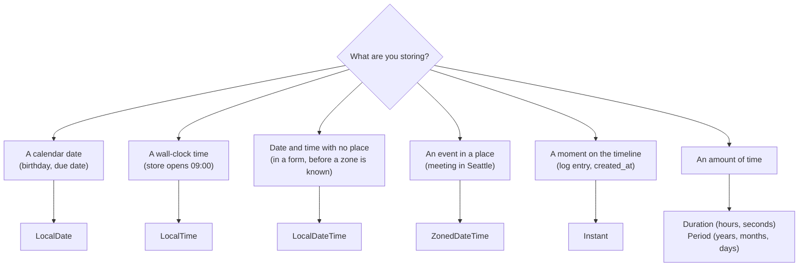

# 17. Dates and Times

> [!TIP]
> You're reading the **complete edition**, the reference guide with every deep dive and runnable sample. For a focused read, see this chapter on the [website edition](https://hikefromjava7.com/part6/ch17-dates-and-times/).

> **In this chapter:** why `java.util.Date` and [`Calendar`](https://docs.oracle.com/en/java/javase/25/docs/api/java.base/java/util/Calendar.html) caused so many bugs, and how Java 8's `java.time` fixed them with immutable types that say exactly what they mean: a date, a time, a moment, or a duration.

> [!TIP]
> **Key points**
>
> - Java 7's `Date` is mutable, `Calendar` months start at **0**, `Date.getYear()` counts from **1900**, and [`SimpleDateFormat`](https://docs.oracle.com/en/java/javase/25/docs/api/java.base/java/text/SimpleDateFormat.html) isn't thread-safe.
> - **Java 8**'s `java.time` ([JSR 310](https://jcp.org/en/jsr/detail?id=310)) has immutable, thread-safe types: [`LocalDate`](https://docs.oracle.com/en/java/javase/25/docs/api/java.base/java/time/LocalDate.html), `LocalTime`, [`LocalDateTime`](https://docs.oracle.com/en/java/javase/25/docs/api/java.base/java/time/LocalDateTime.html), [`ZonedDateTime`](https://docs.oracle.com/en/java/javase/25/docs/api/java.base/java/time/ZonedDateTime.html), [`Instant`](https://docs.oracle.com/en/java/javase/25/docs/api/java.base/java/time/Instant.html), [`Duration`](https://docs.oracle.com/en/java/javase/25/docs/api/java.base/java/time/Duration.html), [`Period`](https://docs.oracle.com/en/java/javase/25/docs/api/java.base/java/time/Period.html).
> - Pick by meaning: a birthday is a `LocalDate`, a meeting is a `ZonedDateTime`, a log timestamp is an `Instant`.
> - `ZonedDateTime` handles daylight saving time correctly. [`DateTimeFormatter`](https://docs.oracle.com/en/java/javase/25/docs/api/java.base/java/time/format/DateTimeFormatter.html) is immutable and safe to share.

## The trouble with `Date` and `Calendar`

**Example:** [`code/ch17/OldDateTraps.java`](../../code/ch17/OldDateTraps.java) · [how to run it](../../code/ch17/README.md#olddatetrapsjava) · any Java

```java
import java.text.SimpleDateFormat;
import java.util.Calendar;
import java.util.Date;
import java.util.GregorianCalendar;
import java.util.Locale;
import java.util.TimeZone;

public class OldDateTraps {
    public static void main(String[] args) {
        // the old API silently uses a global default
        TimeZone.setDefault(TimeZone.getTimeZone("UTC"));
        // month 7 is AUGUST: months start at 0
        Calendar cal = new GregorianCalendar(2013, 7, 1);
        SimpleDateFormat fmt = new SimpleDateFormat("yyyy-MM-dd", Locale.US);
        System.out.println("asked for 2013-7-1, got "
                + fmt.format(cal.getTime()));

        Date date = cal.getTime();
        Date copy = date;
        copy.setTime(0);  // Date is mutable: shared objects change
        System.out.println("original changed too: " + (date.getTime() == 0));
        System.out.println("year field of new Date(0): "
                + new Date(0).getYear() + " (years since 1900)");
    }
}
```

```text
asked for 2013-7-1, got 2013-08-01
original changed too: true
year field of new Date(0): 70 (years since 1900)
```

Each line is a real-world bug:

- **Zero-based months.** `new GregorianCalendar(2013, 7, 1)` is 1 **August**. Everyone writes `7` for July at least once.
- **Mutability.** `Date` has setters, so a `Date` passed to another object or returned from a getter can be changed behind your back. Defensive copies everywhere were the Java 7 workaround.
- **Strange offsets.** `getYear()` returns the year minus 1900, and it has been deprecated since Java 1.1.
- **Hidden global state.** These APIs quietly use the JVM's default time zone, which is why the sample pins it to UTC. On a machine in California, `new Date(0)` falls on 31 December **1969**.
- **`SimpleDateFormat` isn't thread-safe**, so sharing one as a `static` field corrupts results under load.

## `java.time` (Java 8)

Java 8 replaced all of this with `java.time`, developed through JSR 310, which was led by Stephen Colebourne, the author of the popular Joda-Time library. Every type is **immutable** and **thread-safe**, and each represents exactly one concept:



**Example:** [`code/ch17/JavaTimeBasics.java`](../../code/ch17/JavaTimeBasics.java) · [how to run it](../../code/ch17/README.md#javatimebasicsjava) · Java 8+

```java
import java.time.DayOfWeek;
import java.time.LocalDate;
import java.time.Month;
import java.time.Period;
import java.time.temporal.ChronoUnit;
import java.time.temporal.TemporalAdjusters;

public class JavaTimeBasics {
    public static void main(String[] args) {
        // months are 1-based, or use the enum
        LocalDate start = LocalDate.of(2013, Month.JULY, 1);
        LocalDate book = LocalDate.of(2026, 11, 21);
        System.out.println(start + " was a " + start.getDayOfWeek());
        // returns a new object
        System.out.println("plus one month: " + start.plusMonths(1));
        System.out.println("start unchanged: " + start);

        Period gap = Period.between(start, book);
        System.out.println("gap: " + gap + " = " + gap.getYears() + " years, "
                + gap.getMonths() + " months, " + gap.getDays() + " days");
        System.out.println("days: " + ChronoUnit.DAYS.between(start, book));

        System.out.println("2024 leap? "
                + LocalDate.of(2024, 1, 1).isLeapYear());
        LocalDate release = LocalDate.of(2026, 9, 15);
        System.out.println("next Monday after release day: "
                + release.with(TemporalAdjusters.next(DayOfWeek.MONDAY)));
    }
}
```

```text
2013-07-01 was a MONDAY
plus one month: 2013-08-01
start unchanged: 2013-07-01
gap: P13Y4M20D = 13 years, 4 months, 20 days
days: 4891
2024 leap? true
next Monday after release day: 2026-09-21
```

- Months are 1-based, or use the `Month` [enum](https://docs.oracle.com/javase/specs/jls/se25/html/jls-8.html#jls-8.9).
- `plusMonths` returns a **new** date; the original is unchanged.
- `Period` measures in calendar units; `ChronoUnit.DAYS.between` counts days exactly.
- `TemporalAdjusters` answer questions like "next Monday" or "last day of the month."

## Time zones and daylight saving

**Example:** [`code/ch17/ZonesAndDst.java`](../../code/ch17/ZonesAndDst.java) · [how to run it](../../code/ch17/README.md#zonesanddstjava) · Java 8+

```java
import java.time.Duration;
import java.time.Instant;
import java.time.LocalDateTime;
import java.time.ZoneId;
import java.time.ZonedDateTime;

public class ZonesAndDst {
    public static void main(String[] args) {
        ZoneId seattle = ZoneId.of("America/Los_Angeles");
        ZonedDateTime beforeJump = ZonedDateTime.of(
                LocalDateTime.of(2026, 3, 8, 1, 30), seattle);
        // clocks jump from 2:00 to 3:00
        ZonedDateTime oneHourLater = beforeJump.plusHours(1);
        System.out.println(beforeJump);
        System.out.println(oneHourLater);
        System.out.println("elapsed: "
                + Duration.between(beforeJump, oneHourLater));

        // a point on the timeline, in UTC
        Instant release = Instant.parse("2026-09-15T17:00:00Z");
        ZoneId kolkata = ZoneId.of("Asia/Kolkata");
        System.out.println("in Kolkata: "
                + release.atZone(kolkata).toLocalDateTime());
        System.out.println("in Seattle: "
                + release.atZone(seattle).toLocalDateTime());
    }
}
```

```text
2026-03-08T01:30-08:00[America/Los_Angeles]
2026-03-08T03:30-07:00[America/Los_Angeles]
elapsed: PT1H
in Kolkata: 2026-09-15T22:30
in Seattle: 2026-09-15T10:00
```

On 8 March 2026, US clocks jumped from 2:00 to 3:00. Adding one hour to 01:30 correctly gives 03:30, and the elapsed time is still exactly one hour. An `Instant` is one point in time; `atZone` shows what clocks read at that moment in different places. The zone rules come from the IANA time-zone database bundled with the JDK and updated in JDK releases.

> [!IMPORTANT]
> **Store instants, display zones**
>
> Store timestamps as `Instant` (UTC). Convert to a `ZonedDateTime` only to show them to a person. Use `ZoneId.of("America/Los_Angeles")`-style region IDs, never fixed offsets like `-08:00`, for future events, because offsets change with daylight saving and with politics.

## Formatting and parsing

**Example:** [`code/ch17/Formatting.java`](../../code/ch17/Formatting.java) · [how to run it](../../code/ch17/README.md#formattingjava) · Java 8+

```java
import java.time.LocalDate;
import java.time.format.DateTimeFormatter;
import java.time.format.DateTimeParseException;
import java.util.Locale;

public class Formatting {
    public static void main(String[] args) {
        // immutable, thread-safe
        DateTimeFormatter f =
                DateTimeFormatter.ofPattern("dd MMM uuuu", Locale.US);
        LocalDate d = LocalDate.of(2013, 7, 1);
        System.out.println(d.format(f));
        System.out.println(LocalDate.parse("21 Nov 2026", f));
        System.out.println(d.format(DateTimeFormatter.ISO_DATE));
        try {
            LocalDate.parse("2026-02-30");
        } catch (DateTimeParseException e) {
            System.out.println("rejected: " + e.getMessage());
        }
    }
}
```

```text
01 Jul 2013
2026-11-21
2013-07-01
rejected: Text '2026-02-30' could not be parsed: Invalid date 'FEBRUARY 30'
```

`DateTimeFormatter` is immutable, so one instance can be a shared constant. ISO formats (`2026-11-21`) are the default for `toString` and `parse`. Invalid dates are rejected instead of silently rolling over, as the old `lenient` `Calendar` did.

> [!WARNING]
> **`yyyy` vs `uuuu`, and locales**
>
> In patterns, `uuuu` is the proleptic year and `yyyy` is year-of-era. They agree for modern dates, but `uuuu` behaves better with strict parsing. Always pass a `Locale` for month names (the sample uses `Locale.US`): since Java 9 the JDK uses CLDR locale data, and some locales abbreviate months differently than you might expect.

### Bridging old and new

Legacy APIs still hand you `Date`s. Convert at the boundary: `date.toInstant()` and `Date.from(instant)`, `calendar.toZonedDateTime()`, and `java.sql.Date.valueOf(localDate)` for JDBC (which also supports `java.time` types directly since JDBC 4.2).

## Exercises

1. Compute your age in years, months and days with `Period.between`.
2. Find every Friday the 13th in 2026 with a stream of dates (`LocalDate.datesUntil`, Java 9).
3. Schedule a weekly meeting at 09:00 in Seattle and print its next five occurrences in UTC across the November daylight-saving change.
4. Replace a shared `static SimpleDateFormat` in old code with a `DateTimeFormatter` constant.

## IQ corner

1. **Why is `SimpleDateFormat` dangerous as a static field?** It isn't thread-safe; concurrent use corrupts results.
2. **`Instant` vs. `LocalDateTime`?** An `Instant` is a moment on the UTC timeline. A `LocalDateTime` has no zone, so it isn't a moment until you add one.
3. **`Duration` vs. `Period`?** `Duration` is time-based (seconds, nanoseconds); `Period` is date-based (years, months, days).
4. **Are `java.time` objects mutable?** No. Every "change" returns a new object.
5. **What's the first month in `java.time`?** January = 1.

## Summary

- `Date`/`Calendar` were mutable, zero-based and zone-confused.
- Java 8's `java.time` types are immutable and specific: choose by what the value means.
- Store `Instant`s, display `ZonedDateTime`s, format with shared `DateTimeFormatter`s.

**Next:** Chapter 18 tackles concurrency, from raw threads to Java 21's virtual threads.
