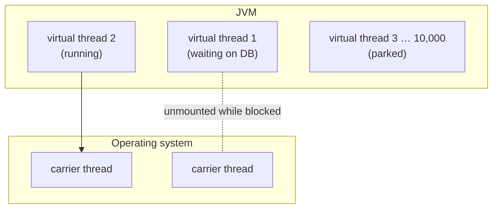

# 18. Concurrency: Threads → Virtual Threads

> [!TIP]
> You're reading the **complete edition**, the reference guide with every deep dive and runnable sample. For a focused read, see this chapter on the [website edition](https://hikefromjava7.com/part6/ch18-concurrency/).

> **In this chapter:** why shared data breaks under concurrency, the toolkit Java 5 introduced, Java 8's [`CompletableFuture`](https://docs.oracle.com/en/java/javase/25/docs/api/java.base/java/util/concurrent/CompletableFuture.html), and the Java 21 change that made blocking code scale again: virtual threads. Then Java 25's scoped values, and where structured concurrency stands in Java 27.

> [!TIP]
> **Key points**
>
> - Two threads updating the same variable can **lose updates**. Fix it with `synchronized`, locks, or atomic classes such as `AtomicInteger` (**Java 5**).
> - Don't manage threads by hand: use an [`ExecutorService`](https://docs.oracle.com/en/java/javase/25/docs/api/java.base/java/util/concurrent/ExecutorService.html) (**Java 5**). Combine async results with `CompletableFuture` (**Java 8**).
> - **Virtual threads** (**Java 21**) are cheap threads managed by the JVM. Millions can block on I/O at once. Use one per task: `Executors.newVirtualThreadPerTaskExecutor()`.
> - **Scoped values** (**Java 25**) share per-call context safely; they're a better `ThreadLocal`.
> - **Structured concurrency** treats related tasks as one unit. It's still a **preview** in Java 27.

## The problem: shared, mutable state

**Example:** [`code/ch18/SafeCounting.java`](../../code/ch18/SafeCounting.java) · [how to run it](../../code/ch18/README.md#safecountingjava) · any Java

```java
import java.util.ArrayList;
import java.util.List;
import java.util.concurrent.atomic.AtomicInteger;

public class SafeCounting {
    static int unsafe = 0;                                   // shown only to explain the race
    static int locked = 0;
    static final Object LOCK = new Object();
    static final AtomicInteger atomic = new AtomicInteger(); // Java 5

    public static void main(String[] args) throws InterruptedException {
        List<Thread> threads = new ArrayList<>();
        for (int t = 0; t < 4; t++) {
            Thread th = new Thread(() -> {
                for (int i = 0; i < 100_000; i++) {
                    unsafe++;                                  // read, add, write: not atomic
                    synchronized (LOCK) { locked++; }          // one thread at a time
                    atomic.incrementAndGet();                  // a single atomic CPU operation
                }
            });
            threads.add(th);
            th.start();
        }
        for (Thread th : threads) th.join();                   // wait for all four
        System.out.println("synchronized: " + locked);
        System.out.println("atomic:       " + atomic.get());
        System.out.println("unsafe <= 400000: " + (unsafe <= 400_000));   // usually less: lost updates
    }
}
```

```text
synchronized: 400000
atomic:       400000
unsafe <= 400000: true
```

`unsafe++` looks like one step but is three: read, add, write. Two threads can read the same value, both add one, and both write it back, so one increment disappears. The unsafe count usually ends up below 400,000, and differs on every run, which is what makes these bugs so hard to reproduce.

- **`synchronized`** lets one thread at a time into a block guarded by a lock object.
- **Atomic classes** (`AtomicInteger`, `AtomicLong`, `LongAdder` from Java 8) use CPU instructions that read-modify-write in one indivisible step.
- **Immutable objects** (records, [`List.of`](https://docs.oracle.com/en/java/javase/25/docs/api/java.base/java/util/List.html), `java.time`) can't be corrupted at all, which is why modern Java leans on them.

## Java 5: executors instead of threads

Creating a `new Thread` for every task is expensive and unbounded. Java 5's `java.util.concurrent` ([JSR 166](https://jcp.org/en/jsr/detail?id=166), led by Doug Lea) separated *what to run* from *which thread runs it*:

**Example:** [`code/ch18/ExecutorsDemo.java`](../../code/ch18/ExecutorsDemo.java) · [how to run it](../../code/ch18/README.md#executorsdemojava) · Java 8+

```java
import java.util.ArrayList;
import java.util.List;
import java.util.concurrent.Callable;
import java.util.concurrent.ExecutorService;
import java.util.concurrent.Executors;
import java.util.concurrent.Future;

public class ExecutorsDemo {
    public static void main(String[] args) throws Exception {
        ExecutorService pool = Executors.newFixedThreadPool(4);        // Java 5
        try {
            List<Callable<Integer>> jobs = new ArrayList<>();
            for (int chapter = 1; chapter <= 20; chapter++) {
                final int c = chapter;
                jobs.add(() -> c * 10);                                // pretend: pages in chapter c
            }
            int total = 0;
            for (Future<Integer> f : pool.invokeAll(jobs)) total += f.get();
            System.out.println("total pages: " + total);
        } finally {
            pool.shutdown();
        }
    }
}
```

```text
total pages: 2100
```

The package also brought [`ConcurrentHashMap`](https://docs.oracle.com/en/java/javase/25/docs/api/java.base/java/util/concurrent/ConcurrentHashMap.html), `CountDownLatch`, `Semaphore`, `BlockingQueue` and explicit `Lock`s, and Java 7 added the Fork/Join framework for divide-and-conquer work (it powers parallel streams).

## Java 8: `CompletableFuture`

A `Future` can only be waited on. `CompletableFuture` can be **composed**:

**Example:** [`code/ch18/CompletableDemo.java`](../../code/ch18/CompletableDemo.java) · [how to run it](../../code/ch18/README.md#completabledemojava) · Java 8+

```java
import java.util.concurrent.CompletableFuture;

public class CompletableDemo {
    static int fetchPrice()    { return 4500; }   // pretend these call remote services
    static double fetchTaxRate() { return 0.10; }

    public static void main(String[] args) {
        CompletableFuture<Integer> price = CompletableFuture.supplyAsync(CompletableDemo::fetchPrice);   // Java 8
        CompletableFuture<Double>  tax   = CompletableFuture.supplyAsync(CompletableDemo::fetchTaxRate);

        String total = price.thenCombine(tax, (p, r) -> p + Math.round(p * r))
                            .thenApply(cents -> String.format("$%d.%02d", cents / 100, cents % 100))
                            .exceptionally(e -> "unavailable")
                            .join();
        System.out.println(total);
    }
}
```

```text
$49.50
```

Two calls run concurrently, `thenCombine` merges their results, `thenApply` formats, and `exceptionally` supplies a fallback. It works, but long chains get hard to read and debug, because stack traces no longer show where a task came from. That pain is what the next two features address.

## Java 21: virtual threads

A classic Java thread is a **platform thread**: a thin wrapper around an operating-system thread, which costs about a megabyte of stack and takes real time to create. Servers that gave each request its own thread ran out of threads long before they ran out of CPU, because most threads were just waiting for a database or an HTTP call. The workarounds were thread pools and asynchronous, callback-style code.

**Virtual threads** ([JEP 444](https://openjdk.org/jeps/444), Project Loom) are threads managed by the JVM. When one blocks on I/O, the JVM parks it and runs another virtual thread on the same underlying *carrier* thread.



**Example:** [`code/ch18/VirtualThreads.java`](../../code/ch18/VirtualThreads.java) · [how to run it](../../code/ch18/README.md#virtualthreadsjava) · Java 21+

```java
import java.time.Duration;
import java.util.concurrent.ExecutorService;
import java.util.concurrent.Executors;
import java.util.concurrent.atomic.AtomicInteger;

public class VirtualThreads {
    public static void main(String[] args) {
        AtomicInteger done = new AtomicInteger();
        try (ExecutorService exec = Executors.newVirtualThreadPerTaskExecutor()) {   // Java 21
            for (int i = 0; i < 10_000; i++) {
                exec.submit(() -> {
                    Thread.sleep(Duration.ofMillis(50));     // blocking is cheap on a virtual thread
                    done.incrementAndGet();
                    return null;
                });
            }
        }                                                    // close() waits for every task
        System.out.println(done.get() + " tasks finished");

        Thread vt = Thread.ofVirtual().unstarted(() -> {});
        System.out.println("virtual? " + vt.isVirtual());
    }
}
```

```text
10000 tasks finished
virtual? true
```

Ten thousand tasks, each sleeping for 50 ms, finish in roughly the time of one, without a pool to size. Notice the code is ordinary, blocking, readable Java: no callbacks.

- Use **one virtual thread per task**, and don't pool them; they're cheap.
- They help with **waiting** (I/O), not **computing**. CPU-heavy work still needs about as many threads as cores.
- `ExecutorService` became [`AutoCloseable`](https://docs.oracle.com/en/java/javase/25/docs/api/java.base/java/lang/AutoCloseable.html) in Java 19, so [try-with-resources](https://docs.oracle.com/javase/specs/jls/se25/html/jls-14.html#jls-14.20.3) waits for all tasks.
- In Java 21, a virtual thread blocking inside `synchronized` could "pin" its carrier thread. **Java 24** fixed this ([JEP 491](https://openjdk.org/jeps/491)), so `synchronized` is fine again.

## Java 25: scoped values

`ThreadLocal` has long been the way to pass context, such as the current user or a request ID, without adding a parameter to every method. But thread-locals are mutable, can leak if not removed, and are costly to copy into millions of virtual threads. **Scoped values** ([JEP 506](https://openjdk.org/jeps/506)), final in Java 25, bind a value for the duration of a call:

**Example:** [`code/ch18/ScopedValues.java`](../../code/ch18/ScopedValues.java) · [how to run it](../../code/ch18/README.md#scopedvaluesjava) · Java 21 only, Java 25+

```java
public class ScopedValues {
    static final ScopedValue<String> USER = ScopedValue.newInstance();   // Java 25 (preview in 21-24)

    static void audit(String action) {
        String who = USER.isBound() ? USER.get() : "anonymous";
        System.out.println(who + " " + action);
    }

    public static void main(String[] args) {
        ScopedValue.where(USER, "asha").run(() -> {
            audit("opened chapter 18");
            audit("ran the samples");
        });
        audit("left");                                    // outside the scope: not bound
    }
}
```

```text
asha opened chapter 18
asha ran the samples
anonymous left
```

The binding is immutable, visible to everything called inside `run`, and automatically gone afterwards, so there's nothing to clean up.

## Structured concurrency (preview)

The last piece of Project Loom treats a group of concurrent subtasks like a block of code: they start together, finish together, and if one fails, the others are cancelled. It has been in preview since Java 21 and is in its **seventh preview in Java 27** ([JEP 533](https://openjdk.org/jeps/533)), so the API may still change. Its shape as of the Java 25 preview looks like this:

```java
// Preview API: needs --enable-preview, and details may change before it is final.
Response handle(String id) throws InterruptedException {
    try (var scope = StructuredTaskScope.open()) {
        Subtask<User> user   = scope.fork(() -> findUser(id));
        Subtask<Order> order = scope.fork(() -> fetchOrder(id));
        scope.join();                         // waits for both; fails fast if either fails
        return new Response(user.get(), order.get());
    }
}
```

This book doesn't run a test for it, because its API has changed between previews. Check the JEP for your JDK version before trying it.

> [!IMPORTANT]
> **Migration tip**
>
> For a typical request-per-thread server on Java 21+, switching the request executor to virtual threads is often a one-line change. Before you do, remove thread pools that exist only to limit concurrency (use a `Semaphore` instead), and check that libraries don't cache expensive objects in `ThreadLocal`s.

## Exercises

1. Run `SafeCounting` several times and print the unsafe count. How much does it vary?
2. Change `VirtualThreads` to use `Executors.newFixedThreadPool(100)`. How long does it take now, and why?
3. Make `CompletableDemo`'s `fetchTaxRate` throw. Where does `exceptionally` catch it?
4. Replace a `ThreadLocal<String>` holding a request ID with a `ScopedValue<String>` (Java 25).

## IQ corner

1. **What is a race condition?** A result that depends on the timing of threads, such as lost updates on shared data.
2. **`synchronized` vs. `AtomicInteger`?** Both are correct for a counter; atomics are lock-free and usually faster under contention.
3. **Platform vs. virtual threads?** Platform threads map one-to-one to OS threads; virtual threads are scheduled by the JVM onto a few carrier threads.
4. **Should you pool virtual threads?** No. Create one per task.
5. **Is structured concurrency final in Java 27?** No, it's in its seventh preview.

## Summary

- Shared mutable state needs `synchronized`, atomics, or (better) immutability.
- Executors (5) and `CompletableFuture` (8) replaced hand-managed threads.
- Virtual threads (21) make blocking code scale; scoped values (25) carry context safely.
- Structured concurrency is still in preview in Java 27.

**Next:** Chapter 19 brings records, sealed types and pattern matching together into a style called data-oriented programming.
