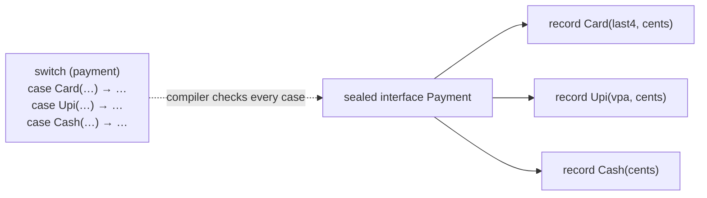
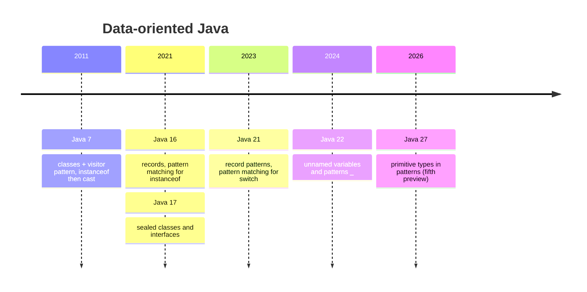

# 19. Data-Oriented Java: Records, Sealed Types and Patterns

> [!TIP]
> You're reading the **complete edition**, the reference guide with every deep dive and runnable sample. For a focused read, see this chapter on the [website edition](https://hikefromjava7.com/part6/ch19-data-oriented-java/).

> **In this chapter:** how three features from Java 16–21 work together. Records hold data, sealed types close a hierarchy, and pattern matching takes data apart safely. Together they replace a lot of Java 7 visitor-pattern and `instanceof`-chain code.

> [!TIP]
> **Key points**
>
> - **Records** (**Java 16**): immutable data carriers with generated constructor, accessors, `equals`, `hashCode` and `toString`. Validate in a compact constructor.
> - **Sealed interfaces** (**Java 17**): a closed set of alternatives, such as `Card`, `Upi` or `Cash`.
> - **Record patterns** (**Java 21**) deconstruct records in `switch` and `instanceof`: `case Card(String last4, long cents)`.
> - Over a sealed type, `switch` is **exhaustive**: no `default`, and adding a new alternative becomes a compile error everywhere it's unhandled.
> - `_` (**Java 22**) ignores parts you don't need. Primitive patterns are still in preview in Java 27.

## The idea

Object-oriented design puts behavior inside the objects: a `Shape` knows its own `area()`. That's the right choice when the set of operations is stable and new types keep arriving. But many programs face the opposite: the **types are a fixed set** (payment methods, JSON nodes, commands, events) and the **operations keep growing**. Java 7 handled that with the visitor pattern, which needed an interface, an `accept` method in every class and a visitor class for each operation.

Data-oriented programming models the fixed set directly:



## Records, in more depth

Chapter 4 introduced records. They can do more than hold fields:

**Example:** [`code/ch19/RecordRules.java`](../../code/ch19/RecordRules.java) · [how to run it](../../code/ch19/README.md#recordrulesjava) · Java 16+

```java
public class RecordRules {
    record Range(int low, int high) {
        Range {                                            // compact constructor: validate and normalize
            if (low > high) throw new IllegalArgumentException(low + " > " + high);
        }
        Range(int single) { this(single, single); }        // extra constructors must delegate
        int length() { return high - low; }                // ordinary methods are fine
        static Range of(int a, int b) { return new Range(Math.min(a, b), Math.max(a, b)); }
    }

    public static void main(String[] args) {
        System.out.println(new Range(7, 27) + " length " + new Range(7, 27).length());
        System.out.println(new Range(5));
        System.out.println(Range.of(27, 7));
        try {
            new Range(27, 7);
        } catch (IllegalArgumentException e) {
            System.out.println("rejected: " + e.getMessage());
        }
    }
}
```

```text
Range[low=7, high=27] length 20
Range[low=5, high=5]
Range[low=7, high=27]
rejected: 27 > 7
```

- A **compact constructor** (`Range { … }`) runs validation before the fields are assigned; no parameter list, no assignments.
- **Extra constructors** must delegate to the canonical one with `this(...)`.
- **Methods** and **static factories** are fine. **Instance fields** beyond the components aren't.
- Records can implement interfaces, which is how they join a sealed hierarchy.

## Sealed types plus record patterns

**Example:** [`code/ch19/Payments.java`](../../code/ch19/Payments.java) · [how to run it](../../code/ch19/README.md#paymentsjava) · Java 21+

```java
public class Payments {
    sealed interface Payment permits Card, Upi, Cash { }
    record Card(String last4, long cents) implements Payment { }
    record Upi(String vpa, long cents) implements Payment { }
    record Cash(long cents) implements Payment { }

    static String receipt(Payment p) {
        return switch (p) {                                          // exhaustive: no default
            case Card(String last4, long cents) when cents > 100_000 -> "card *" + last4 + " (needs approval)";
            case Card(String last4, long cents)                      -> "card *" + last4 + " " + cents;
            case Upi(String vpa, long cents)                         -> "upi " + vpa + " " + cents;
            case Cash(long cents)                                    -> "cash " + cents;
        };
    }

    public static void main(String[] args) {
        Payment[] payments = { new Card("4242", 2_500), new Card("1881", 250_000),
                               new Upi("asha@bank", 900), new Cash(100) };
        for (Payment p : payments) System.out.println(receipt(p));
    }
}
```

```text
card *4242 2500
card *1881 (needs approval)
upi asha@bank 900
cash 100
```

`case Card(String last4, long cents)` is a **[record pattern](https://docs.oracle.com/javase/specs/jls/se25/html/jls-14.html#jls-14.30.1)** ([JEP 440](https://openjdk.org/jeps/440)): it tests the type and extracts the components in one step. Guards (`when`) refine a case. And because `Payment` is sealed, the `switch` needs no `default`. If you add `record Wallet(...) implements Payment`, this method stops compiling until you handle it. Compare that with Java 7, where a new subclass silently fell into an `else` branch.

## Nested patterns

**Example:** [`code/ch19/NestedPatterns.java`](../../code/ch19/NestedPatterns.java) · [how to run it](../../code/ch19/README.md#nestedpatternsjava) · Java 21+

```java
public class NestedPatterns {
    record Point(int x, int y) { }
    record Line(Point from, Point to) { }

    static String describe(Object o) {
        if (o instanceof Line(Point(var x1, var y1), Point(var x2, var y2)) && x1 == x2) {   // Java 21
            return "vertical line at x=" + x1 + " from y=" + y1 + " to y=" + y2;
        }
        if (o instanceof Line line) {                                                           // Java 16
            return "line " + line.from() + " -> " + line.to();
        }
        return "not a line";
    }

    public static void main(String[] args) {
        System.out.println(describe(new Line(new Point(3, 0), new Point(3, 9))));
        System.out.println(describe(new Line(new Point(0, 0), new Point(4, 4))));
        System.out.println(describe("7 to 27"));
    }
}
```

```text
vertical line at x=3 from y=0 to y=9
line Point[x=0, y=0] -> Point[x=4, y=4]
not a line
```

Patterns nest, so you can match the *shape* of a whole object graph and name only what you need. `var` lets the compiler infer component types. The second `if` uses the simpler **type pattern** from Java 16 ([JEP 394](https://openjdk.org/jeps/394)), `o instanceof Line line`, which already removed the old "test, then cast" pair.

## Ignoring what you don't need: `_` (Java 22)

**Example:** [`code/ch19/UnnamedPatterns.java`](../../code/ch19/UnnamedPatterns.java) · [how to run it](../../code/ch19/README.md#unnamedpatternsjava) · Java 21 only, Java 22+

```java
public class UnnamedPatterns {
    sealed interface Shape permits Circle, Square, Rect { }
    record Circle(double r) implements Shape { }
    record Square(double side) implements Shape { }
    record Rect(double w, double h) implements Shape { }

    static String corners(Shape s) {
        return switch (s) {
            case Circle _             -> "no corners";        // Java 22: _ for an unused binding
            case Square _, Rect _     -> "four corners";      // several patterns, one case
        };
    }

    static boolean isWide(Shape s) {
        return s instanceof Rect(var w, _) && w > 10;         // ignore the height component
    }

    public static void main(String[] args) {
        System.out.println(corners(new Circle(1)) + ", " + corners(new Rect(2, 3)));
        System.out.println(isWide(new Rect(12, 1)) + " " + isWide(new Square(20)));
    }
}
```

```text
no corners, four corners
true false
```

`_` ([JEP 456](https://openjdk.org/jeps/456)) marks a pattern or component you don't care about. It also lets several patterns share one case (`case Square _, Rect _`), which isn't allowed when the patterns bind names.

## The journey at a glance



> [!IMPORTANT]
> **Migration tip**
>
> Good candidates: classes that only carry data (→ records), hierarchies with an `if/else instanceof` ladder or a visitor (→ [sealed interface](https://docs.oracle.com/javase/specs/jls/se25/html/jls-8.html#jls-8.1.1.2) + `switch`), and "type code" [enums](https://docs.oracle.com/javase/specs/jls/se25/html/jls-8.html#jls-8.9) paired with nullable fields (→ one record per case). Keep classic object-oriented polymorphism where new types are added often and operations rarely change.

## Exercises

1. Add `record Wallet(String provider, long cents) implements Payment` and see which line the compiler flags.
2. Write a sealed `Expr` interface with `Num`, `Add` and `Mul` records, and an `eval(Expr)` method using nested record patterns.
3. Rewrite `Payments.receipt` in Java 7 style with a visitor. Count the lines.
4. Add a compact constructor to `Card` that rejects a `last4` that isn't exactly four digits.

## IQ corner

1. **Can a record extend a class?** No; it implicitly extends `java.lang.Record`. It can implement interfaces.
2. **Are records immutable?** Their fields are `final`, but a component that's a mutable object (like a `List`) can still change; copy it with `List.copyOf` in the compact constructor.
3. **Why doesn't a switch over a sealed interface need `default`?** The compiler knows every permitted subtype and checks that each is covered.
4. **Type pattern vs. record pattern?** `o instanceof Line l` tests and binds; `o instanceof Line(Point a, Point b)` also deconstructs.
5. **When is classic polymorphism better?** When new types are added often and the set of operations is stable.

## Summary

- Records hold data; sealed interfaces fix the set of alternatives; patterns take data apart.
- Exhaustive `switch` over sealed types turns "forgot a case" into a compile error.
- Java 22's `_` keeps patterns focused; primitive patterns are still previewing in Java 27.

**Next:** Chapter 20 closes the journey with the tools around the language: the HTTP client, [`jlink`](https://docs.oracle.com/en/java/javase/25/docs/specs/man/jlink.html), [`jpackage`](https://docs.oracle.com/en/java/javase/25/docs/specs/man/jpackage.html), JFR and more.
