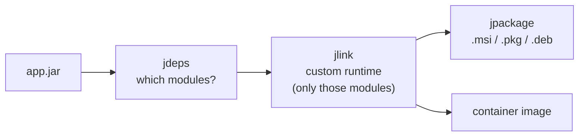

# 20. The Modern Toolchain

> [!TIP]
> You're reading the **complete edition**, the reference guide with every deep dive and runnable sample. For a focused read, see this chapter on the [website edition](https://hikefromjava7.com/part6/ch20-modern-toolchain/).

> **In this chapter:** the JDK tools and APIs that changed how Java programs are built, shipped and observed between Java 7 and Java 27: the standard HTTP client, a built-in web server, custom runtimes with [`jlink`](https://docs.oracle.com/en/java/javase/25/docs/specs/man/jlink.html), native installers with [`jpackage`](https://docs.oracle.com/en/java/javase/25/docs/specs/man/jpackage.html), Flight Recorder, Markdown documentation, and the start of ahead-of-time optimization.

> [!TIP]
> **Key points**
>
> - **HTTP Client** (**Java 11**) replaced `HttpURLConnection`; **Java 26** added HTTP/3.
> - **[`jwebserver`](https://docs.oracle.com/en/java/javase/25/docs/specs/man/jwebserver.html)** and `SimpleFileServer` (**Java 18**) serve static files for testing.
> - **[`jdeps`](https://docs.oracle.com/en/java/javase/25/docs/specs/man/jdeps.html)** finds the modules your code needs; **`jlink`** (**Java 9**) builds a runtime with only those; **`jpackage`** (**Java 16**) makes native installers.
> - **JDK Flight Recorder** became free and open source in **Java 11**: low-overhead production profiling.
> - **Markdown doc comments** (`///`, **Java 23**), `@snippet` (**Java 18**), and ahead-of-time caches (**Java 24–25**) round out the toolbox.

## The HTTP Client (Java 11)

In Java 7, calling a web service meant `HttpURLConnection`: a 1990s API with no HTTP/2, awkward streams, and no async support. Most projects pulled in Apache HttpClient or OkHttp instead. Java 11 standardized a modern client ([JEP 321](https://openjdk.org/jeps/321)):

**Example:** [`code/ch20/HttpClientDemo.java`](../../code/ch20/HttpClientDemo.java) · [how to run it](../../code/ch20/README.md#httpclientdemojava) · Java 11+

```java
import com.sun.net.httpserver.HttpServer;
import java.net.InetSocketAddress;
import java.net.URI;
import java.net.http.HttpClient;
import java.net.http.HttpRequest;
import java.net.http.HttpResponse;
import java.nio.charset.StandardCharsets;

public class HttpClientDemo {
    public static void main(String[] args) throws Exception {
        // A tiny local server so the example needs no internet (com.sun.net.httpserver: since Java 6)
        HttpServer server = HttpServer.create(new InetSocketAddress("127.0.0.1", 0), 0);
        server.createContext("/release", exchange -> {
            byte[] body = "Java 27 shipped on 2026-09-15".getBytes(StandardCharsets.UTF_8);
            exchange.getResponseHeaders().add("Content-Type", "text/plain");
            exchange.sendResponseHeaders(200, body.length);
            exchange.getResponseBody().write(body);
            exchange.close();
        });
        server.start();
        try {
            HttpClient client = HttpClient.newHttpClient();                       // Java 11
            HttpRequest request = HttpRequest.newBuilder(
                    URI.create("http://127.0.0.1:" + server.getAddress().getPort() + "/release")).build();
            HttpResponse<String> response = client.send(request, HttpResponse.BodyHandlers.ofString());
            System.out.println(response.statusCode() + " " + response.body());
        } finally {
            server.stop(0);
        }
    }
}
```

```text
200 Java 27 shipped on 2026-09-15
```

- Immutable builders for the client and requests, and `BodyHandlers` that turn responses into strings, files or streams.
- HTTP/2 by default, with fallback to HTTP/1.1; `sendAsync` returns a [`CompletableFuture`](https://docs.oracle.com/en/java/javase/25/docs/api/java.base/java/util/concurrent/CompletableFuture.html).
- **Java 26** added HTTP/3 support ([JEP 517](https://openjdk.org/jeps/517)), opted into with `HttpClient.newBuilder().version(HttpClient.Version.HTTP_3)`.
- On virtual threads (Chapter 18), the simple blocking `send` scales well, so you rarely need `sendAsync`.

## A web server in the JDK (Java 18)

**Example:** [`code/ch20/StaticSite.java`](../../code/ch20/StaticSite.java) · [how to run it](../../code/ch20/README.md#staticsitejava) · Java 18+

```java
import com.sun.net.httpserver.SimpleFileServer;
import com.sun.net.httpserver.SimpleFileServer.OutputLevel;
import java.net.InetSocketAddress;
import java.net.URI;
import java.net.http.HttpClient;
import java.net.http.HttpRequest;
import java.net.http.HttpResponse;
import java.nio.file.Files;
import java.nio.file.Path;

public class StaticSite {
    public static void main(String[] args) throws Exception {
        Path root = Files.createTempDirectory("site");
        Files.writeString(root.resolve("index.html"), "<h1>A Hike from Java 7</h1>");

        var server = SimpleFileServer.createFileServer(                          // Java 18
                new InetSocketAddress("127.0.0.1", 0), root.toAbsolutePath(), OutputLevel.NONE);
        server.start();
        try {
            var uri = URI.create("http://127.0.0.1:" + server.getAddress().getPort() + "/index.html");
            var response = HttpClient.newHttpClient()
                    .send(HttpRequest.newBuilder(uri).build(), HttpResponse.BodyHandlers.ofString());
            System.out.println(response.statusCode() + " " + response.body());
        } finally {
            server.stop(0);
        }
    }
}
```

```text
200 <h1>A Hike from Java 7</h1>
```

`SimpleFileServer` ([JEP 408](https://openjdk.org/jeps/408)) serves a folder of files over HTTP. From a terminal, `jwebserver -p 8000` does the same for the current directory: handy for previewing a site (such as this book's) or for test fixtures. It's deliberately minimal and not meant for production.

## Shipping: `jdeps` → `jlink` → `jpackage`

In the Java 7 era you shipped a JAR and told users to install a JRE. Today an application usually brings its own trimmed runtime.



**Step 1: find the modules you need.**

```text
$ jdeps --print-module-deps out/HttpClientDemo.class
java.base,java.net.http,jdk.httpserver
```

That output comes from a real run on the sample above.

**Step 2: build a runtime with only those modules** (`jlink`, [JEP 282](https://openjdk.org/jeps/282), Java 9):

```text
$ jlink --add-modules java.base,java.net.http,jdk.httpserver \
        --strip-debug --no-header-files --no-man-pages \
        --output runtime
$ runtime/bin/java -cp out HttpClientDemo
```

The result is a fraction of a full JDK's size and contains nothing your application doesn't use.

**Step 3, optionally: a native installer** (`jpackage`, [JEP 392](https://openjdk.org/jeps/392), Java 16):

```text
$ jpackage --name HikeFromJava7 --input out --main-jar app.jar --main-class com.trail.app.Main
```

`jpackage` must run on the target platform: build the Windows installer on Windows, the macOS package on macOS.

## Observing production: JDK Flight Recorder

**JDK Flight Recorder (JFR)** records what the JVM and your application are doing (allocations, locks, GC pauses, I/O, method samples) with overhead low enough for production. It was a commercial Oracle feature in the Java 7 era. **Java 11 open-sourced it** ([JEP 328](https://openjdk.org/jeps/328)).

```text
java -XX:StartFlightRecording=duration=60s,filename=app.jfr -jar app.jar
jcmd <pid> JFR.start duration=60s filename=app.jfr      # attach to a running JVM
jfr print --events jdk.GarbageCollection app.jfr        # inspect from the command line
```

Open `.jfr` files in JDK Mission Control for a visual timeline. **Java 27** added in-process redaction of sensitive data in recordings ([JEP 536](https://openjdk.org/jeps/536)), which makes it easier to share recordings safely.

## Documentation: Markdown and snippets

**Example:** [`code/ch20/MarkdownDocs.java`](../../code/ch20/MarkdownDocs.java) · [how to run it](../../code/ch20/README.md#markdowndocsjava) · any Java

```java
/// Converts between Java release numbers and years.
///
/// Since Java 10, a release ships every **March** and **September**:
///
/// | Release | Ships |
/// |---------|-------|
/// | 26      | March 2026 |
/// | 27      | September 2026 |
///
/// @see #yearOf(int)
public class MarkdownDocs {

    /// Returns the year a feature release (10 or later) shipped.
    ///
    /// @param release the feature release number, such as `27`
    /// @return the year it shipped
    static int yearOf(int release) {
        return 2018 + (release - 10) / 2;
    }

    public static void main(String[] args) {
        System.out.println("Java 27 shipped in " + yearOf(27));
        System.out.println("Java 21 shipped in " + yearOf(21));
    }
}
```

```text
Java 27 shipped in 2026
Java 21 shipped in 2023
```

- **Java 23** lets doc comments use **Markdown** with `///` ([JEP 467](https://openjdk.org/jeps/467)) instead of HTML inside `/** … */`. Tables, lists, `code` and links all work, and [`javadoc`](https://docs.oracle.com/en/java/javase/25/docs/specs/man/javadoc.html) renders them. To older compilers, `///` is just a line comment, so this sample runs on any Java.
- **Java 18** added `{@snippet …}` ([JEP 413](https://openjdk.org/jeps/413)) for code examples in API docs, including examples taken from real, compiled source files.

## Faster startup: the AOT cache

Java's JIT makes long-running programs fast, but every startup repeats the same class loading and warm-up. Project Leyden is tackling that:

- **Java 24** introduced an **ahead-of-time cache** ([JEP 483](https://openjdk.org/jeps/483)): run a training run once, save the loaded and linked classes, and later runs start faster.
- **Java 25** made the cache easier to create ([JEP 514](https://openjdk.org/jeps/514)) and let it store method profiles so the JIT warms up sooner ([JEP 515](https://openjdk.org/jeps/515)).

```text
java -XX:AOTCacheOutput=app.aot -jar app.jar      # training run (Java 25)
java -XX:AOTCache=app.aot -jar app.jar            # faster startups afterwards
```

## Smaller tools worth knowing

| Tool or feature | Since | Use it for |
|---|---|---|
| `jshell` | 9 | Trying APIs interactively (Chapter 1) |
| `java File.java` | 11 (multi-file: 22) | Scripts and small programs without a build |
| `jcmd` | 7 | Heap info, thread dumps, JFR control on a running JVM |
| `jwebserver` | 18 | Serving static files locally |
| Class-File API | 24 ([JEP 484](https://openjdk.org/jeps/484)) | Reading and writing `.class` files without third-party libraries |

## Exercises

1. Run `jdeps --print-module-deps` on one of your own JARs, then build a `jlink` runtime and compare its size with your JDK.
2. Record a JFR file while running `VirtualThreads` from Chapter 18 and find the virtual thread events.
3. Convert a Javadoc comment in your code to `///` Markdown and generate docs with JDK 23+.
4. Time `java -jar` startup of a small application with and without an AOT cache (JDK 25+).

## IQ corner

1. **Why use the built-in HTTP Client over `HttpURLConnection`?** HTTP/2 (and HTTP/3 since Java 26), async support, immutable builders and a far simpler API.
2. **What does `jlink` produce?** A custom runtime image containing only the modules you list.
3. **Is JFR safe for production?** Yes; it was designed for low overhead, and it's free since Java 11.
4. **What does `jdeps --print-module-deps` do?** Lists the JDK modules a class or JAR depends on, in a form `jlink` accepts.
5. **What is `///`?** A Markdown documentation comment, rendered by `javadoc` since Java 23.

## Summary

- The JDK now covers HTTP (11, HTTP/3 in 26), a test web server (18), and documentation in Markdown (23).
- `jdeps`, `jlink` and `jpackage` replace "install a JRE" with a self-contained application.
- JFR (free since 11) and the AOT cache (24–25) improve production insight and startup.

**Journey's end:** from `javac Hello.java` in 2013 to a self-contained, observable, fast-starting application today. Appendix B follows with a checklist for moving older code bases onto this modern Java.
